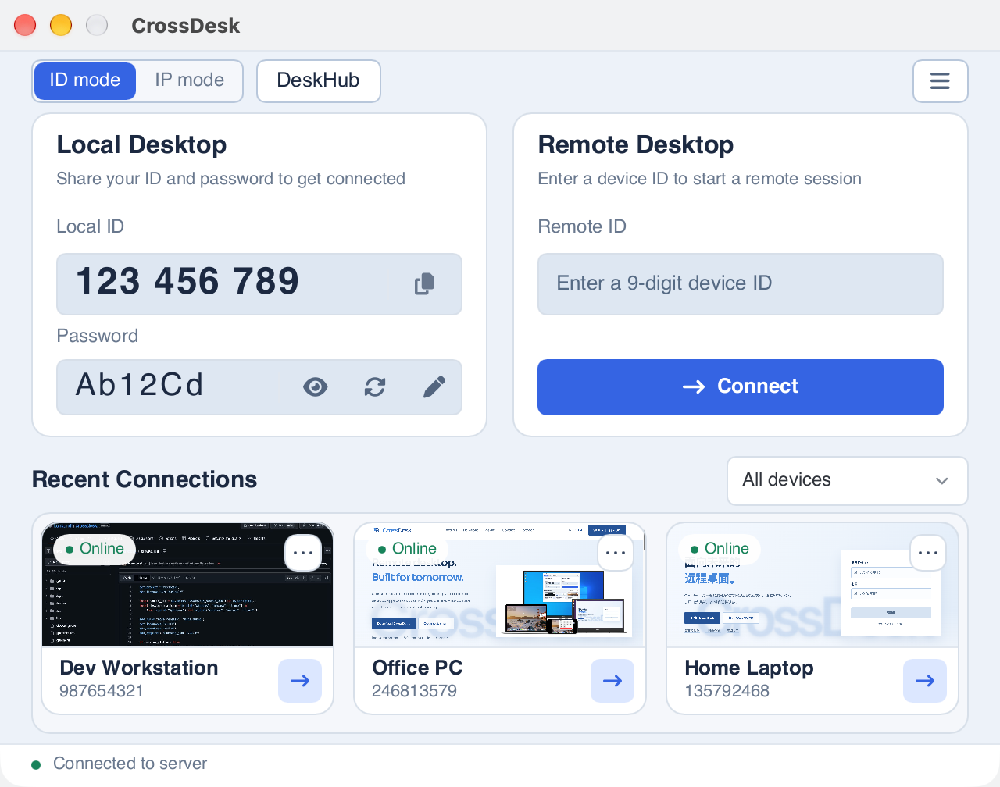
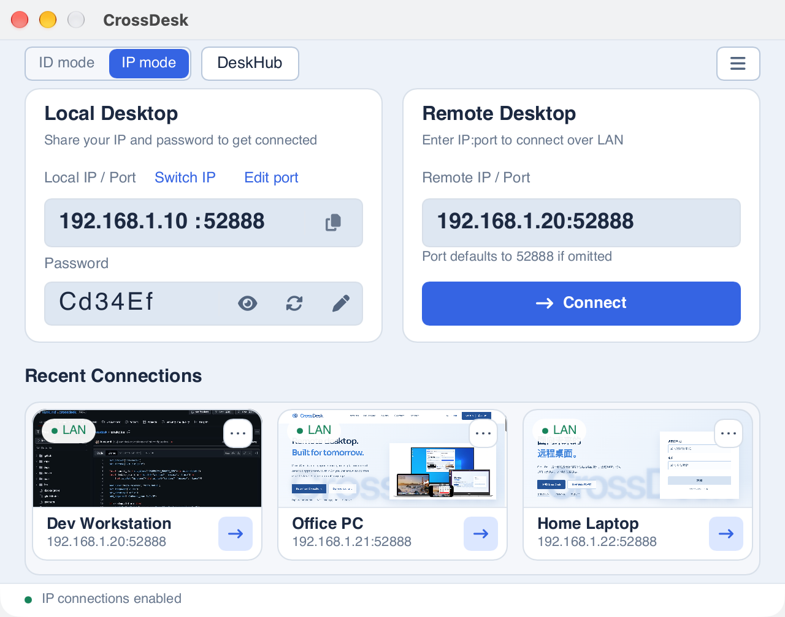
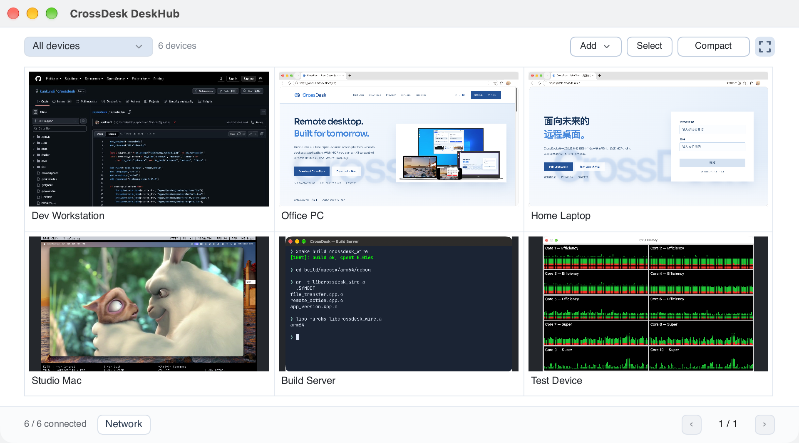
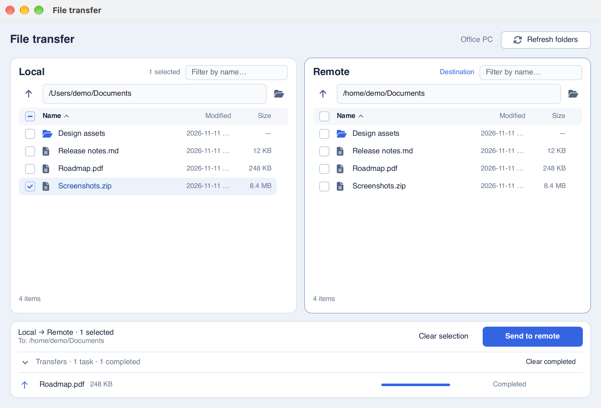
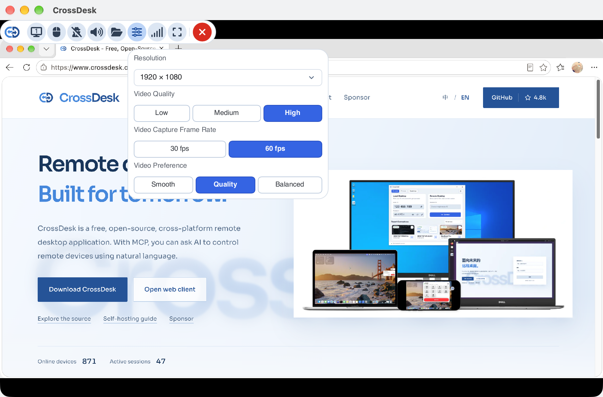
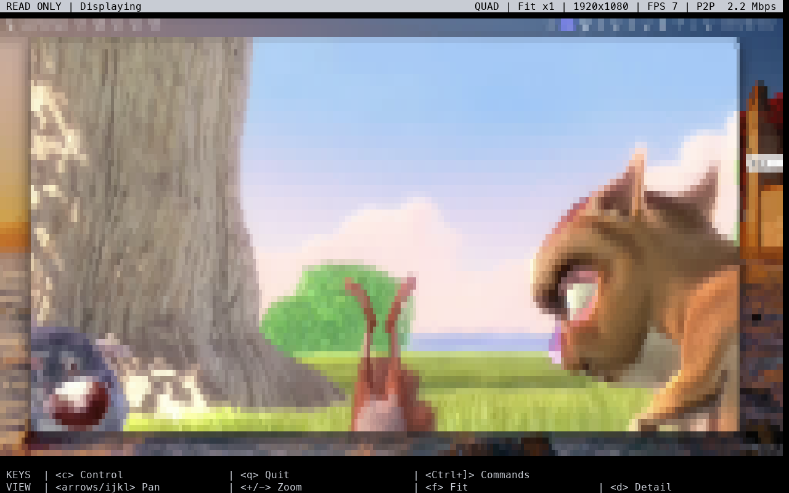
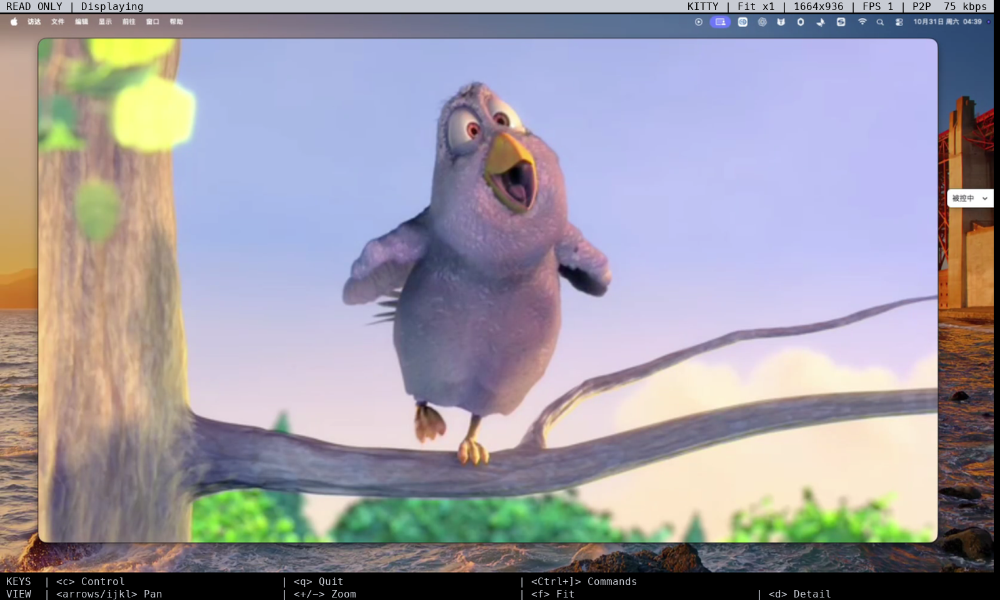
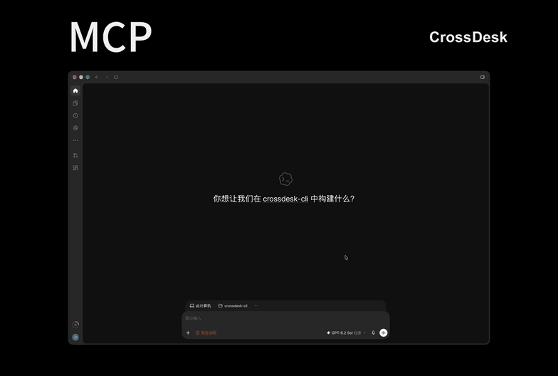

<div align="center">
  
  <p>A lightweight, cross-platform remote desktop for computers, browsers, mobile devices, and terminals, with DeskHub for viewing and controlling multiple desktops.</p>
  <p><a href="https://www.crossdesk.cn/">Website</a> · <a href="https://github.com/kunkundi/crossdesk/releases">Download</a> · <a href="#build">Build guide</a> · <a href="https://web.crossdesk.cn/">Open Web Client</a> · <a href="README_ZH.md">中文</a></p>
</div>

<div align="center">

[](#download)

[](#download)

[](https://github.com/kunkundi/crossdesk/releases)
[](https://www.npmjs.com/package/@chunkdash/crossdesk-cli)
[](https://github.com/kunkundi/crossdesk/actions/workflows/build.yml)
[](LICENSE)
[](https://github.com/kunkundi/crossdesk/stargazers)

</div>

<p align="center">
  <a href="https://trendshift.io/repositories/17514?utm_source=repository-badge&amp;utm_medium=badge&amp;utm_campaign=badge-repository-17514" target="_blank" rel="noopener noreferrer"></a>
</p>

<p align="center">
  <a href="https://trendshift.io/repositories/17514?utm_source=trendshift-badge&amp;utm_medium=badge&amp;utm_campaign=badge-trendshift-17514" target="_blank" rel="noopener noreferrer"></a>
  <a href="https://trendshift.io/repositories/17514?utm_source=trendshift-badge&amp;utm_medium=badge&amp;utm_campaign=badge-trendshift-17514" target="_blank" rel="noopener noreferrer"></a>
  <a href="https://trendshift.io/repositories/17514?utm_source=trendshift-badge&amp;utm_medium=badge&amp;utm_campaign=badge-trendshift-17514" target="_blank" rel="noopener noreferrer"></a>
</p>

## Special Sponsors

<table border="1">
  <tr>
    <td align="center" valign="middle" width="160">
      <a href="https://crossdesk.hualong-ai.com/">
        
      </a>
    </td>
    <td valign="middle">
      <p><strong><a href="https://crossdesk.hualong-ai.com/">HuaLongAI 华龙算力</a></strong></p>
      <p>A stable, efficient API relay for Codex, zero-injection Kiro, and Claude models. HuaLongAI sources 100% of its models directly from official providers, with no substitutions. It offers high availability and reports an average SLA above 99.2%. Token-level billing lets you verify each charge. Enterprise contracts and invoices are available.</p>
    </td>
  </tr>
</table>

## Overview

CrossDesk connects your computers from desktop, browser, mobile, and terminal clients, with a desktop wall for viewing and controlling multiple devices together. It is built on [MiniRTC](https://github.com/kunkundi/minirtc) and supports self-hosting.

[Features](#features) · [Download and platforms](#download) · [Build guide](#build) · [Quick start](#quick-start) · [Terminal CLI](#cli) · [Agent / MCP](#mcp) · [Direct IP](#lan-direct) · [Trusted devices](#trusted-devices) · [Preview](#preview) · [User guide](docs/USER_GUIDE_EN.md) · [Self-hosting](#self-hosting) · [Documentation and feedback](#development) · [Sponsor](#sponsor)

<a id="features"></a>

## Features

- **Cross-platform access:** control Windows, macOS, and Linux desktops from computers, browsers, or native iOS / Android clients. HarmonyOS PC and mobile clients are in development.
- **Direct IP over LAN:** connect to a desktop from Android, iOS, HarmonyOS, or another desktop using an IP address, port, and six-character password without a cloud signaling service. You can change the port, remember passwords, and view recent devices separately by mode.
- **Terminal controller:** view and control remote desktops by device ID, with ANSI / Kitty / Sixel rendering, zoom and pan, persistent local command mode, a Pi extension, and a build independent of the desktop GUI.
- **DeskHub:** live multi-device previews, groups, enlarged control, group input, and batch file distribution.
- **Video and audio:** H.264 / AV1, hardware codecs, remote audio, and in-session quality, frame-rate, and remote display resolution controls. Confirmed resolution choices are remembered; the original display mode is restored when the last controller disconnects. Capabilities depend on the platform and device.
- **Everyday controls:** monitor switching, keyboard and mouse input, shortcuts, and text clipboard. A dual-pane file browser supports directory navigation, bidirectional file and folder transfers, drag and drop, and transfer management.
- **Agent / MCP:** authorize an Agent through a local MCP service to observe and operate remote computers, with live monitoring, manual takeover, multiple sessions, clipboard, and file tools. Install the package for your local platform.
- **Trusted devices:** optionally restrict desktop access to trusted device identities in addition to the connection password. Copy and paste pairing information to approve devices before they connect.
- **Deployment:** direct P2P connections, TURN relay, SRTP media encryption, self-hosting, Windows access before sign-in, and Linux headless operation.

<a id="download"></a>

## Download and platform support

Get a package matching your OS and CPU architecture from the [website](https://www.crossdesk.cn/) or [GitHub Releases](https://github.com/kunkundi/crossdesk/releases), or open the [Web Client](https://web.crossdesk.cn/) directly.

| Platform | Support and installation |
| --- | --- |
| Windows | **Control + host**. Windows 10+, x64; `.exe` installer, with portable builds also supported |
| macOS | **Control + host**. macOS 14.0+; x64 / arm64 `.pkg` for Intel / Apple Silicon |
| Linux | **Control + host**. Ubuntu 20.04+, glibc 2.31 baseline; amd64 / arm64 `.deb` |
| iOS / iPadOS | **Control only**. Install from the [App Store](https://apps.apple.com/app/id6828859211); check the listing for its OS requirements. Current source targets iOS 16.0+ and can also be built and signed locally |
| Android | **Control only**. Android 8.0+, arm64; install the signed APK or build from source |
| HarmonyOS PC (development) | **Control + host**. API 26, arm64; build and sign a HAP with DevEco; physical-device validation is ongoing |
| HarmonyOS phones / tablets (development) | **Control only**. API 20+, arm64; build and sign a HAP with DevEco; physical-device validation is ongoing |
| Web | **Control only**. A WebRTC-capable browser; no client installation on the controlling device |
| Terminal CLI (development) | **Control only**. Distribution targets: macOS / Linux (x64, arm64) and Windows (x64). [Install from npm](#cli-npm) or build from source; see the [CLI guide](apps/cli/README.md) (Chinese) for system requirements and compatibility |
| MCP (development) | **Control only**. Operate and watch a remote computer in Codex or DSH. DSH needs one plugin package; Codex also needs Node.js 22+. See [installation and usage](apps/mcp/README.md) (Chinese) |

Choose the package for your operating system and processor. Some development features may not be available in released packages; check the release notes for your download.

- **Linux:** use `crossdesk-linux-…deb` for an existing desktop, or `crossdesk-virtual-desktop-xfce-…deb` for a server needing a separate Xfce desktop. Choose one. See [installation details](docs/USER_GUIDE_EN.md#installation) and [headless operation](docs/HEADLESS_EN.md).
- **macOS:** grant Screen Recording and Accessibility when prompted on first launch. These enable desktop capture and remote keyboard/mouse input. See [permissions](docs/USER_GUIDE_EN.md#installation).
- **iOS:** install from the [App Store](https://apps.apple.com/app/id6828859211). Unsigned GitHub artifacts still require signing; see the [iOS build guide](apps/ios/README.md). HarmonyOS requires a signed DevEco build; see the [HarmonyOS guide](apps/harmony/README.md) (Chinese).

<a id="build"></a>

## Build guide

The desktop client uses Xmake. Install Git, Xmake 3.1.1 or newer, and the toolchain and dependencies for your platform, then clone the source and submodules:

```bash
git clone --recurse-submodules https://github.com/kunkundi/crossdesk.git
cd crossdesk
```

- **Desktop:** follow the [Windows](docs/BUILD_EN.md#windows), [macOS](docs/BUILD_EN.md#macos), or [Linux](docs/BUILD_EN.md#linux) steps to configure, build, and run. See the [full build guide](docs/BUILD_EN.md) for packaging, signing, and CI configuration.
- **Mobile and HarmonyOS:** [iOS / iPadOS](apps/ios/README.md), [Android](apps/android/README.md), [HarmonyOS phones / tablets](apps/harmony/README.md), and [HarmonyOS PC](apps/harmony/desktop-port/README.md) (Chinese).
- **Terminal and integrations:** [CLI build and usage](apps/cli/README.md) and [MCP build and integration](apps/mcp/DEVELOPMENT.md) (Chinese).

<a id="quick-start"></a>

## Quick start

### Connect by device ID

1. **Prepare the host.** Install and run CrossDesk on the computer to control, select ID mode, and wait for the server-connected status, then find its ID and password under **Local Desktop**.
2. **Connect.** On another computer, enter the host's 9-digit ID and click **Connect**. Native mobile clients and the [Web Client](https://web.crossdesk.cn/) can also connect.
3. **Verify the password.** Enter the host's current connection password and wait for the desktop to appear. On desktop, select **Remember password** to reconnect later from **Recent Connections**.

For self-hosting, connect both ends to the same service and update the server before upgrading clients. See the [user guide](docs/USER_GUIDE_EN.md#quick-start) for connection steps and the [FAQ](docs/FAQ.md#english) for connection, video, and input problems.

<a id="lan-direct"></a>

### Connect directly over LAN

On a phone or tablet, paste the address shown by the host into **Device ID or IP address** on the home screen and enter the host’s **Direct IP password**. For a desktop controller, follow these steps.

1. **Switch modes.** Open the desktop client on both computers. Click the top-left mode button to select **Direct IP mode**. If the button is hidden, select **Enable direct IP** under **Settings → General → Network** and save.
2. **Enter the address.** On the controller, enter the host's displayed `IP:port`, for example `192.168.1.20:52888` or `[2001:db8::20]:52888`, and click **Connect**. Omitting the port uses **52888**; use the actual port shown on the host.
3. **Enter the password.** Use the host's **six-character ASCII letter/digit password** shown in Direct IP mode. You can select **Remember password**. Switching modes also switches the recent device list.

The controller and host must be mutually reachable over a LAN or VPN. Internet access may be available or absent; direct sessions do not depend on a cloud signaling service. The main window lets you select the local IP, edit its port, and change the password. **Listen on all IP interfaces** is enabled by default for IPv4, IPv6, VPN, and other local interfaces on a shared port; change it under **Settings → General → Network**. Disabling **Enable direct IP** stops listeners, disconnects direct IP sessions, and hides the mode button. See the [direct IP guide](docs/USER_GUIDE_EN.md#lan-direct).

<a id="trusted-devices"></a>

### Allow only trusted devices (optional)

The desktop trusted-device restriction is **off by default** and applies to both ID and direct IP connections. When enabled, the controller must pass the existing password verification and prove possession of a pairing private key recognized by the host. Knowing the ID and password alone does not satisfy this restriction.

1. **Copy pairing information on the controller.** Open **Settings → General → Privacy → Manage trusted devices**. Under **This device’s pairing info**, click **Copy pairing info**.
2. **Add the controller on the host.** Open the same management dialog, paste the information into **Add a trusted device**, and click **Add**. It is saved immediately, with no second confirmation or prior remote connection required.
3. **Enable the restriction on the host.** Return to settings, select **Only allow trusted devices**, and save. Connect by ID or IP and verify the password as usual.

Pairing information contains only the public key, device name, and ID, with no private key or password. Exchange it through a trusted channel. After adding a device, use **View fingerprint** to compare it with the controller. You can also add the local device; the same public key is not added twice. Trust is one-way: to control each other, add the other device on both computers.

Adding or removing a device takes effect immediately. With the restriction enabled, **Remove trust** disconnects that device’s sessions, and an empty list rejects all controllers. The dialog also lets you add connected controllers that have completed identity verification.

**Compatibility:** Use a recent desktop, iOS, Android, or HarmonyOS mobile client with pairing support. On a phone or tablet, copy the pairing information under **Settings → This device’s pairing info** and add it on the host computer. Older clients and the current terminal CLI cannot connect to a host with this restriction enabled.

Before reinstalling, clearing application data, or moving to another computer, see [identity backup and migration](docs/CONNECTIONS.md#backup) (Chinese). An ID and password alone cannot restore a bound desktop identity; a changed identity must be paired again.

<a id="preview"></a>

## Preview

### Desktop client

Local credentials, remote connections, and recent devices share the main window. The top-left controls switch connection modes and open DeskHub.

<p align="center">
  
</p>

### Direct IP mode

Select the local IP, edit its port and password, and connect using the other desktop's address. Recent LAN devices have their own list below.

<p align="center">
  
</p>

<a id="deskhub"></a>

### DeskHub

View devices by group, click a preview to enlarge it, and take control when needed. Batch actions include connecting, muting, and sending files.

<p align="center">
  
</p>

Group control sends input to all connected devices; closing DeskHub disconnects all remote connections. See the [DeskHub user guide](docs/USER_GUIDE_EN.md#deskhub) for exact scopes and controls.

### Dual-pane file transfers

Open file transfer from the session toolbar to browse local and remote directories side by side. Send selected files or folders, or drag them between panes; the task list shows progress and lets you cancel unfinished transfers. Remote directory browsing requires a compatible host.

<p align="center">
  
</p>

<a id="session"></a>
<a id="settings"></a>

## Session controls and settings

Remote sessions support monitor switching, video quality and frame-rate controls, audio, text clipboard synchronization, and bidirectional file transfers. The toolbar also provides network statistics and privacy screen controls. Desktop settings configure direct IP availability, trusted-device restrictions, codecs, relay, self-hosting, video pausing when minimized, and the DeskHub video budget.

For Windows, macOS, and Linux X11 hosts, **Video settings → Resolution** selects a mode supported by the current remote display without reconnecting. Desktop and native mobile controllers remember confirmed choices and reapply them on reconnection when still supported. When the last controller disconnects, the host restores the display mode used before the first change in that connection period. Linux requires X11 capture and RandR; Wayland / XWayland resolution changes are not currently supported.

<p align="center">
  
</p>

- [Session controls](docs/USER_GUIDE_EN.md#session): toolbar, text clipboard, received files, and privacy screens.
- [Client settings and updates](docs/USER_GUIDE_EN.md#settings): general options, DeskHub video settings, and version checks.
- [DeskHub guide](docs/deskhub.md) (Chinese): organize devices, use group control, distribute files, and reduce bandwidth use.

<a id="cli"></a>

## Terminal client CLI

`crossdesk-cli` connects to a host by its 9-digit device ID and starts in read-only, silent mode. Standard terminals use ANSI character rendering; terminals supporting the Kitty or Sixel graphics protocol can display pixel graphics. The CLI supports monitor selection, quality settings, detail zoom, panning, and optional keyboard/mouse control. It builds independently of the desktop GUI. The host still needs CrossDesk and a capturable graphical session, and the signaling service must support temporary `cli` identities.

### Display preview

<table>
  <tr>
    <th width="50%">ANSI character rendering</th>
    <th width="50%">Kitty pixel graphics</th>
  </tr>
  <tr>
    <td></td>
    <td></td>
  </tr>
  <tr>
    <td>Colored characters show the desktop in standard terminals; use <code>+/-</code> or the wheel to zoom at the mouse position.</td>
    <td>Pixel graphics display the desktop in terminals supporting the Kitty graphics protocol, such as Ghostty.</td>
  </tr>
</table>

ANSI displays characters; Kitty displays pixels. Appearance depends on terminal support, font, and window size.

<a id="cli-npm"></a>

### Install from npm and connect

Install **Node.js 22 or later** and npm, then get [@chunkdash/crossdesk-cli](https://www.npmjs.com/package/@chunkdash/crossdesk-cli). npm selects the native executable for your OS and CPU architecture; Xmake and a C++ toolchain are not required.

```sh
npm install -g @chunkdash/crossdesk-cli@latest
crossdesk-cli doctor --json
crossdesk-cli 123456789
```

Replace `123456789` with the host's 9-digit device ID and enter its password at the hidden prompt. Connections start in read-only, silent mode; `doctor` checks the local environment without connecting. To update, run `npm install -g @chunkdash/crossdesk-cli@latest` again.

You can also use `npx` without a global installation. The first run downloads the matching platform package:

```sh
npx @chunkdash/crossdesk-cli@latest doctor --json
npx @chunkdash/crossdesk-cli@latest 123456789
```

Install the main `@chunkdash/crossdesk-cli` package with npm optional dependencies enabled; do not add `--omit=optional`. Installing a platform package alone does not register the `crossdesk-cli` command. See the [npm distribution guide](apps/cli/docs/npm-distribution.md) (Chinese) for platform requirements, migration from older packages, and troubleshooting.

### Everyday controls

Connections start read-only and silent. Press `c` in read-only mode to enable keyboard and mouse input, `+/-` or the wheel to zoom, and `f` to restore the full desktop. **To quit while controlling the host, press `Ctrl+]`, then `q`**; ordinary keys otherwise go to the remote computer.

```sh
# Character graphics in a standard terminal
crossdesk-cli 123456789 --renderer ansi

# Pixel graphics in a terminal supporting the Kitty graphics protocol
crossdesk-cli 123456789 --renderer kitty
```

The CLI connects by device ID. Direct IP, audio playback, file transfer, clipboard synchronization, and hosts with trusted-device restrictions are not currently supported. The host needs CrossDesk and an available desktop session. Self-hosted servers must support CLI connections.

[Complete CLI guide](apps/cli/README.md) · [Options, Pi extension, and source builds](apps/cli/docs/terminal-client.md) · [Installation troubleshooting](apps/cli/docs/npm-distribution.md) (Chinese)

<a id="mcp"></a>

## Agents and MCP

[CrossDesk MCP](apps/mcp/README.md) lets you request remote tasks in a Codex or DeepSeek Harness chat and watch the remote screen on the right. Run CrossDesk on the remote computer, follow the installation guide for your local app below, then choose and authorize the device in the panel.

<p align="center">
  
</p>

| Host | Installation and configuration | Remote video |
| --- | --- | --- |
| Codex desktop | [Codex setup](apps/mcp/README.md#install-codex) (Chinese): register the MCP server; no extra plugin | The Agent opens the built-in browser on the right |
| DeepSeek Harness desktop (DSH) | [DSH setup](apps/mcp/README.md#install-dsh) (Chinese): install one platform plugin package; MCP registration is automatic | The plugin opens the current chat's browser sidebar automatically |

1. [Download the platform package for your local computer](apps/mcp/README.md#install-package), then follow the guide for your app above.
2. Ask the Agent to open CrossDesk. Choose a device and enter its password in the local monitoring panel, then grant view-only or control access. Saving a password and allowing future automatic connections are separate choices.
3. The Agent uses screenshots, keyboard and mouse actions, and structured desktop tools. You can watch live, pause the Agent, take over manually, or disconnect.

The service supports up to 8 concurrent device sessions, multi-display observation, remote text clipboard, file browsing and transfers, audio, system locking, and unlocking with a password entered locally. Window and accessibility actions depend on the remote platform and permissions; some tools require an updated host. Browser, terminal, and MCP Apps panels have different host requirements. See the [MCP guide](apps/mcp/README.md) (Chinese) for configuration and compatibility.

<a id="mobile"></a>

## Mobile and HarmonyOS

<a id="ios"></a>

### iOS / iPadOS

Install the native controller from the [App Store](https://apps.apple.com/app/id6828859211). It supports touch and a virtual mouse, multiple monitors, remote audio, file transfers, and text clipboard. Tap **Clipboard** in the floating menu to send local text, up to 128 KiB per transfer. Video settings can change supported remote display resolutions and remember confirmed choices. iPhone and iPad cannot currently act as remote hosts; in-app update checks point to the App Store.

[User guide](docs/USER_GUIDE_EN.md#ios) · [Build and signing](apps/ios/README.md)

<a id="android"></a>

### Android

The native controller supports touch, external keyboards and mice, monitor switching, file transfers, text clipboard, and video settings. Switching apps uses Picture in Picture when available, with a background notification as a fallback. Use the floating menu to toggle the computer’s privacy screen. Android phones and tablets cannot currently act as hosts.

[User guide](docs/USER_GUIDE_EN.md#android) · [Build from source](apps/android/README.md) (Chinese)

<a id="harmonyos"></a>

### HarmonyOS (development)

The PC client acts as both controller and host, sharing the desktop UI and DeskHub. Phones and tablets use a native ArkUI controller with touch, external input devices, monitors, text clipboard, and file transfers. PC screen capture and input control require system authorization. Physical-device and long-session validation are ongoing.

[Usage and limits](docs/USER_GUIDE_EN.md#harmonyos) · [Build and signing](apps/harmony/README.md) · [PC guide](apps/harmony/desktop-port/README.md) · [Mobile features](apps/harmony/MOBILE_PARITY.md) (platform guides in Chinese)

<a id="windows-service"></a>

## Unattended and headless access

- **Windows:** CrossDesk Service supports lock screens, sign-in, and secure desktops. Enabling **Auto Start** in an installed Release build uses the same device ID and password before and after sign-in. The interface opens after sign-in while the existing remote connection continues. Portable and Debug builds do not offer this switch. Without a monitor, the host attempts to prepare a virtual display and restore a previously recorded resolution. See the [Windows unattended guide](docs/USER_GUIDE_EN.md#windows-service) for capabilities, limits, and commands.
- **Linux:** reuse an existing desktop or create an independent Xvfb / Xfce session. See [Linux headless operation](docs/HEADLESS_EN.md).

<a id="self-hosting"></a>

## Self-hosting

Host your own signaling and TURN services, then enable them under **Settings → General → Self-Hosted Config**. Both the controller and host must use the same service.

[Deployment guide](docs/SELF_HOSTING_EN.md) · [Client setup](docs/USER_GUIDE_EN.md#self-hosting) · [Server source](https://github.com/kunkundi/crossdesk-server) · [Web client deployment](https://github.com/kunkundi/crossdesk-web-client)

<a id="development"></a>

## Documentation and feedback

- [Documentation index](docs/README.md) (Chinese): find help by task.
- [User guide](docs/USER_GUIDE_EN.md): installation, connections, session controls, settings, and unattended access.
- [FAQ](docs/FAQ.md#english): connection failures, blank video, permissions, and received files.
- [Connections and trusted devices](docs/CONNECTIONS.md) (Chinese): connection modes, pairing, and identity migration.
- [Client updates](docs/UPDATER.md) (Chinese): check, install, and recover from update failures.
- [Build from source](docs/BUILD_EN.md): dependencies, compilation, packaging, and signing.
- [Architecture and integration](docs/README.md#构建与集成) (Chinese): GUI and connection architecture, CLI / MCP interfaces, and platform support.
- [Versions and releases](docs/VERSIONING.md) (Chinese): component version synchronization, release numbering, and update manifests.

Open **Feedback & suggestions** from the desktop main menu to export diagnostic logs and [report an issue](https://github.com/kunkundi/crossdesk/issues). Include both operating systems, client versions, connection mode, error message, and reproduction steps. Review logs and screenshots for private information before sharing. See [feedback and diagnostic logs](docs/USER_GUIDE_EN.md#feedback).

<a id="sponsor"></a>

## Sponsors and support

### Backers

<p>
  <a href="https://afdian.com/u/41c14324f4b511ee8d785254001e7c00"></a>
  <a href="https://afdian.com/u/0229e818d9a711f1b32852540025c377"></a>
  <a href="https://afdian.com/u/1dfe098add7011f180f252540025c377"></a>
  <a href="https://afdian.com/u/52890a84df4011f1be6a525400c8052f"></a>
  <a href="https://afdian.com/u/49d40918e87311efb07a5254001e7c00"></a>
  <a href="https://afdian.com/u/e9addbece5b211f1970052540025c377"></a>
  <a href="https://afdian.com/u/ec7329c4bc1511eda50252540025c377"></a>
</p>

### Become a sponsor

If CrossDesk is useful to you, consider sponsoring its continued development, cross-platform testing, and maintenance through one of the platforms below. Thank you for your support!

[](https://ko-fi.com/kunkundi)
[](https://github.com/sponsors/kunkundi)
[](https://afdian.com/a/kunkundi)

## Acknowledgements and license

Thanks to [HelloGitHub](https://hellogithub.com/), [Ruanyf Weekly](https://github.com/ruanyf/weekly), and the [LinuxDo](https://linux.do) community for featuring CrossDesk and contributing feedback.

Copyright (c) 2026 JUNKUN DI.

CrossDesk is licensed under [GPL-3.0-only](LICENSE). See the [Privacy Policy](PRIVACY.md#english).

### Code signing policy

CrossDesk uses SignPath.io to sign official Windows releases built from this repository.

**Free code signing provided by [SignPath.io](https://signpath.io/), certificate by [SignPath Foundation](https://signpath.org/).**

- **Committers and reviewers:** [kunkundi](https://github.com/kunkundi)
- **Approvers:** [kunkundi](https://github.com/kunkundi)
