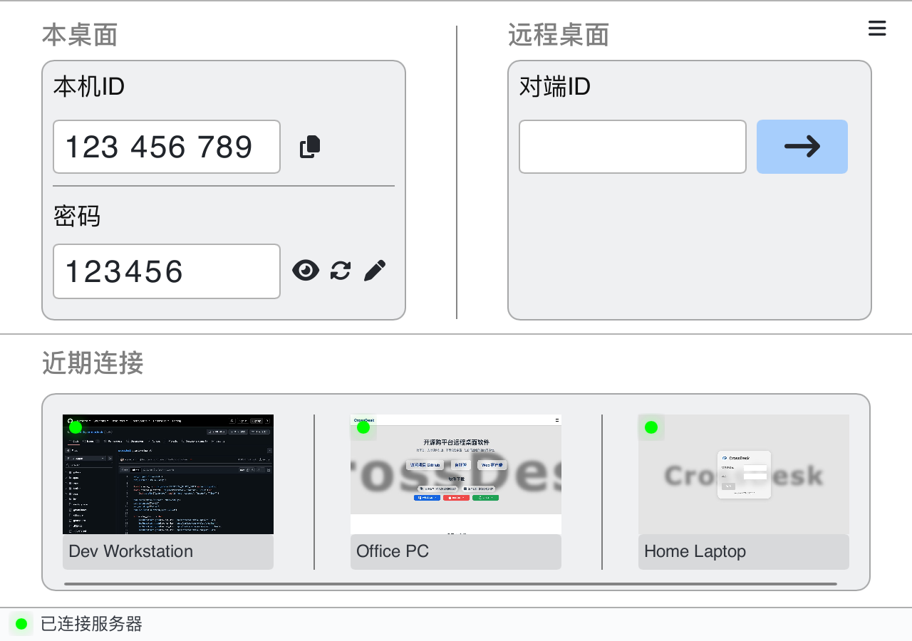

<div align="center">
  
  <p>轻量、跨平台的远程桌面，支持电脑、浏览器、移动端和终端连接，用桌面墙集中查看与操控多台设备。</p>
  <p><a href="https://www.crossdesk.cn/">官方网站</a> · <a href="https://github.com/kunkundi/crossdesk/releases">下载客户端</a> · <a href="https://web.crossdesk.cn/">打开 Web 客户端</a> · <a href="README_EN.md">English</a></p>
</div>

<div align="center">

[](#download)
[](#cli)
[](https://www.npmjs.com/package/@chunkdash/crossdesk-cli)

[](https://github.com/kunkundi/crossdesk/releases)
[](https://github.com/kunkundi/crossdesk/actions/workflows/build.yml)
[](LICENSE)
[](https://github.com/kunkundi/crossdesk/stargazers)

[](https://afdian.com/a/kunkundi)
[](https://ko-fi.com/kunkundi)
[](https://github.com/sponsors/kunkundi)

</div>

CrossDesk 让你从电脑、浏览器、手机或终端连接远端电脑，也能通过 **桌面墙（DeskHub）** 集中查看与操控多台设备。项目基于 [MiniRTC](https://github.com/kunkundi/minirtc)，支持自托管。

[主要功能](#features) · [下载与平台支持](#download) · [快速连接](#quick-start) · [终端 CLI](#cli) · [IP 直连](#lan-direct) · [界面预览](#preview) · [使用指南](docs/USER_GUIDE.md) · [自托管](#self-hosting) · [构建与反馈](#development) · [赞助](#sponsor)

<a id="features"></a>

## 主要功能

- **跨平台远控：** Windows、macOS、Linux 桌面互控，浏览器及原生 iOS / Android 客户端访问电脑；鸿蒙 PC 与移动端处于开发阶段。
- **局域网 IP 直连：** 桌面客户端通过 IP、端口和六位密码连接，无需云端信令服务；支持独立端口、记住密码及按模式显示近期设备。
- **终端主控：** 在终端中通过设备 ID 观看和操控远程桌面，支持 ANSI / Kitty 画面、局部缩放与平移、持续本地命令模式及 Pi 扩展，可单独构建。
- **桌面墙：** 多设备实时预览、分组、放大操控、群控和批量文件分发。
- **画面与声音：** H.264 / AV1、硬件编解码、远端音频，以及会话内画质和帧率调整；可用能力随平台与设备而异。
- **日常协作：** 多显示器切换、键鼠与组合键、文本剪贴板、文件传输。
- **部署与运维：** P2P 直连、TURN 中继、SRTP 媒体加密、自托管，以及 Windows 登录前远控和 Linux 无头运行。

<a id="download"></a>

## 下载与平台支持

从 [官方网站](https://www.crossdesk.cn/) 或 [GitHub Releases](https://github.com/kunkundi/crossdesk/releases) 下载与你的系统和 CPU 架构匹配的安装包；也可直接打开 [Web 客户端](https://web.crossdesk.cn/)。

| 平台 | 支持范围与安装要求 |
| --- | --- |
| Windows | **控制 / 被控**；Windows 10+，x64；`.exe` 安装包，也支持便携构建 |
| macOS | **控制 / 被控**；macOS 14.0+；按 Intel / Apple Silicon 选择 x64 / arm64 `.pkg` |
| Linux | **控制 / 被控**；Ubuntu 20.04+、glibc 2.31 基线；amd64 / arm64 `.deb` |
| iOS / iPadOS | **仅控制**；iOS 16.0+；发布包为未签名应用，需自行签名，或使用 Xcode 构建安装 |
| Android | **仅控制**；Android 8.0+，arm64；下载已签名 APK 安装，或自行构建 |
| 鸿蒙 PC（开发版） | **控制 / 被控**；API 26，arm64；使用 DevEco 构建并签名 HAP，仍在进行真机验收 |
| 鸿蒙手机 / 平板（开发版） | **仅控制**；API 20+，arm64；使用 DevEco 构建并签名 HAP，仍在进行真机验收 |
| Web | **仅控制**；支持 WebRTC 的浏览器；无需在控制端安装客户端 |
| 终端 CLI（开发版） | **仅控制**；分发目标为 macOS / Linux（x64、arm64）和 Windows（x64）；通过 [npm 安装](#cli-npm) 或从源码构建，平台验收范围见 [CLI 说明](apps/cli/README.md) |

系统要求按当前源码与构建配置整理，具体安装包以对应 Release 说明为准。各客户端的功能范围见 [终端 CLI](#cli) 与 [移动端与鸿蒙](#mobile)。

- **Linux：** 已有桌面选普通版 `crossdesk-linux-…deb`；需要独立 Xfce 桌面的服务器选 `crossdesk-virtual-desktop-xfce-…deb`。两者选择其一，安装与启动方法见 [使用指南](docs/USER_GUIDE.md#installation) 和 [无头运行](docs/HEADLESS.md)。
- **macOS：** 首次运行时按提示授予屏幕录制及辅助功能权限；前者用于桌面采集，后者用于远程键鼠输入。[权限说明](docs/USER_GUIDE.md#installation)
- **iOS / 鸿蒙：** 签名与构建步骤分别见 [iOS](apps/ios/README.md) 和 [鸿蒙](apps/harmony/README.md)，不要将未签名产物当作可直接安装的应用。

<a id="quick-start"></a>

## 快速连接

### 通过设备 ID 连接

1. **准备被控电脑。** 安装并运行 CrossDesk，切换至 ID 连接模式，等待显示“已连接服务器”，查看“本桌面”中的本机 ID 和密码。
2. **发起连接。** 在另一台电脑的 CrossDesk 中输入被控电脑的 9 位 ID，点击“连接”；也可使用原生移动端或 [Web 客户端](https://web.crossdesk.cn/)。
3. **验证密码。** 输入被控电脑当前的连接密码，等待远程画面出现。桌面端可勾选“记住密码”，后续从“近期连接”重连。

使用自建服务器时，两端需要接入同一服务。更多连接、密码及浏览器操作见 [使用指南](docs/USER_GUIDE.md#quick-start)；连接失败、黑屏或无法操作键鼠时先查阅 [常见问题](docs/FAQ.md)。

<a id="lan-direct"></a>

### 通过局域网 IP 直连

1. **切换模式。** 两台电脑均运行支持 IP 直连的桌面客户端，点击左上角模式按钮切换到 **IP 直连模式**。若按钮未显示，在 **设置 → 常规 → 网络连接** 中勾选 **启用 IP 直连** 并保存。
2. **填写地址。** 在控制端输入被控电脑显示的 `IP:端口`，例如 `192.168.1.20:52888` 或 `[2001:db8::20]:52888`，点击“连接”。只输入 IP 时使用默认端口 **52888**；请以对方界面显示的实际端口为准。
3. **输入密码。** 输入被控电脑在 IP 直连模式下显示的 **6 位英文字母或数字密码**，可勾选“记住密码”。切换模式时，“近期连接”同步切换为对应模式的设备记录。

两台电脑需要在局域网内可互相访问；网络可以有外网，也可以没有外网，直连会话不依赖云端信令服务。主窗口可直接切换本机 IP、修改端口和密码，默认开启所有 IP 接口监听，支持 IPv4 和 IPv6，支持通过 VPN 等接口连接，可在设置的“网络连接”中调整；关闭设置中的“启用 IP 直连”会停止监听、断开 IP 直连会话并隐藏模式按钮。详见 [IP 直连使用指南](docs/USER_GUIDE.md#lan-direct)。

<a id="preview"></a>

## 界面预览

### 桌面客户端

本机凭据、远程连接和近期设备集中在主窗口，左上角提供连接模式切换和桌面墙入口。

<p align="center">
  
</p>

### IP 直连模式

切换本机 IP、修改端口与密码，通过对方地址连接；下方展示独立的局域网近期设备。

<p align="center">
  
</p>

<a id="deskhub"></a>

### 桌面墙（DeskHub）

按分组查看多台设备，点击画面放大，再选择接管操控；支持批量连接、静音与文件分发。

<p align="center">
  
</p>

群控会向所有已连接设备发送输入；关闭桌面墙会断开全部远程连接。操作范围与详细用法见 [桌面墙使用指南](docs/USER_GUIDE.md#deskhub)。截图使用演示数据，更多界面及来源见 [使用指南](docs/USER_GUIDE.md) 与 [截图说明](docs/images/README.md)。

<a id="session"></a>
<a id="settings"></a>

## 会话操作与设置

远程会话支持显示器切换、画质与帧率调整、声音、文本剪贴板同步和文件传输。工具栏还可查看网络状态、控制隐私屏；桌面设置中可配置 IP 直连开关、编码、中继、自托管与桌面墙画面预算。

- [会话操作](docs/USER_GUIDE.md#session)：工具栏、文本剪贴板、文件保存和隐私屏。
- [客户端设置与更新](docs/USER_GUIDE.md#settings)：常规设置、桌面墙传输及版本检查。
- [桌面墙技术说明](docs/deskhub.md)：预览订阅、带宽分配、协议与兼容性。

<a id="cli"></a>

## 终端客户端 CLI

`crossdesk-cli` 在终端中通过 9 位设备 ID 连接被控电脑，默认只读、静音。普通终端使用 ANSI 字符画面，支持 Kitty 图形协议的终端可显示像素画面；可切换显示器、调整画质、放大细节和平移，也可明确开启键鼠控制。CLI 可以独立于桌面 GUI 构建，被控电脑仍需运行 CrossDesk 并提供可捕获的图形会话，信令服务需支持 `cli` 临时身份注册。

### 画面预览

| ANSI 字符画面 | Kitty 协议像素画面 |
| --- | --- |
|  |  |
| 用彩色字符显示桌面轮廓，适合普通终端；查看局部可按 `d` 放大。 | 直接显示像素画面，适合支持 Kitty 图形协议的终端，如 Ghostty。 |

两图采集于 **2026-10-31**，来自同一授权设备的实际只读连接，以 160 × 48 字符视口还原 CLI 的 ANSI / Kitty 协议输出。图示为输出渲染，终端实窗效果受字体、窗口大小及协议支持影响；采集方法见 [图示来源](docs/images/README.md#cli-captures)。

<a id="cli-npm"></a>

### 通过 npm 安装并连接

准备 **Node.js 22 或以上**及 npm，从 [@chunkdash/crossdesk-cli](https://www.npmjs.com/package/@chunkdash/crossdesk-cli) 安装。npm 会按操作系统与 CPU 架构选择原生程序，无需安装 Xmake 或 C++ 编译工具链。

```sh
npm install -g @chunkdash/crossdesk-cli@latest
crossdesk-cli doctor --json
crossdesk-cli 123456789
```

将 `123456789` 换成被控电脑的 9 位设备 ID，连接时按提示隐藏输入密码。默认只读、静音；`doctor` 仅检查本机环境，不发起连接。更新到最新版时，重新执行上面的 `npm install -g @chunkdash/crossdesk-cli@latest`。

无需全局安装时，也可使用 `npx`，首次运行会下载对应平台包：

```sh
npx @chunkdash/crossdesk-cli@latest doctor --json
npx @chunkdash/crossdesk-cli@latest 123456789
```

请安装统一入口 `@chunkdash/crossdesk-cli`，并保留 npm 的可选依赖，不要添加 `--omit=optional`；仅安装平台包不会注册 `crossdesk-cli` 命令。平台运行要求、旧包迁移及故障排查见 [npm 分发说明](apps/cli/docs/npm-distribution.md)。

### 从源码构建并连接

准备 Git、Xmake 3.1.1 或以上、C++17 编译工具链及对应平台依赖。以下以 macOS / Linux shell 为例；Windows 的 Git Bash / 开发者 PowerShell 步骤见 [CLI 构建说明](apps/cli/docs/terminal-client.md#构建与安装)。

```sh
git clone --recurse-submodules https://github.com/kunkundi/crossdesk.git
cd crossdesk
./apps/cli/scripts/prepare-deps.sh
xmake f -y --CROSSDESK_BUILD_DESKTOP=n --CROSSDESK_BUILD_CLI=y --USE_CUDA=n -m release
xmake build crossdesk-cli
xmake run crossdesk-cli doctor --json
xmake run crossdesk-cli 123456789
```

已有仓库时从仓库根目录执行依赖准备及后续命令。将 `123456789` 换成被控电脑的 ID，密码在连接时隐藏输入。`doctor` 只检查本机环境，不发起连接。仓库默认构建桌面端；以上配置只构建 CLI，需要同时构建桌面端时将 `CROSSDESK_BUILD_DESKTOP` 设为 `y`。产物位于 `build/<platform>/<arch>/release/`。

### 选择画面与连接参数

默认 `--renderer auto` 自动探测 Kitty 图形协议，未获支持时回退为 ANSI。macOS「终端」等普通终端可显式选择 `ansi`；Ghostty 等支持该协议的终端可选择 `kitty`。显式指定 `kitty` 但探测失败时会报错，此时改用 `ansi`。

以下示例使用 npm 全局安装后的命令；从源码构建时，可在仓库根目录将 `crossdesk-cli` 替换为 `xmake run crossdesk-cli`。

```sh
# 普通终端：以细节模式查看局部
crossdesk-cli 123456789 --renderer ansi --zoom native

# 支持 Kitty 图形协议的终端：显示像素画面
crossdesk-cli 123456789 --renderer kitty

# 降低远端画质与刷新请求
crossdesk-cli 123456789 --quality balanced --fps 8
```

| 参数 | 用途 |
| --- | --- |
| `--renderer auto\|ansi\|kitty` | 自动选择、字符画面或像素画面；默认 `auto` |
| `--zoom native` | 从原始细节模式开始；`--zoom 2` 表示相对全景放大 2 倍 |
| `--quality low\|balanced\|high\|ultra` | 请求最高 360p / 720p / 1080p / 2160p；默认 `high`，实际画质由被控端决定 |
| `--fps 8` | 固定本地输出目标和相应远端预览请求；允许 1–30，默认本地目标为 30，未指定时远端供帧会自适应 |
| `--display 1` | 选择第二个显示器，索引从 `0` 开始 |
| `--control` | 连接后直接启用键鼠控制；省略时默认只读 |
| `--server your-server.example --port 9099` | 使用自建信令服务，两端需接入同一服务 |

ANSI 全景受字符网格限制，提高画质不能让整屏小字变得清晰；可扩大终端、缩小字体，再按 `d` 查看局部，按 `f` 回到全景。顶部状态栏显示模式、连接进度、渲染器、缩放、实时输出 FPS 和网络信息，窄窗口会省略部分字段。通过 SSH 使用时分配 PTY（`ssh -t`）；tmux / screen 使用 ANSI。更多显示、鼠标报告和兼容性说明见 [终端使用指南](apps/cli/docs/terminal-client.md)。

### 控制、查看与退出

| 模式 / 按键 | 行为 |
| --- | --- |
| 只读模式 | `c` 开启远端控制；`q` 或 `Ctrl+C` 退出 CLI |
| 控制模式 | 键鼠输入传给远端；`Ctrl+]` 进入本地命令模式并暂停远端输入 |
| 本地命令模式 | 执行命令后持续保持；`c` 选择手动返回后是否启用控制，`q` 退出 CLI |
| `Esc` / `Ctrl+C` | 在本地命令模式中手动返回所选的控制或只读模式 |
| `+` / `=` / `-` | 在只读或本地命令模式中放大 / 缩小 |
| `d` / `f` | 在只读或本地命令模式中切换原始细节 / 完整桌面；只读时也可点击目标进入细节 |
| 方向键 / `i j k l` | 在只读或本地命令模式中平移；`i` 上、`j` 左、`k` 下、`l` 右 |

**控制模式下退出：先按 `Ctrl+]`，再按 `q`。** 普通 `c`、`q` 和 `Ctrl+C` 在控制模式中会发送到远端。

`Ctrl+]` 模式不会因为缩放、平移或按 `c` 自动结束。状态栏中的 `CONTROL PAUSED` / `READ ONLY` 表示返回后是否启用控制；按 `Esc` / `Ctrl+C` 手动返回。再次按 `Ctrl+]` 也可返回，若返回控制模式则向远端发送一次该组合键。

### Pi 扩展与功能范围

CLI 附带 Pi 自定义 TUI 扩展，使用同样的输入模式。在仓库根目录启动，例如 macOS Apple Silicon 的 release 构建：

```sh
export CROSSDESK_CLI="$PWD/build/macosx/arm64/release/crossdesk-cli"
pi -e ./apps/cli/plugins/pi/index.ts
```

其他平台将 `CROSSDESK_CLI` 改为原生可执行文件的绝对路径。在 Pi 中输入 `/crossdesk` 或 `/crossdesk 123456789`，按提示输入密码。安装要求与验证范围见 [Pi 扩展说明](apps/cli/docs/terminal-client.md#pi-扩展)。

CLI 当前仅提供 ID 连接与远程观看 / 输入，不提供 IP 直连、音频播放、文件传输或剪贴板同步。macOS arm64 已完成本地构建和连接验证；Linux / Windows 完整运行、SSH / Kitty 实机显示及真实 Pi TUI 的验收范围见 [验证记录](apps/cli/docs/validation.md)。平台构建与 npm 发布不代表全部平台已完成实机验收。

[CLI 文档入口](apps/cli/README.md) · [终端使用与故障排查](apps/cli/docs/terminal-client.md) · [桥接协议](apps/cli/docs/bridge-protocol.md) · [npm 打包与分发](apps/cli/docs/npm-distribution.md)

<a id="mobile"></a>

## 移动端与鸿蒙

<a id="ios"></a>

### iOS / iPadOS

原生控制端支持触控与虚拟鼠标、多显示器、远端音频、文件收发和文本剪贴板。悬浮菜单的“剪贴板”按钮可主动发送本机文本，单次上限为 128 KiB。iPhone / iPad 当前不能作为被控桌面。

[使用说明](docs/USER_GUIDE.md#ios) · [构建与签名](apps/ios/README.md)

<a id="android"></a>

### Android

原生控制端支持触控与外接键鼠、多屏切换、文件收发、文本剪贴板和会话画面设置。H.264 / AV1 优先使用硬件解码，不支持或运行失败时回退到软件解码；切换应用时优先通过画中画保持会话，画中画不可用时尝试前台服务保活。当前不提供手机被控功能。悬浮菜单中的“隐私屏”按钮可直接开启或关闭电脑本地遮罩，按钮按电脑确认的状态显示“隐私屏已开启”或“隐私屏已关闭”，开启与关闭使用相同配色，正常切换不显示额外文字，仅在异常时显示提示；开启时与桌面端一致屏蔽电脑本地键鼠。

[使用说明](docs/USER_GUIDE.md#android) · [源码构建](apps/android/README.md)

<a id="harmonyos"></a>

### 鸿蒙 HarmonyOS（开发版）

PC 端可控制和被控制，复用桌面界面与桌面墙；手机和平板使用原生 ArkUI 控制端，支持触控、外接键鼠、多屏、文本剪贴板和文件收发。PC 录屏与输入控制需要系统授权，真机和长期会话验收仍在进行。

[使用与限制](docs/USER_GUIDE.md#harmonyos) · [构建与签名](apps/harmony/README.md) · [PC 说明](apps/harmony/desktop-port/README.md) · [移动端功能](apps/harmony/MOBILE_PARITY.md)

<a id="windows-service"></a>

## 无人值守与无头运行

- **Windows：** CrossDesk Service 支持锁屏、登录和安全桌面控制。安装版可额外启用登录前远控，使用独立设备 ID 和密码；普通“开机自启”仅在用户登录后启动客户端。功能限制及启停命令见 [Windows 无人值守指南](docs/USER_GUIDE.md#windows-service)。
- **Linux：** 可复用现有桌面，也可创建独立 Xvfb / Xfce 会话，操作方法见 [Linux 无头运行](docs/HEADLESS.md)。

<a id="self-hosting"></a>

## 自托管

可自行部署信令与 TURN 中继服务，并在客户端“设置 → 常规 → 自托管配置”中启用。控制端与被控端需要接入同一服务。

[部署指南](docs/SELF_HOSTING.md) · [客户端配置](docs/USER_GUIDE.md#self-hosting) · [服务端源码](https://github.com/kunkundi/crossdesk-server) · [Web 客户端部署](https://github.com/kunkundi/crossdesk-web-client)

<a id="development"></a>

## 构建与反馈

- [终端客户端 CLI](apps/cli/README.md)：独立构建、终端使用、Pi 扩展、桥接协议和 npm 打包。
- [源码构建](docs/BUILD.md)：桌面端依赖、编译参数与打包；移动端请使用上方各平台的构建指南。
- [GUI 架构](docs/gui-architecture.md)：桌面界面、平台实现与工程结构。
- [连接模式架构](docs/connection-architecture.md)：ID 连接与 IP 直连的寻址、认证、协商、数据路径及生命周期。
- [常见问题](docs/FAQ.md)：连接失败、黑屏、系统权限、文件位置与构建问题。
- [提交问题或建议](https://github.com/kunkundi/crossdesk/issues)：请提供两端系统、客户端版本、连接方式和可复现步骤。

桌面端的 `CROSSDESK_UPDATE_PUBLIC_KEY` 是可选编译参数，用于验证应用内升级清单的 Ed25519 签名。不配置仍可正常编译、运行和检查版本，但更新只能手动下载；需要应用内自动安装更新时，须配置与发布私钥匹配的公钥。配置方式见 [更新公钥](docs/BUILD.md#update-public-key)，密钥生成与发布流程见 [桌面端应用内升级](docs/UPDATER.md)。

<a id="sponsor"></a>

## 支持 CrossDesk

如果 CrossDesk 对你有帮助，欢迎通过以下平台赞助，支持项目的持续开发、跨平台测试与日常维护。感谢你的支持！

[爱发电](https://afdian.com/a/kunkundi) · [Ko-fi](https://ko-fi.com/kunkundi) · [GitHub Sponsors](https://github.com/sponsors/kunkundi)

## 致谢与许可

感谢 [HelloGitHub](https://hellogithub.com/)、[阮一峰的科技爱好者周刊](https://github.com/ruanyf/weekly) 与 [LinuxDo](https://linux.do) 社区的推荐、交流与支持。

Copyright (c) 2026 JUNKUN DI.

CrossDesk 使用 [GPL-3.0-only](LICENSE) 许可。隐私说明见 [隐私政策](PRIVACY.md#中文)。

### Code signing policy

CrossDesk 使用 SignPath.io 为本仓库构建的官方 Windows 发布包提供代码签名。

**Free code signing provided by [SignPath.io](https://signpath.io/), certificate by [SignPath Foundation](https://signpath.org/).**

- **Committers and reviewers（代码提交与审核）：** [kunkundi](https://github.com/kunkundi)
- **Approvers（签名审批）：** [kunkundi](https://github.com/kunkundi)
