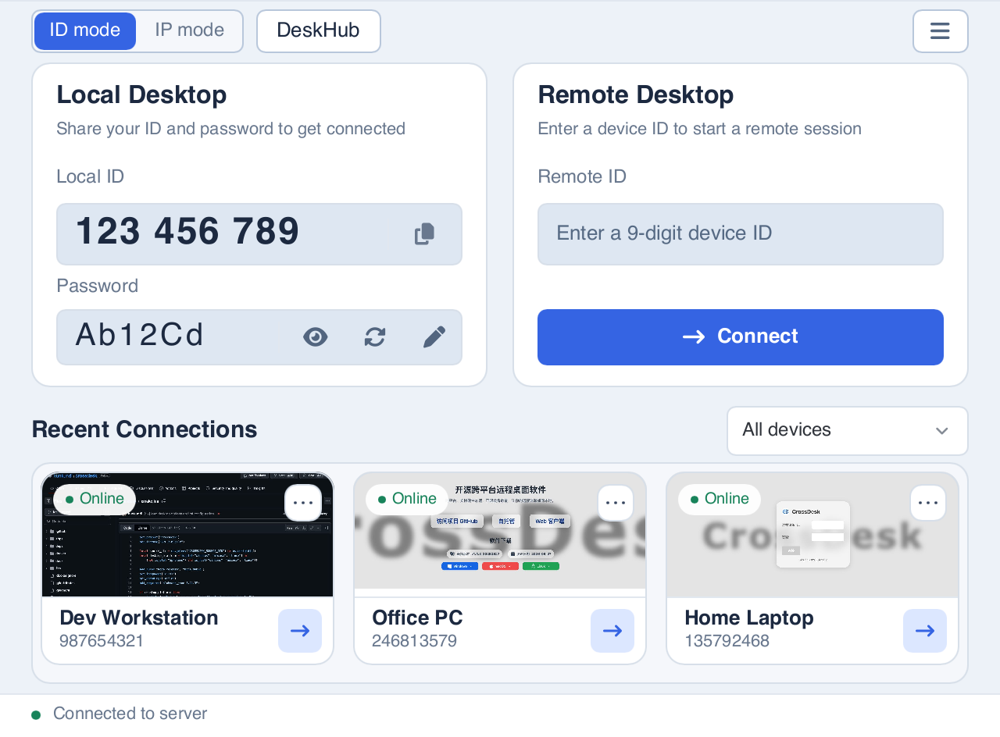
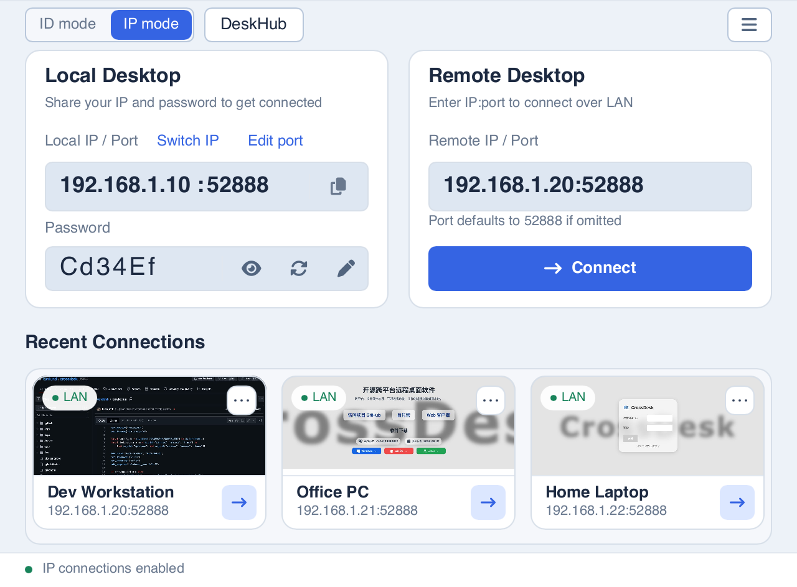
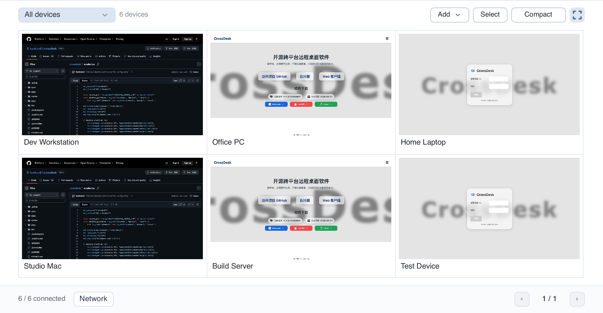
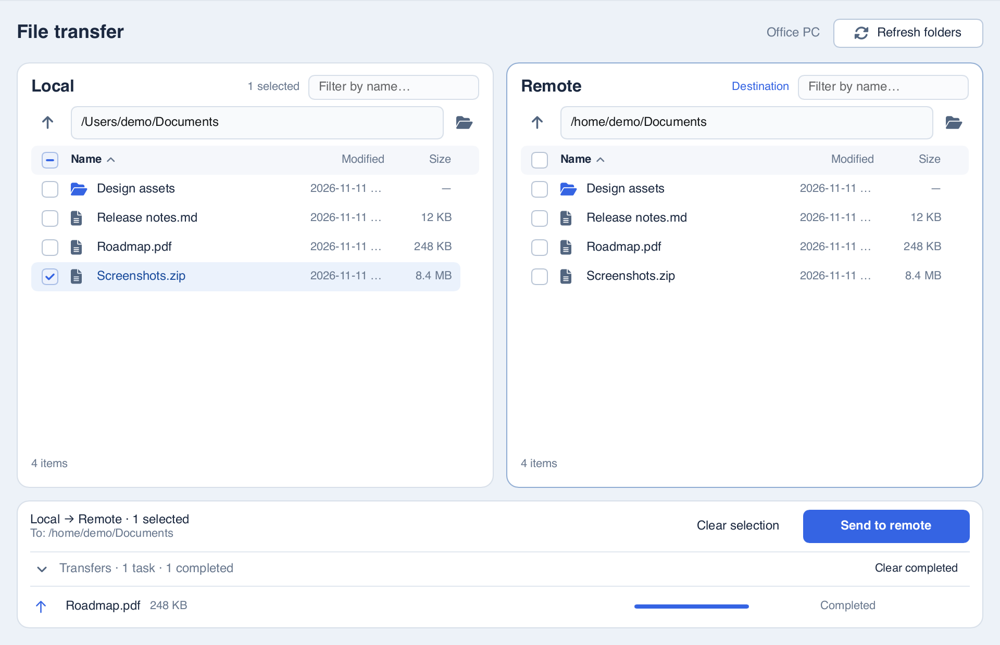
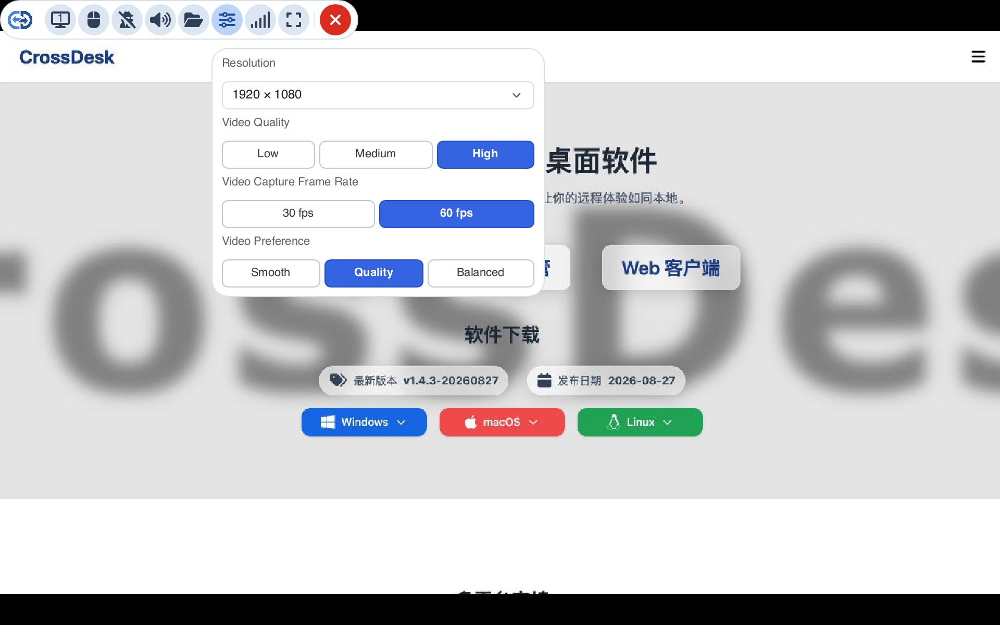
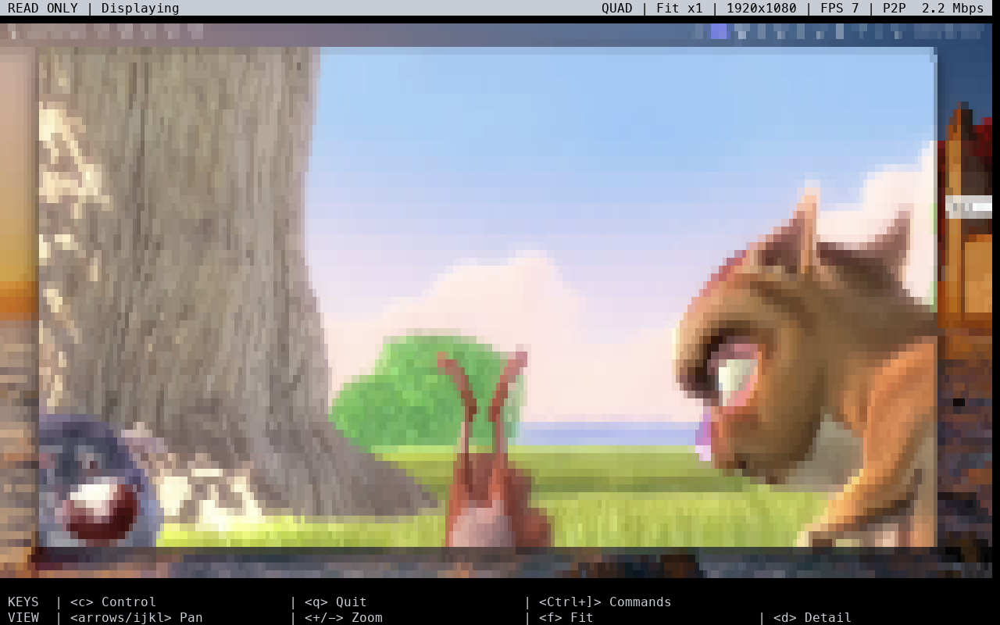
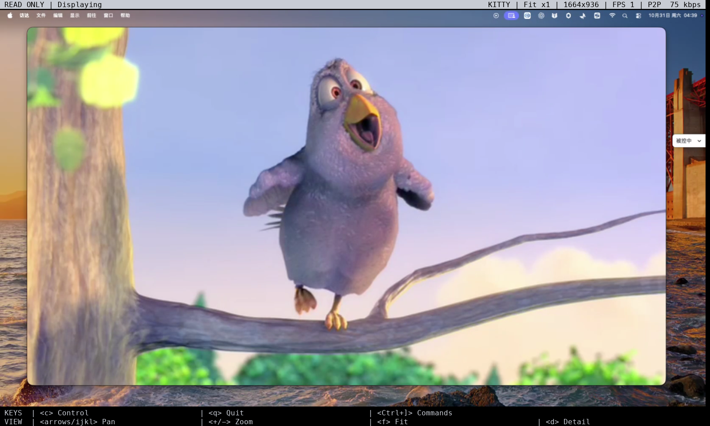

<div align="center">
  
  <p>A lightweight, cross-platform remote desktop for computers, browsers, mobile devices, and terminals, with DeskHub for viewing and controlling multiple desktops.</p>
  <p><a href="https://www.crossdesk.cn/">Website</a> · <a href="https://github.com/kunkundi/crossdesk/releases">Download</a> · <a href="https://web.crossdesk.cn/">Open Web Client</a> · <a href="README.md">中文</a></p>
</div>

<div align="center">

[](#download)

[](#download)

[](https://github.com/kunkundi/crossdesk/releases)
[](https://www.npmjs.com/package/@chunkdash/crossdesk-cli)
[](https://github.com/kunkundi/crossdesk/actions/workflows/build.yml)
[](LICENSE)
[](https://github.com/kunkundi/crossdesk/stargazers)

[](https://ko-fi.com/kunkundi)
[](https://github.com/sponsors/kunkundi)
[](https://afdian.com/a/kunkundi)

</div>

CrossDesk connects your computers from desktop, browser, mobile, and terminal clients, with DeskHub for viewing and controlling multiple devices together. It is built on [MiniRTC](https://github.com/kunkundi/minirtc) and supports self-hosting.

[Features](#features) · [Download and platforms](#download) · [Quick start](#quick-start) · [Terminal CLI](#cli) · [Agent / MCP](#mcp) · [Direct IP](#lan-direct) · [Trusted devices](#trusted-devices) · [Preview](#preview) · [User guide](docs/USER_GUIDE_EN.md) · [Self-hosting](#self-hosting) · [Build and feedback](#development) · [Sponsor](#sponsor)

<a id="features"></a>

## Features

- **Cross-platform access:** control Windows, macOS, and Linux desktops from computers, browsers, or native iOS / Android clients. HarmonyOS PC and mobile clients are in development.
- **Direct IP over LAN:** connect desktop clients using an IP address, port, and six-character password without a cloud signaling service. Each local IP has its own port; passwords can be remembered and recent devices are separated by mode.
- **Terminal controller:** view and control remote desktops by device ID, with ANSI / Kitty / Sixel rendering, zoom and pan, persistent local command mode, a Pi extension, and a build independent of the desktop GUI.
- **DeskHub:** live multi-device previews, groups, enlarged control, group input, and batch file distribution.
- **Video and audio:** H.264 / AV1, hardware codecs, remote audio, and in-session quality, frame-rate, and remote display resolution controls. Confirmed resolution choices are remembered; the original display mode is restored when the last controller disconnects. Capabilities depend on the platform and device.
- **Everyday controls:** monitor switching, keyboard and mouse input, shortcuts, and text clipboard. A dual-pane file browser supports directory navigation, bidirectional file and folder transfers, drag and drop, and transfer management.
- **Agent / MCP:** authorize an Agent through a local MCP service to observe and operate remote computers, with live monitoring, manual takeover, multiple sessions, clipboard, and file tools. Currently built from source.
- **Trusted devices:** optionally restrict desktop access to trusted device identities in addition to the connection password. Copy and paste pairing information to approve devices before they connect.
- **Deployment:** direct P2P connections, TURN relay, SRTP media encryption, self-hosting, Windows access before sign-in, and Linux headless operation.

<a id="download"></a>

## Download and platform support

Get a package matching your OS and CPU architecture from the [website](https://www.crossdesk.cn/) or [GitHub Releases](https://github.com/kunkundi/crossdesk/releases), or open the [Web Client](https://web.crossdesk.cn/) directly.

| Platform | Support and installation |
| --- | --- |
| Windows | **Control + host**. Windows 10+, x64; `.exe` installer, with portable builds also supported |
| macOS | **Control + host**. macOS 14.0+; x64 / arm64 `.pkg` for Intel / Apple Silicon |
| Linux | **Control + host**. Ubuntu 20.04+, glibc 2.31 baseline; amd64 / arm64 `.deb` |
| iOS / iPadOS | **Control only**. Install from the [App Store](https://apps.apple.com/app/id6828859211); check the listing for its OS requirements. Current source targets iOS 16.0+ and can also be built and signed locally |
| Android | **Control only**. Android 8.0+, arm64; install the signed APK or build from source |
| HarmonyOS PC (development) | **Control + host**. API 26, arm64; build and sign a HAP with DevEco; physical-device validation is ongoing |
| HarmonyOS phones / tablets (development) | **Control only**. API 20+, arm64; build and sign a HAP with DevEco; physical-device validation is ongoing |
| Web | **Control only**. A WebRTC-capable browser; no client installation on the controlling device |
| Terminal CLI (development) | **Control only**. Distribution targets: macOS / Linux (x64, arm64) and Windows (x64). [Install from npm](#cli-npm) or build from source; see the [CLI guide](apps/cli/README.md) (Chinese) for platform validation status |
| MCP (development) | **Control only**. Local Node.js 22+, a compatible Agent host, and the native CLI; browser, terminal, and MCP Apps monitoring. See [source setup](apps/mcp/README.md) (Chinese) |

Requirements follow the current source and build configuration. Check the release notes for the downloaded package. Client capabilities are summarized under [Terminal CLI](#cli) and [Mobile and HarmonyOS](#mobile).

- **Linux:** use `crossdesk-linux-…deb` for an existing desktop, or `crossdesk-virtual-desktop-xfce-…deb` for a server needing a separate Xfce desktop. Choose one. See [installation details](docs/USER_GUIDE_EN.md#installation) and [headless operation](docs/HEADLESS_EN.md).
- **macOS:** grant Screen Recording and Accessibility when prompted on first launch. These enable desktop capture and remote keyboard/mouse input. See [permissions](docs/USER_GUIDE_EN.md#installation).
- **iOS:** install from the [App Store](https://apps.apple.com/app/id6828859211). Unsigned GitHub artifacts still require signing; see the [iOS build guide](apps/ios/README.md). HarmonyOS requires a signed DevEco build; see the [HarmonyOS guide](apps/harmony/README.md) (Chinese).

<a id="quick-start"></a>

## Quick start

### Connect by device ID

1. **Prepare the host.** Install and run CrossDesk on the computer to control, select ID mode, and wait for the server-connected status, then find its ID and password under **Local Desktop**.
2. **Connect.** On another computer, enter the host's 9-digit ID and click **Connect**. Native mobile clients and the [Web Client](https://web.crossdesk.cn/) can also connect.
3. **Verify the password.** Enter the host's current connection password and wait for the desktop to appear. On desktop, select **Remember password** to reconnect later from **Recent Connections**.

For self-hosting, both ends must use the same service. Upgrade the server before using the new desktop client: device login uses a private key, with its public key bound at registration or after a one-time password check for an existing ID. Once bound, wrong-password attempts against that ID cannot block valid signature login. Remote control still requires the connection password. Signed controllers have separate per-controller and controller-to-destination failure budgets; failures from one controller no longer lock the destination for others. See the [device login guide](docs/connection-architecture.md#41-id-模式) (Chinese) for identity backups and compatibility, the [user guide](docs/USER_GUIDE_EN.md#quick-start) for controls, or the [FAQ](docs/FAQ.md#english) for connection problems.

<a id="lan-direct"></a>

### Connect directly over LAN

1. **Switch modes.** Run a desktop client with direct IP support on both computers. Click the top-left mode button to select **Direct IP mode**. If the button is hidden, select **Enable direct IP** under **Settings → General → Network** and save.
2. **Enter the address.** On the controller, enter the host's displayed `IP:port`, for example `192.168.1.20:52888` or `[2001:db8::20]:52888`, and click **Connect**. Omitting the port uses **52888**; use the actual port shown on the host.
3. **Enter the password.** Use the host's **six-character ASCII letter/digit password** shown in Direct IP mode. You can select **Remember password**. Switching modes also switches the recent device list.

Both computers must be reachable over the LAN. Internet access may be available or absent; direct sessions do not depend on a cloud signaling service. The main window lets you select the local IP, edit its port, and change the password. **Listen on all IP interfaces** is enabled by default for IPv4, IPv6, VPN, and other local interfaces on a shared port; change it under **Settings → General → Network**. Disabling **Enable direct IP** stops listeners, disconnects direct IP sessions, and hides the mode button. See the [direct IP guide](docs/USER_GUIDE_EN.md#lan-direct).

<a id="trusted-devices"></a>

### Allow only trusted devices (optional)

The desktop trusted-device restriction is **off by default** and applies to both ID and direct IP connections. When enabled, the controller must pass the existing password verification and prove possession of a pairing private key recognized by the host. Knowing the ID and password alone does not satisfy this restriction.

1. **Copy pairing information on the controller.** Open **Settings → General → Privacy → Manage trusted devices**. Under **This device’s pairing info**, click **Copy pairing info**.
2. **Add the controller on the host.** Open the same management dialog, paste the information into **Add a trusted device**, and click **Add**. It is saved immediately, with no second confirmation or prior remote connection required.
3. **Enable the restriction on the host.** Return to settings, select **Only allow trusted devices**, and save. Connect by ID or IP and verify the password as usual.

Pairing information contains only the public key, device name, and ID, with no private key or password. Exchange it through a trusted channel. After adding a device, use **View fingerprint** to compare it with the controller. You can also add the local device; the same public key is not added twice. Trust is one-way: to control each other, add the other device on both computers.

Adding or removing a device takes effect immediately. With the restriction enabled, **Remove trust** disconnects that device’s sessions, and an empty list rejects all controllers. The dialog also lets you add connected controllers that have completed identity verification.

**Compatibility:** both clients must support trusted-device authentication. Older clients without the protocol cannot connect to a restricted host. The CLI, iOS, Android, and HarmonyOS mobile clients do not currently implement it. With the restriction disabled, the existing connection behavior applies.

Device login and pairing share the private key in the cache directory's `identity.json`; the trusted list is stored in `trusted-devices/devices.json` in the configuration directory. Back up the ID/password cache and `identity.json` together when migrating a device: a bound ID cannot be recovered with its password alone. Clearing the entire cache requires a new ID and renewed trust from other devices. See the [trusted-device technical guide](docs/connection-architecture.md#43-可选可信设备认证) (Chinese) for details.

<a id="preview"></a>

## Preview

### Desktop client

Local credentials, remote connections, and recent devices share the main window. The top-left controls switch connection modes and open DeskHub.

<p align="center">
  
</p>

### Direct IP mode

Select the local IP, edit its port and password, and connect using the other desktop's address. Recent LAN devices have their own list below.

<p align="center">
  
</p>

<a id="deskhub"></a>

### DeskHub

View devices by group, click a preview to enlarge it, and take control when needed. Batch actions include connecting, muting, and sending files.

<p align="center">
  
</p>

Group control sends input to all connected devices; closing DeskHub disconnects all remote connections. See the [DeskHub user guide](docs/USER_GUIDE_EN.md#deskhub) for exact scopes and controls. Screenshots use demonstration data; more views and sources are in the [user guide](docs/USER_GUIDE_EN.md) and [screenshot notes](docs/images/README.md).

### Dual-pane file transfers

Open file transfer from the session toolbar to browse local and remote directories side by side. Send selected files or folders, or drag them between panes; the task list shows progress and lets you cancel unfinished transfers. Remote directory browsing requires a compatible host.

<p align="center">
  
</p>

<a id="session"></a>
<a id="settings"></a>

## Session controls and settings

Remote sessions support monitor switching, video quality and frame-rate controls, audio, text clipboard synchronization, and bidirectional file transfers. The toolbar also provides network statistics and privacy screen controls. Desktop settings configure direct IP availability, trusted-device restrictions, codecs, relay, self-hosting, video pausing when minimized, and the DeskHub video budget.

For Windows, macOS, and Linux X11 hosts, **Video settings → Resolution** selects a mode supported by the current remote display without reconnecting. Desktop and native mobile controllers remember confirmed choices and reapply them on reconnection when still supported. When the last controller disconnects, the host restores the display mode used before the first change in that connection period. Linux requires X11 capture and RandR; Wayland / XWayland resolution changes are not currently supported.

<p align="center">
  
</p>

- [Session controls](docs/USER_GUIDE_EN.md#session): toolbar, text clipboard, received files, and privacy screens.
- [Client settings and updates](docs/USER_GUIDE_EN.md#settings): general options, DeskHub video settings, and version checks.
- [DeskHub technical guide](docs/deskhub.md) (Chinese): preview subscriptions, bandwidth allocation, protocol, and compatibility.

<a id="cli"></a>

## Terminal client CLI

`crossdesk-cli` connects to a host by its 9-digit device ID and starts in read-only, silent mode. Standard terminals use ANSI character rendering; terminals supporting the Kitty or Sixel graphics protocol can display pixel graphics. The CLI supports monitor selection, quality settings, detail zoom, panning, and optional keyboard/mouse control. It builds independently of the desktop GUI. The host still needs CrossDesk and a capturable graphical session, and the signaling service must support temporary `cli` identities.

### Display preview

| ANSI character rendering | Kitty pixel graphics |
| --- | --- |
|  |  |
| Colored characters show the desktop in standard terminals; use `+/-` or the wheel to zoom at the mouse position. | Pixel graphics display the desktop in terminals supporting the Kitty graphics protocol, such as Ghostty. |

Both images were captured on **2026-10-31** from real read-only connections to the same authorized host. They render the CLI's ANSI / Kitty protocol output in a 128 × 40 character viewport. FPS counts actual output during capture; an unchanged ANSI view can show `FPS 0`. Actual terminal appearance depends on the font, window size, and protocol support. See [capture notes](docs/images/README.md#cli-captures) for the method.

<a id="cli-npm"></a>

### Install from npm and connect

Install **Node.js 22 or later** and npm, then get [@chunkdash/crossdesk-cli](https://www.npmjs.com/package/@chunkdash/crossdesk-cli). npm selects the native executable for your OS and CPU architecture; Xmake and a C++ toolchain are not required.

```sh
npm install -g @chunkdash/crossdesk-cli@latest
crossdesk-cli doctor --json
crossdesk-cli 123456789
```

Replace `123456789` with the host's 9-digit device ID and enter its password at the hidden prompt. Connections start in read-only, silent mode; `doctor` checks the local environment without connecting. To update, run `npm install -g @chunkdash/crossdesk-cli@latest` again.

You can also use `npx` without a global installation. The first run downloads the matching platform package:

```sh
npx @chunkdash/crossdesk-cli@latest doctor --json
npx @chunkdash/crossdesk-cli@latest 123456789
```

Install the main `@chunkdash/crossdesk-cli` package with npm optional dependencies enabled; do not add `--omit=optional`. Installing a platform package alone does not register the `crossdesk-cli` command. See the [npm distribution guide](apps/cli/docs/npm-distribution.md) (Chinese) for platform requirements, migration from older packages, and troubleshooting.

### Build and connect

Install Git, Xmake 3.1.1 or later, a C++17 toolchain, and the platform dependencies. The following example uses a macOS / Linux shell; Windows Git Bash / Developer PowerShell steps are in the [CLI build guide](apps/cli/docs/terminal-client.md#构建与安装) (Chinese).

```sh
git clone --recurse-submodules https://github.com/kunkundi/crossdesk.git
cd crossdesk
./apps/cli/scripts/prepare-deps.sh
xmake f -y --CROSSDESK_BUILD_DESKTOP=n --CROSSDESK_BUILD_CLI=y --USE_CUDA=n -m release
xmake build crossdesk-cli
xmake run crossdesk-cli doctor --json
xmake run crossdesk-cli 123456789
```

For an existing checkout, run the dependency preparation and subsequent commands from the repository root. Replace `123456789` with the host's ID; the password prompt hides your input. `doctor` reports the local environment without connecting. The repository builds the desktop client by default; this configuration builds only the CLI. Set `CROSSDESK_BUILD_DESKTOP=y` to also build the desktop client. Binaries are placed in `build/<platform>/<arch>/release/`.

### Rendering and connection options

The default `--renderer auto` selects Kitty, then Sixel, then ANSI according to terminal capability replies. Use `ansi` in standard terminals such as macOS Terminal, or `kitty` / `sixel` in terminals supporting the corresponding protocol. Explicit pixel modes report an error if the probe fails; use `ansi` in that case. Sixel output alone does not guarantee Xshell compatibility: the terminal itself must support the protocol.

These examples use the command installed globally by npm. For a source build, replace `crossdesk-cli` with `xmake run crossdesk-cli` and run it from the repository root.

```sh
# Standard terminal: start with a detail view
crossdesk-cli 123456789 --renderer ansi --zoom native

# Terminal supporting the Kitty graphics protocol: display pixel graphics
crossdesk-cli 123456789 --renderer kitty

# Request lower video quality and refresh rate
crossdesk-cli 123456789 --quality balanced --fps 8
```

| Option | Purpose |
| --- | --- |
| `--renderer auto\|ansi\|kitty\|sixel` | Automatic selection, character rendering, or pixel graphics; default: `auto` |
| `--zoom native` | Start in native detail mode; `--zoom 2` zooms to twice the full-desktop scale |
| `--quality low\|balanced\|high\|ultra` | Request up to 360p / 720p / 1080p / 2160p; default: `high`. The host determines actual quality |
| `--fps 8` | Fix the local output target and corresponding remote preview request; accepts 1–30. The default local target is 30, with adaptive remote requests when omitted |
| `--display 1` | Select the second monitor; indexes start at `0` |
| `--control` | Enable keyboard/mouse control immediately after connecting; omitted by default for read-only viewing |
| `--server your-server.example --port 9099` | Use a self-hosted signaling service; both ends must use the same service |

ANSI overviews are limited by the character grid: higher video quality alone cannot make full-desktop text legible. Enlarge the terminal or reduce its font size, use `+/-` or the wheel for detail, and `f` to restore the full desktop and reset panning. The top bar shows input mode, connection progress, renderer, zoom, live output FPS, and network information; narrow windows omit some fields. Allocate a PTY over SSH (`ssh -t`), and use ANSI inside tmux / screen. See the [terminal guide](apps/cli/docs/terminal-client.md) (Chinese) for rendering, mouse reporting, and compatibility details.

### Control, navigation, and exit

| Mode / key | Behavior |
| --- | --- |
| Read-only mode | `c` enables remote control; `q` or `Ctrl+C` exits the CLI |
| Control mode | Keyboard/mouse input goes to the host; `Ctrl+]` enters local command mode and pauses remote input |
| Local command mode | Stays active after commands; `c` selects whether control resumes when you leave; `q` exits the CLI |
| `Esc` / `Ctrl+C` | Manually leave local command mode and return to the selected control or read-only mode |
| `+` / `=` / `-` | Zoom in / out at the mouse position in read-only or local command mode |
| Wheel / click | In read-only mode, zoom at the mouse position with the wheel; click a point to open native detail |
| `f` | Restore the full desktop and reset zoom, pan, and native detail mode in read-only or local command mode |
| Arrow keys / `i j k l` | Pan in read-only or local command mode: `i` up, `j` left, `k` down, `l` right |

Zoom keeps the content under the pointer in place where possible, clamping the crop at desktop edges. Without a valid mouse position, zoom uses the current center. In local command mode, mouse reports only update the zoom anchor; clicks and the wheel do not change the view.

**To quit while controlling the host, press `Ctrl+]`, then `q`.** Ordinary `c`, `q`, and `Ctrl+C` go to the host in control mode.

Zooming, panning, or pressing `c` does not end `Ctrl+]` mode. The status bar shows `CONTROL PAUSED` / `READ ONLY` to indicate whether control will resume; press `Esc` / `Ctrl+C` to return manually. Pressing `Ctrl+]` again also leaves local mode and forwards that shortcut if control resumes.

### Pi extension and feature scope

The CLI includes a Pi custom TUI extension with the same input modes. Launch it from the repository root; for example, with a macOS Apple Silicon release build:

```sh
export CROSSDESK_CLI="$PWD/build/macosx/arm64/release/crossdesk-cli"
pi -e ./apps/cli/plugins/pi/index.ts
```

On other platforms, set `CROSSDESK_CLI` to the absolute path of the native executable. Enter `/crossdesk` or `/crossdesk 123456789` in Pi and follow the password prompt. See the [Pi extension guide](apps/cli/docs/terminal-client.md#pi-扩展) (Chinese) for requirements and validation scope.

The interactive CLI provides ID-based viewing and input, without direct IP connections, audio playback, file transfer, or clipboard synchronization. For Agent automation and file or audio tools, use the [MCP service](#mcp) below. The CLI cannot yet connect to hosts with [trusted-device restrictions](#trusted-devices) enabled. Local builds and remote connections have been validated on macOS arm64. See the [validation record](apps/cli/docs/validation.md) (Chinese) for the remaining Linux / Windows, SSH / Kitty / Sixel terminal, and actual Pi TUI checks. Platform builds and npm publication do not establish that every platform has been validated on real devices.

[CLI documentation](apps/cli/README.md) · [Terminal usage and troubleshooting](apps/cli/docs/terminal-client.md) · [Bridge protocol](apps/cli/docs/bridge-protocol.md) · [npm packaging and distribution](apps/cli/docs/npm-distribution.md) (detailed guides in Chinese)

<a id="mcp"></a>

## Agents and MCP

[`apps/mcp`](apps/mcp/README.md) provides a local MCP service for Agents to connect to remote computers through CrossDesk. The controller needs Node.js 22+ and a compatible native CLI, without the CrossDesk desktop GUI. The remote host still needs a compatible CrossDesk client and a signaling server supporting `cli` registration. Use a local package supplied by the maintainer or build from source; package versions in the repository do not establish npm availability.

| Host | Installation and configuration | Remote video |
| --- | --- | --- |
| Codex desktop | [Codex setup](apps/mcp/README.md#install-codex) (Chinese): register the MCP server; no extra plugin | The Agent opens the built-in browser on the right |
| DeepSeek Harness desktop (DSH) | [DSH setup](apps/mcp/README.md#install-dsh) (Chinese): register the MCP server and install the CrossDesk Sidebar plugin | The plugin opens the current chat's browser sidebar automatically |

1. Choose a [local package](apps/mcp/README.md#install-package) or [source build](apps/mcp/README.md#从源码运行), then configure your host using the guides above. These guides include configuration examples, native dependencies, and troubleshooting.
2. Ask the Agent to open CrossDesk. Choose a device and enter its password in the local monitoring panel, then grant view-only or control access. Saving a password and allowing future automatic connections are separate choices.
3. The Agent uses screenshots, keyboard and mouse actions, and structured desktop tools. You can watch live, pause the Agent, take over manually, or disconnect.

The service supports up to 8 concurrent device sessions, multi-display observation, remote text clipboard, file browsing and transfers, audio, system locking, and unlocking with a password entered locally. Window and accessibility actions depend on the remote platform and permissions; some tools require an updated host. Browser, terminal, and MCP Apps panels have different host requirements. See the [MCP guide](apps/mcp/README.md) (Chinese) for configuration and compatibility.

<a id="mobile"></a>

## Mobile and HarmonyOS

<a id="ios"></a>

### iOS / iPadOS

Install the native controller from the [App Store](https://apps.apple.com/app/id6828859211). It supports touch and a virtual mouse, multiple monitors, remote audio, file transfers, and text clipboard. Tap **Clipboard** in the floating menu to send local text, up to 128 KiB per transfer. Video settings can change supported remote display resolutions and remember confirmed choices. iPhone and iPad cannot currently act as remote hosts; in-app update checks point to the App Store.

[User guide](docs/USER_GUIDE_EN.md#ios) · [Build and signing](apps/ios/README.md)

<a id="android"></a>

### Android

The native controller supports touch and external keyboards/mice, monitor switching, file transfers, text clipboard, and video settings. H.264 / AV1 use hardware decoding when available, with software fallback when unsupported or when decoding fails. Active sessions use Picture in Picture when switching apps, with a foreground service as a fallback when Picture in Picture is unavailable. Phone-as-host is not currently supported. The floating menu’s **Privacy screen** button toggles the computer’s local cover directly, labels the host-confirmed on/off state without changing colors, and shows inline feedback only for errors or unavailable status. Enabling privacy also blocks local keyboard/mouse input, matching the desktop controller.

[User guide](docs/USER_GUIDE_EN.md#android) · [Build from source](apps/android/README.md) (Chinese)

<a id="harmonyos"></a>

### HarmonyOS (development)

The PC client acts as both controller and host, sharing the desktop UI and DeskHub. Phones and tablets use a native ArkUI controller with touch, external input devices, monitors, text clipboard, and file transfers. PC screen capture and input control require system authorization. Physical-device and long-session validation are ongoing.

[Usage and limits](docs/USER_GUIDE_EN.md#harmonyos) · [Build and signing](apps/harmony/README.md) · [PC guide](apps/harmony/desktop-port/README.md) · [Mobile features](apps/harmony/MOBILE_PARITY.md) (platform guides in Chinese)

<a id="windows-service"></a>

## Unattended and headless access

- **Windows:** CrossDesk Service supports lock screens, sign-in, and secure desktops. Enabling **Auto Start** in an installed Release build uses the same device ID and password before and after sign-in. The background service owns the identity and remote connections; the GUI starts and attaches after sign-in. Portable and Debug builds do not offer this switch. Without a monitor, the host attempts to prepare a virtual display and restore a previously recorded resolution. See the [Windows unattended guide](docs/USER_GUIDE_EN.md#windows-service) for capabilities, limits, and commands.
- **Linux:** reuse an existing desktop or create an independent Xvfb / Xfce session. See [Linux headless operation](docs/HEADLESS_EN.md).

<a id="self-hosting"></a>

## Self-hosting

Host your own signaling and TURN services, then enable them under **Settings → General → Self-Hosted Config**. Both the controller and host must use the same service.

[Deployment guide](docs/SELF_HOSTING_EN.md) · [Client setup](docs/USER_GUIDE_EN.md#self-hosting) · [Server source](https://github.com/kunkundi/crossdesk-server) · [Web client deployment](https://github.com/kunkundi/crossdesk-web-client)

<a id="development"></a>

## Build and feedback

- [Agent / MCP](apps/mcp/README.md) (Chinese): package and source installation, Codex / DSH setup, authorization, monitoring, automation tools, and compatibility.
- [Terminal client CLI](apps/cli/README.md) (Chinese): independent builds, terminal usage, Pi extension, bridge protocol, and npm packaging.
- [Build from source](docs/BUILD_EN.md): desktop dependencies, build options, and packaging. Use the platform guides above for mobile builds.
- [GUI architecture](docs/gui-architecture.md) (Chinese): desktop UI, platform implementation, and project structure.
- [Connection architecture](docs/connection-architecture.md) (Chinese): discovery, authentication, negotiation, data paths, and lifecycle for ID and direct IP modes.
- [FAQ](docs/FAQ.md#english): connections, blank video, permissions, received files, and build issues.
- [Report an issue or suggestion](https://github.com/kunkundi/crossdesk/issues): include both operating systems, client versions, connection mode, and reproduction steps.

The optional desktop build parameter `CROSSDESK_UPDATE_PUBLIC_KEY` verifies Ed25519 signatures on in-app update manifests. Without it, the app still builds, runs, and checks for new versions, but updates require manual download. In-app update installation requires a public key matching the release signing private key. See [Update public key](docs/BUILD_EN.md#update-public-key) for configuration and the [desktop updater guide](docs/UPDATER.md) (Chinese) for key generation and publishing.

Open **Feedback & suggestions** from the desktop main menu to visit GitHub issues or export CrossDesk and MiniRTC logs with basic version information as a ZIP archive. Attach the archive when reporting a problem; see [feedback and diagnostic logs](docs/USER_GUIDE_EN.md#feedback).

<a id="sponsor"></a>

## Support CrossDesk

If CrossDesk is useful to you, consider sponsoring its continued development, cross-platform testing, and maintenance through one of the platforms below. Thank you for your support!

[Ko-fi](https://ko-fi.com/kunkundi) · [GitHub Sponsors](https://github.com/sponsors/kunkundi) · [AFDIAN](https://afdian.com/a/kunkundi)

## Acknowledgements and license

Thanks to [HelloGitHub](https://hellogithub.com/), [Ruanyf Weekly](https://github.com/ruanyf/weekly), and the [LinuxDo](https://linux.do) community for featuring CrossDesk and contributing feedback.

Copyright (c) 2026 JUNKUN DI.

CrossDesk is licensed under [GPL-3.0-only](LICENSE). See the [Privacy Policy](PRIVACY.md#english).

### Code signing policy

CrossDesk uses SignPath.io to sign official Windows releases built from this repository.

**Free code signing provided by [SignPath.io](https://signpath.io/), certificate by [SignPath Foundation](https://signpath.org/).**

- **Committers and reviewers:** [kunkundi](https://github.com/kunkundi)
- **Approvers:** [kunkundi](https://github.com/kunkundi)
