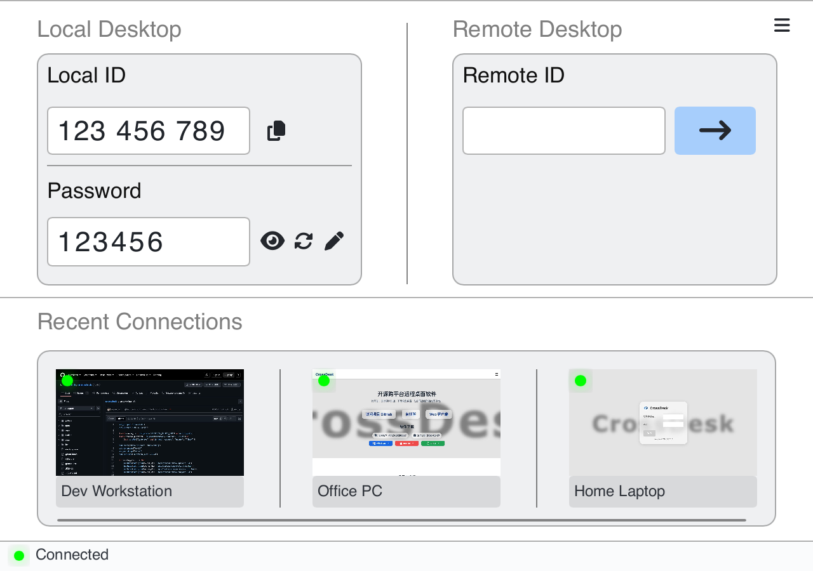
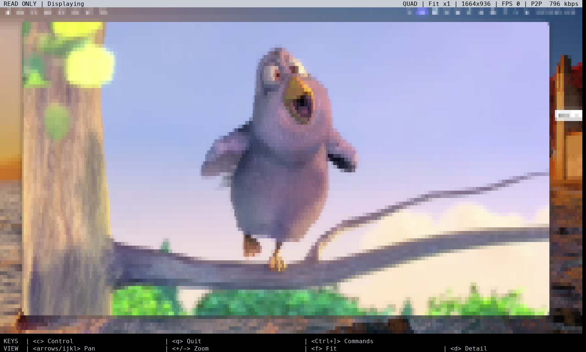
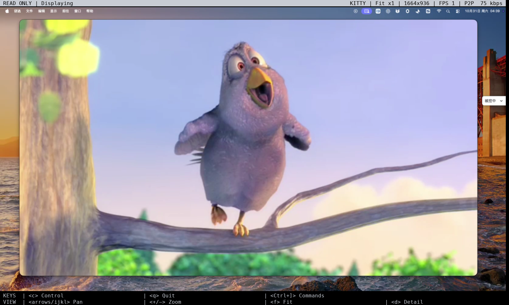

<div align="center">
  
  <p>A lightweight, cross-platform remote desktop for computers, browsers, mobile devices, and terminals, with DeskHub for viewing and controlling multiple desktops.</p>
  <p><a href="https://www.crossdesk.cn/">Website</a> · <a href="https://github.com/kunkundi/crossdesk/releases">Download</a> · <a href="https://web.crossdesk.cn/">Open Web Client</a> · <a href="README.md">中文</a></p>
</div>

<div align="center">

[](#download)
[](#cli)
[](https://www.npmjs.com/package/@chunkdash/crossdesk-cli)

[](https://github.com/kunkundi/crossdesk/releases)
[](https://github.com/kunkundi/crossdesk/actions/workflows/build.yml)
[](LICENSE)
[](https://github.com/kunkundi/crossdesk/stargazers)

[](https://ko-fi.com/kunkundi)
[](https://github.com/sponsors/kunkundi)
[](https://afdian.com/a/kunkundi)

</div>

CrossDesk connects your computers from desktop, browser, mobile, and terminal clients, with **DeskHub** for viewing and controlling multiple devices together. It is built on [MiniRTC](https://github.com/kunkundi/minirtc) and supports self-hosting.

[Features](#features) · [Download and platforms](#download) · [Quick start](#quick-start) · [Terminal CLI](#cli) · [Direct IP](#lan-direct) · [Preview](#preview) · [User guide](docs/USER_GUIDE_EN.md) · [Self-hosting](#self-hosting) · [Build and feedback](#development) · [Sponsor](#sponsor)

<a id="features"></a>

## Features

- **Cross-platform access:** control Windows, macOS, and Linux desktops from computers, browsers, or native iOS / Android clients. HarmonyOS PC and mobile clients are in development.
- **Direct IP over LAN:** connect desktop clients using an IP address, port, and six-character password without a cloud signaling service. Each local IP has its own port; passwords can be remembered and recent devices are separated by mode.
- **Terminal controller:** view and control remote desktops by device ID, with ANSI / Kitty rendering, zoom and pan, persistent local command mode, a Pi extension, and a build independent of the desktop GUI.
- **DeskHub:** live multi-device previews, groups, enlarged control, group input, and batch file distribution.
- **Video and audio:** H.264 / AV1, hardware codecs, remote audio, and in-session quality and frame-rate controls. Capabilities depend on the platform and device.
- **Everyday controls:** monitor switching, keyboard and mouse input, shortcuts, text clipboard, and file transfer.
- **Deployment:** direct P2P connections, TURN relay, SRTP media encryption, self-hosting, Windows access before sign-in, and Linux headless operation.

<a id="download"></a>

## Download and platform support

Get a package matching your OS and CPU architecture from the [website](https://www.crossdesk.cn/) or [GitHub Releases](https://github.com/kunkundi/crossdesk/releases), or open the [Web Client](https://web.crossdesk.cn/) directly.

| Platform | Support and installation |
| --- | --- |
| Windows | **Control + host**. Windows 10+, x64; `.exe` installer, with portable builds also supported |
| macOS | **Control + host**. macOS 14.0+; x64 / arm64 `.pkg` for Intel / Apple Silicon |
| Linux | **Control + host**. Ubuntu 20.04+, glibc 2.31 baseline; amd64 / arm64 `.deb` |
| iOS / iPadOS | **Control only**. iOS 16.0+; sign the unsigned release app yourself, or build and install with Xcode |
| Android | **Control only**. Android 8.0+, arm64; install the signed APK or build from source |
| HarmonyOS PC (development) | **Control + host**. API 26, arm64; build and sign a HAP with DevEco; physical-device validation is ongoing |
| HarmonyOS phones / tablets (development) | **Control only**. API 20+, arm64; build and sign a HAP with DevEco; physical-device validation is ongoing |
| Web | **Control only**. A WebRTC-capable browser; no client installation on the controlling device |
| Terminal CLI (development) | **Control only**. Distribution targets: macOS / Linux (x64, arm64) and Windows (x64). [Install from npm](#cli-npm) or build from source; see the [CLI guide](apps/cli/README.md) (Chinese) for platform validation status |

Requirements follow the current source and build configuration. Check the release notes for the downloaded package. Client capabilities are summarized under [Terminal CLI](#cli) and [Mobile and HarmonyOS](#mobile).

- **Linux:** use `crossdesk-linux-…deb` for an existing desktop, or `crossdesk-virtual-desktop-xfce-…deb` for a server needing a separate Xfce desktop. Choose one. See [installation details](docs/USER_GUIDE_EN.md#installation) and [headless operation](docs/HEADLESS_EN.md).
- **macOS:** grant Screen Recording and Accessibility when prompted on first launch. These enable desktop capture and remote keyboard/mouse input. See [permissions](docs/USER_GUIDE_EN.md#installation).
- **iOS / HarmonyOS:** follow the [iOS](apps/ios/README.md) or [HarmonyOS](apps/harmony/README.md) (Chinese) signing and build guide. Unsigned artifacts cannot be installed directly.

<a id="quick-start"></a>

## Quick start

### Connect by device ID

1. **Prepare the host.** Install and run CrossDesk on the computer to control, select ID mode, and wait for the server-connected status, then find its ID and password under **Local Desktop**.
2. **Connect.** On another computer, enter the host's 9-digit ID and click **Connect**. Native mobile clients and the [Web Client](https://web.crossdesk.cn/) can also connect.
3. **Verify the password.** Enter the host's current connection password and wait for the desktop to appear. On desktop, select **Remember password** to reconnect later from **Recent Connections**.

For self-hosting, both ends must use the same service. See the [user guide](docs/USER_GUIDE_EN.md#quick-start) for connection, password, and browser controls, or the [FAQ](docs/FAQ.md#english) for failed connections, blank video, and input problems.

<a id="lan-direct"></a>

### Connect directly over LAN

1. **Switch modes.** Run a desktop client with direct IP support on both computers. Click the top-left mode button to select **Direct IP mode**. If the button is hidden, select **Enable direct IP** under **Settings → General → Network** and save.
2. **Enter the address.** On the controller, enter the host's displayed `IP:port`, for example `192.168.1.20:52888` or `[2001:db8::20]:52888`, and click **Connect**. Omitting the port uses **52888**; use the actual port shown on the host.
3. **Enter the password.** Use the host's **six-character ASCII letter/digit password** shown in Direct IP mode. You can select **Remember password**. Switching modes also switches the recent device list.

Both computers must be reachable over the LAN. Internet access may be available or absent; direct sessions do not depend on a cloud signaling service. The main window lets you select the local IP, edit its port, and change the password. **Listen on all IP interfaces** is enabled by default for IPv4, IPv6, VPN, and other local interfaces on a shared port; change it under **Settings → General → Network**. Disabling **Enable direct IP** stops listeners, disconnects direct IP sessions, and hides the mode button. See the [direct IP guide](docs/USER_GUIDE_EN.md#lan-direct).

<a id="preview"></a>

## Preview

### Desktop client

Local credentials, remote connections, and recent devices share the main window. The top-left controls switch connection modes and open DeskHub.

<p align="center">
  
</p>

### Direct IP mode

Select the local IP, edit its port and password, and connect using the other desktop's address. Recent LAN devices have their own list below.

<p align="center">
  
</p>

<a id="deskhub"></a>

### DeskHub

View devices by group, click a preview to enlarge it, and take control when needed. Batch actions include connecting, muting, and sending files.

<p align="center">
  
</p>

Group control sends input to all connected devices; closing DeskHub disconnects all remote connections. See the [DeskHub user guide](docs/USER_GUIDE_EN.md#deskhub) for exact scopes and controls. Screenshots use demonstration data; more views and sources are in the [user guide](docs/USER_GUIDE_EN.md) and [screenshot notes](docs/images/README.md).

<a id="session"></a>
<a id="settings"></a>

## Session controls and settings

Remote sessions support monitor switching, video quality and frame-rate controls, audio, text clipboard synchronization, and file transfer. The toolbar also provides network statistics and privacy screen controls. Desktop settings configure direct IP availability, codecs, relay, self-hosting, and the DeskHub video budget.

- [Session controls](docs/USER_GUIDE_EN.md#session): toolbar, text clipboard, received files, and privacy screens.
- [Client settings and updates](docs/USER_GUIDE_EN.md#settings): general options, DeskHub video settings, and version checks.
- [DeskHub technical guide](docs/deskhub.md) (Chinese): preview subscriptions, bandwidth allocation, protocol, and compatibility.

<a id="cli"></a>

## Terminal client CLI

`crossdesk-cli` connects to a host by its 9-digit device ID and starts in read-only, silent mode. Standard terminals use ANSI character rendering; terminals supporting the Kitty graphics protocol can display pixel graphics. The CLI supports monitor selection, quality settings, detail zoom, panning, and optional keyboard/mouse control. It builds independently of the desktop GUI. The host still needs CrossDesk and a capturable graphical session, and the signaling service must support temporary `cli` identities.

### Display preview

| ANSI character rendering | Kitty pixel graphics |
| --- | --- |
|  |  |
| Colored characters show the desktop in standard terminals; press `d` to inspect a smaller region. | Pixel graphics display the desktop in terminals supporting the Kitty graphics protocol, such as Ghostty. |

Both images were captured on **2026-10-31** from real read-only connections to the same authorized host. They render the CLI's ANSI / Kitty protocol output in a 160 × 48 character viewport. Actual terminal appearance depends on the font, window size, and protocol support. See [capture notes](docs/images/README.md#cli-captures) for the method.

<a id="cli-npm"></a>

### Install from npm and connect

Install **Node.js 22 or later** and npm, then get [@chunkdash/crossdesk-cli](https://www.npmjs.com/package/@chunkdash/crossdesk-cli). npm selects the native executable for your OS and CPU architecture; Xmake and a C++ toolchain are not required.

```sh
npm install -g @chunkdash/crossdesk-cli@latest
crossdesk-cli doctor --json
crossdesk-cli 123456789
```

Replace `123456789` with the host's 9-digit device ID and enter its password at the hidden prompt. Connections start in read-only, silent mode; `doctor` checks the local environment without connecting. To update, run `npm install -g @chunkdash/crossdesk-cli@latest` again.

You can also use `npx` without a global installation. The first run downloads the matching platform package:

```sh
npx @chunkdash/crossdesk-cli@latest doctor --json
npx @chunkdash/crossdesk-cli@latest 123456789
```

Install the main `@chunkdash/crossdesk-cli` package with npm optional dependencies enabled; do not add `--omit=optional`. Installing a platform package alone does not register the `crossdesk-cli` command. See the [npm distribution guide](apps/cli/docs/npm-distribution.md) (Chinese) for platform requirements, migration from older packages, and troubleshooting.

### Build and connect

Install Git, Xmake 3.1.1 or later, a C++17 toolchain, and the platform dependencies. The following example uses a macOS / Linux shell; Windows Git Bash / Developer PowerShell steps are in the [CLI build guide](apps/cli/docs/terminal-client.md#构建与安装) (Chinese).

```sh
git clone --recurse-submodules https://github.com/kunkundi/crossdesk.git
cd crossdesk
./apps/cli/scripts/prepare-deps.sh
xmake f -y --CROSSDESK_BUILD_DESKTOP=n --CROSSDESK_BUILD_CLI=y --USE_CUDA=n -m release
xmake build crossdesk-cli
xmake run crossdesk-cli doctor --json
xmake run crossdesk-cli 123456789
```

For an existing checkout, run the dependency preparation and subsequent commands from the repository root. Replace `123456789` with the host's ID; the password prompt hides your input. `doctor` reports the local environment without connecting. The repository builds the desktop client by default; this configuration builds only the CLI. Set `CROSSDESK_BUILD_DESKTOP=y` to also build the desktop client. Binaries are placed in `build/<platform>/<arch>/release/`.

### Rendering and connection options

The default `--renderer auto` probes for Kitty graphics support and falls back to ANSI. Use `ansi` explicitly in standard terminals such as macOS Terminal, or `kitty` in compatible terminals such as Ghostty. Explicit `kitty` mode reports an error if the probe fails; use `ansi` in that case.

These examples use the command installed globally by npm. For a source build, replace `crossdesk-cli` with `xmake run crossdesk-cli` and run it from the repository root.

```sh
# Standard terminal: start with a detail view
crossdesk-cli 123456789 --renderer ansi --zoom native

# Terminal supporting the Kitty graphics protocol: display pixel graphics
crossdesk-cli 123456789 --renderer kitty

# Request lower video quality and refresh rate
crossdesk-cli 123456789 --quality balanced --fps 8
```

| Option | Purpose |
| --- | --- |
| `--renderer auto\|ansi\|kitty` | Automatic selection, character rendering, or pixel graphics; default: `auto` |
| `--zoom native` | Start in native detail mode; `--zoom 2` zooms to twice the full-desktop scale |
| `--quality low\|balanced\|high\|ultra` | Request up to 360p / 720p / 1080p / 2160p; default: `high`. The host determines actual quality |
| `--fps 8` | Fix the local output target and corresponding remote preview request; accepts 1–30. The default local target is 30, with adaptive remote requests when omitted |
| `--display 1` | Select the second monitor; indexes start at `0` |
| `--control` | Enable keyboard/mouse control immediately after connecting; omitted by default for read-only viewing |
| `--server your-server.example --port 9099` | Use a self-hosted signaling service; both ends must use the same service |

ANSI overviews are limited by the character grid: higher video quality alone cannot make full-desktop text legible. Enlarge the terminal or reduce its font size, press `d` for detail, and `f` to return to the full desktop. The top bar shows input mode, connection progress, renderer, zoom, live output FPS, and network information; narrow windows omit some fields. Allocate a PTY over SSH (`ssh -t`), and use ANSI inside tmux / screen. See the [terminal guide](apps/cli/docs/terminal-client.md) (Chinese) for rendering, mouse reporting, and compatibility details.

### Control, navigation, and exit

| Mode / key | Behavior |
| --- | --- |
| Read-only mode | `c` enables remote control; `q` or `Ctrl+C` exits the CLI |
| Control mode | Keyboard/mouse input goes to the host; `Ctrl+]` enters local command mode and pauses remote input |
| Local command mode | Stays active after commands; `c` selects whether control resumes when you leave; `q` exits the CLI |
| `Esc` / `Ctrl+C` | Manually leave local command mode and return to the selected control or read-only mode |
| `+` / `=` / `-` | Zoom in / out in read-only or local command mode |
| `d` / `f` | Switch to native detail / full-desktop view in read-only or local command mode; clicking in read-only mode also opens detail at that point |
| Arrow keys / `i j k l` | Pan in read-only or local command mode: `i` up, `j` left, `k` down, `l` right |

**To quit while controlling the host, press `Ctrl+]`, then `q`.** Ordinary `c`, `q`, and `Ctrl+C` go to the host in control mode.

Zooming, panning, or pressing `c` does not end `Ctrl+]` mode. The status bar shows `CONTROL PAUSED` / `READ ONLY` to indicate whether control will resume; press `Esc` / `Ctrl+C` to return manually. Pressing `Ctrl+]` again also leaves local mode and forwards that shortcut if control resumes.

### Pi extension and feature scope

The CLI includes a Pi custom TUI extension with the same input modes. Launch it from the repository root; for example, with a macOS Apple Silicon release build:

```sh
export CROSSDESK_CLI="$PWD/build/macosx/arm64/release/crossdesk-cli"
pi -e ./apps/cli/plugins/pi/index.ts
```

On other platforms, set `CROSSDESK_CLI` to the absolute path of the native executable. Enter `/crossdesk` or `/crossdesk 123456789` in Pi and follow the password prompt. See the [Pi extension guide](apps/cli/docs/terminal-client.md#pi-扩展) (Chinese) for requirements and validation scope.

The CLI currently provides ID-based viewing and input, without direct IP connections, audio playback, file transfer, or clipboard synchronization. Local builds and remote connections have been validated on macOS arm64. See the [validation record](apps/cli/docs/validation.md) (Chinese) for the remaining Linux / Windows, SSH / Kitty terminal, and actual Pi TUI checks. Platform builds and npm publication do not establish that every platform has been validated on real devices.

[CLI documentation](apps/cli/README.md) · [Terminal usage and troubleshooting](apps/cli/docs/terminal-client.md) · [Bridge protocol](apps/cli/docs/bridge-protocol.md) · [npm packaging and distribution](apps/cli/docs/npm-distribution.md) (detailed guides in Chinese)

<a id="mobile"></a>

## Mobile and HarmonyOS

<a id="ios"></a>

### iOS / iPadOS

The native controller supports touch and a virtual mouse, multiple monitors, remote audio, file transfers, and text clipboard. Tap **剪贴板** (Clipboard) in the floating menu to send local text, up to 128 KiB per transfer. iPhone and iPad cannot currently act as remote hosts. The native interface uses Chinese labels.

[User guide](docs/USER_GUIDE_EN.md#ios) · [Build and signing](apps/ios/README.md)

<a id="android"></a>

### Android

The native controller supports touch and external keyboards/mice, monitor switching, file transfers, text clipboard, and video settings. H.264 / AV1 use hardware decoding when available, with software fallback when unsupported or when decoding fails. Active sessions use Picture in Picture when switching apps, with a foreground service as a fallback when Picture in Picture is unavailable. Phone-as-host is not currently supported. The floating menu’s **Privacy screen** button toggles the computer’s local cover directly, labels the host-confirmed on/off state without changing colors, and shows inline feedback only for errors or unavailable status. Enabling privacy also blocks local keyboard/mouse input, matching the desktop controller.

[User guide](docs/USER_GUIDE_EN.md#android) · [Build from source](apps/android/README.md) (Chinese)

<a id="harmonyos"></a>

### HarmonyOS (development)

The PC client acts as both controller and host, sharing the desktop UI and DeskHub. Phones and tablets use a native ArkUI controller with touch, external input devices, monitors, text clipboard, and file transfers. PC screen capture and input control require system authorization. Physical-device and long-session validation are ongoing.

[Usage and limits](docs/USER_GUIDE_EN.md#harmonyos) · [Build and signing](apps/harmony/README.md) · [PC guide](apps/harmony/desktop-port/README.md) · [Mobile features](apps/harmony/MOBILE_PARITY.md) (platform guides in Chinese)

<a id="windows-service"></a>

## Unattended and headless access

- **Windows:** CrossDesk Service supports lock screens, sign-in, and secure desktops. Installed builds can enable access before sign-in with a separate device ID and password; ordinary **Auto Start** runs after a user signs in. See the [Windows unattended guide](docs/USER_GUIDE_EN.md#windows-service) for capabilities, limits, and commands.
- **Linux:** reuse an existing desktop or create an independent Xvfb / Xfce session. See [Linux headless operation](docs/HEADLESS_EN.md).

<a id="self-hosting"></a>

## Self-hosting

Host your own signaling and TURN services, then enable them under **Settings → General → Self-Hosted Config**. Both the controller and host must use the same service.

[Deployment guide](docs/SELF_HOSTING_EN.md) · [Client setup](docs/USER_GUIDE_EN.md#self-hosting) · [Server source](https://github.com/kunkundi/crossdesk-server) · [Web client deployment](https://github.com/kunkundi/crossdesk-web-client)

<a id="development"></a>

## Build and feedback

- [Terminal client CLI](apps/cli/README.md) (Chinese): independent builds, terminal usage, Pi extension, bridge protocol, and npm packaging.
- [Build from source](docs/BUILD_EN.md): desktop dependencies, build options, and packaging. Use the platform guides above for mobile builds.
- [GUI architecture](docs/gui-architecture.md) (Chinese): desktop UI, platform implementation, and project structure.
- [Connection architecture](docs/connection-architecture.md) (Chinese): discovery, authentication, negotiation, data paths, and lifecycle for ID and direct IP modes.
- [FAQ](docs/FAQ.md#english): connections, blank video, permissions, received files, and build issues.
- [Report an issue or suggestion](https://github.com/kunkundi/crossdesk/issues): include both operating systems, client versions, connection mode, and reproduction steps.

The optional desktop build parameter `CROSSDESK_UPDATE_PUBLIC_KEY` verifies Ed25519 signatures on in-app update manifests. Without it, the app still builds, runs, and checks for new versions, but updates require manual download. In-app update installation requires a public key matching the release signing private key. See [Update public key](docs/BUILD_EN.md#update-public-key) for configuration and the [desktop updater guide](docs/UPDATER.md) (Chinese) for key generation and publishing.

<a id="sponsor"></a>

## Support CrossDesk

If CrossDesk is useful to you, consider sponsoring its continued development, cross-platform testing, and maintenance through one of the platforms below. Thank you for your support!

[Ko-fi](https://ko-fi.com/kunkundi) · [GitHub Sponsors](https://github.com/sponsors/kunkundi) · [AFDIAN](https://afdian.com/a/kunkundi)

## Acknowledgements and license

Thanks to [HelloGitHub](https://hellogithub.com/), [Ruanyf Weekly](https://github.com/ruanyf/weekly), and the [LinuxDo](https://linux.do) community for featuring CrossDesk and contributing feedback.

Copyright (c) 2026 JUNKUN DI.

CrossDesk is licensed under [GPL-3.0-only](LICENSE). See the [Privacy Policy](PRIVACY.md#english).

### Code signing policy

CrossDesk uses SignPath.io to sign official Windows releases built from this repository.

**Free code signing provided by [SignPath.io](https://signpath.io/), certificate by [SignPath Foundation](https://signpath.org/).**

- **Committers and reviewers:** [kunkundi](https://github.com/kunkundi)
- **Approvers:** [kunkundi](https://github.com/kunkundi)
