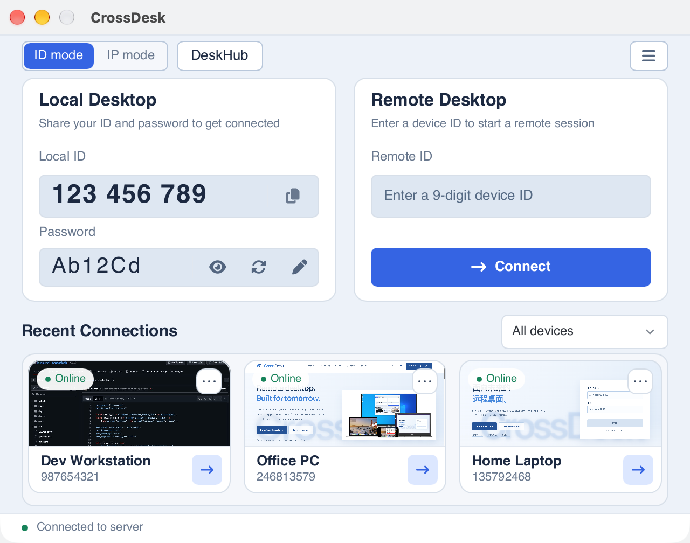
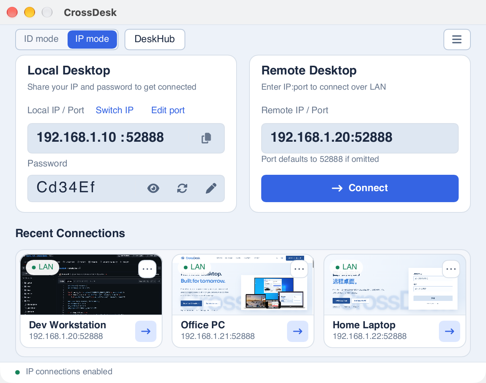
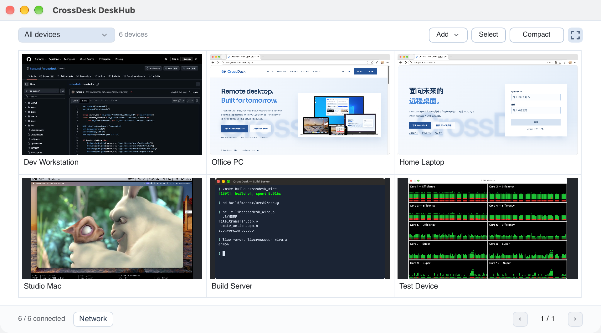
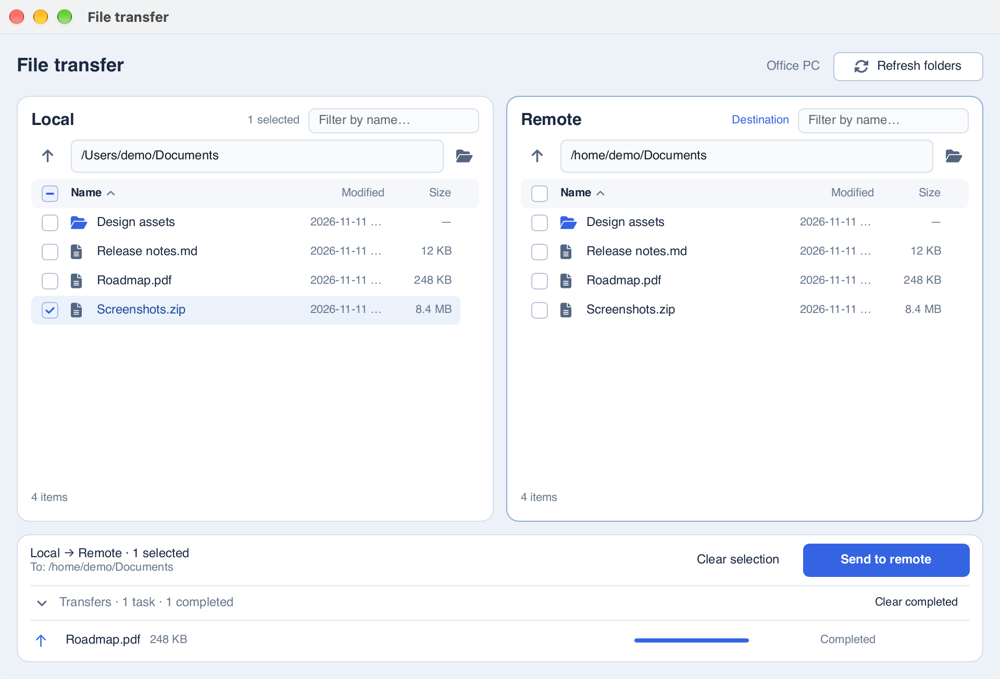
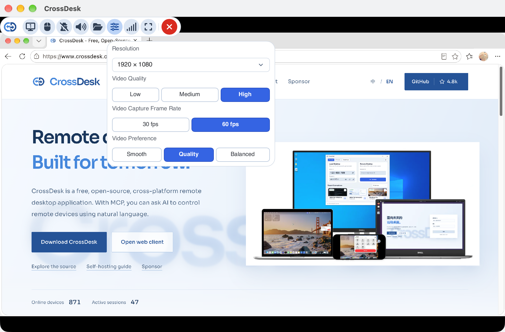
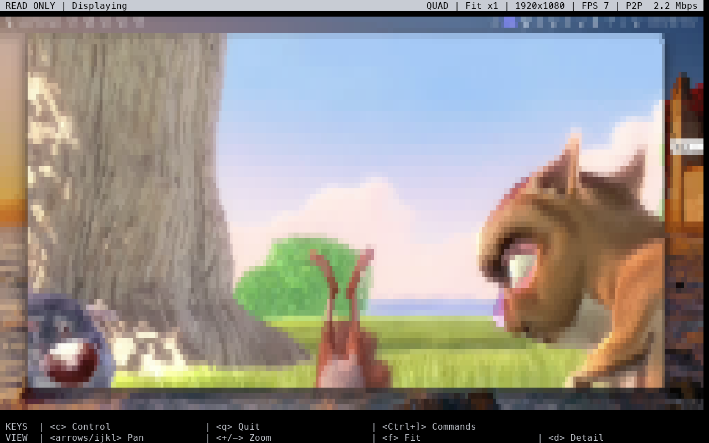
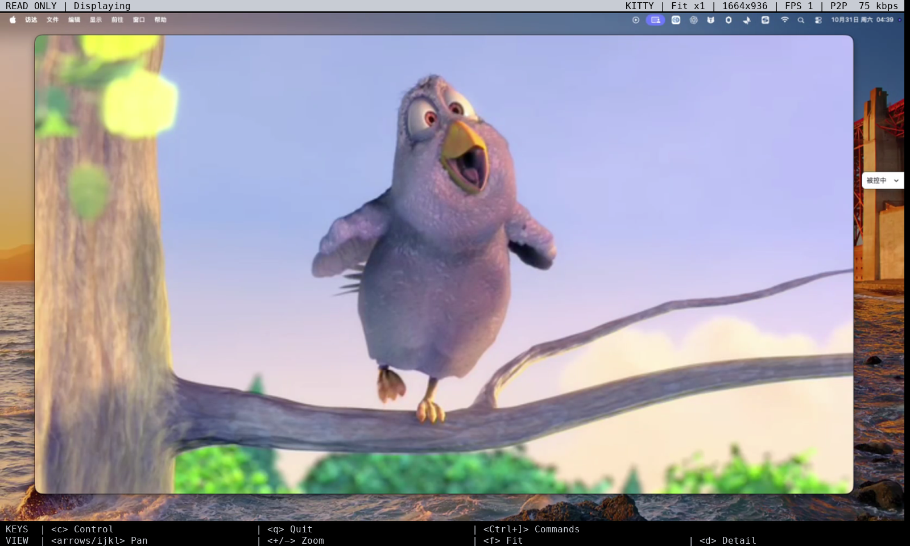
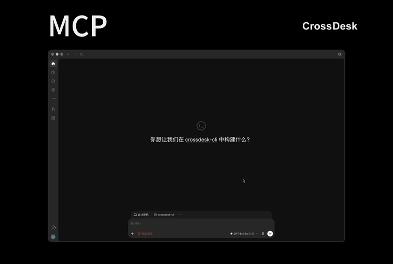

<div align="center">
  
  <p>コンピューター、ブラウザ、モバイルデバイス、ターミナルから使える軽量なクロスプラットフォームのリモートデスクトップです。DeskHub で複数のデスクトップをまとめて表示・操作できます。</p>
  <p><a href="https://www.crossdesk.cn/">Web サイト</a> · <a href="https://github.com/kunkundi/crossdesk/releases">ダウンロード</a> · <a href="#build">ビルドガイド</a> · <a href="https://web.crossdesk.cn/">Web クライアントを開く</a> · <a href="README.md">English</a> · <a href="README_ZH.md">中文</a></p>
</div>

<div align="center">

[](#download)

[](#download)

[](https://github.com/kunkundi/crossdesk/releases)
[](https://www.npmjs.com/package/@chunkdash/crossdesk-cli)
[](https://github.com/kunkundi/crossdesk/actions/workflows/build.yml)
[](LICENSE)
[](https://github.com/kunkundi/crossdesk/stargazers)

</div>

<p align="center">
  <a href="https://trendshift.io/repositories/17514?utm_source=repository-badge&amp;utm_medium=badge&amp;utm_campaign=badge-repository-17514" target="_blank" rel="noopener noreferrer"></a>
</p>

<p align="center">
  <a href="https://trendshift.io/repositories/17514?utm_source=trendshift-badge&amp;utm_medium=badge&amp;utm_campaign=badge-trendshift-17514" target="_blank" rel="noopener noreferrer"></a>
  <a href="https://trendshift.io/repositories/17514?utm_source=trendshift-badge&amp;utm_medium=badge&amp;utm_campaign=badge-trendshift-17514" target="_blank" rel="noopener noreferrer"></a>
  <a href="https://trendshift.io/repositories/17514?utm_source=trendshift-badge&amp;utm_medium=badge&amp;utm_campaign=badge-trendshift-17514" target="_blank" rel="noopener noreferrer"></a>
</p>

## スペシャルスポンサー

<table border="1">
  <tr>
    <td align="center" valign="middle" width="160">
      <a href="https://crossdesk.hualong-ai.com/">
        
      </a>
    </td>
    <td valign="middle">
      <p><strong><a href="https://crossdesk.hualong-ai.com/">HuaLongAI 华龙算力</a></strong></p>
      <p>Codex、インジェクションなしの Kiro、Claude モデル向けの、安定した効率的な API リレーです。HuaLongAI はモデルを 100% 公式プロバイダーから直接調達しており、代替品は一切使用していません。高可用性を備え、平均 SLA は 99.2% 以上と公表されています。トークン単位の課金により、請求を 1 件ずつ確認できます。法人契約と請求書の発行にも対応しています。</p>
    </td>
  </tr>
</table>

## 概要

CrossDesk は、デスクトップ、ブラウザ、モバイル、ターミナルのクライアントからコンピューターに接続でき、デスクトップウォールで複数のデバイスをまとめて表示・操作できます。[MiniRTC](https://github.com/kunkundi/minirtc) をベースに構築されており、セルフホスティングに対応しています。

[機能](#features) · [ダウンロードと対応プラットフォーム](#download) · [ビルドガイド](#build) · [クイックスタート](#quick-start) · [ターミナル CLI](#cli) · [Agent / MCP](#mcp) · [IP 直接接続](#lan-direct) · [信頼済みデバイス](#trusted-devices) · [プレビュー](#preview) · [ユーザーガイド](docs/USER_GUIDE_EN.md) · [セルフホスティング](#self-hosting) · [ドキュメントとフィードバック](#development) · [スポンサー](#sponsor)

<a id="features"></a>

## 機能

- **クロスプラットフォームのアクセス:** コンピューター、ブラウザ、またはネイティブの iOS / Android クライアントから、Windows、macOS、Linux のデスクトップを操作できます。HarmonyOS の PC 版とモバイル版のクライアントは開発中です。
- **LAN での IP 直接接続:** クラウドのシグナリングサービスを使わずに、IP アドレス、ポート、6 文字のパスワードで、Android、iOS、HarmonyOS、または別のデスクトップからデスクトップに接続できます。ポートの変更やパスワードの記憶ができ、最近のデバイスはモードごとに分けて表示されます。
- **ターミナルからの操作:** デバイス ID でリモートデスクトップを表示・操作できます。ANSI / Kitty / Sixel のレンダリング、ズームとパン、持続するローカルコマンドモード、Pi 拡張に対応し、デスクトップ GUI とは独立してビルドできます。
- **DeskHub:** 複数デバイスのライブプレビュー、グループ、拡大しての操作、グループ入力、ファイルの一括配布ができます。
- **映像と音声:** H.264 と AV1 の映像、ハードウェアコーデック、リモート音声に対応し、セッション中に画質、フレームレート、リモートディスプレイの解像度を調整できます。ネイティブのセッションでは、両方のピアがハードウェアによる HEVC のエンコードとデコードに対応している場合に H.265 を使用できます（Windows では Media Foundation または NVIDIA のコーデック、macOS では VideoToolbox、Linux では NVIDIA のコーデック）。確定した解像度の選択は記憶され、最後の操作側が切断すると元のディスプレイモードに戻ります。利用できる機能はプラットフォームとデバイスによって異なります。
- **日常的な操作:** モニターの切り替え、キーボードとマウスの入力、ショートカット、テキストのクリップボードに対応しています。2 ペインのファイルブラウザでは、ディレクトリの移動、ファイルとフォルダーの双方向転送、ドラッグ＆ドロップ、転送の管理ができます。
- **Agent / MCP:** ローカルの MCP サービスを通じて Agent を承認し、リモートコンピューターを観察・操作させることができます。ライブでの監視、手動での引き継ぎ、複数のセッション、クリップボード、ファイルツールに対応しています。ローカルのプラットフォームに合ったパッケージをインストールしてください。
- **信頼済みデバイス:** パスワード認証に加えて、ペアリング用の公開鍵を登録したデバイスだけにデスクトップへのアクセスを許可できます。ペアリング情報をコピー＆ペーストして、接続前にデバイスを承認します。
- **デプロイ:** P2P 直接接続、TURN リレー、SRTP によるメディア暗号化、セルフホスティング、Windows のサインイン前のアクセス、Linux のヘッドレス運用に対応しています。

<a id="download"></a>

## ダウンロードと対応プラットフォーム

[Web サイト](https://www.crossdesk.cn/) または [GitHub Releases](https://github.com/kunkundi/crossdesk/releases) から、お使いの OS と CPU アーキテクチャに合ったパッケージを入手するか、[Web クライアント](https://web.crossdesk.cn/) を直接開いてください。

| プラットフォーム | 対応状況とインストール |
| --- | --- |
| Windows | **操作側 + ホスト**。Windows 10 以降、x64。`.exe` インストーラーのほか、ポータブル版にも対応しています |
| macOS | **操作側 + ホスト**。macOS 14.0 以降。Intel / Apple Silicon 向けの x64 / arm64 `.pkg` |
| Linux | **操作側 + ホスト**。Ubuntu 20.04 以降、glibc 2.31 がベースライン。amd64 / arm64 `.deb` |
| iOS / iPadOS | **操作側のみ**。[App Store](https://apps.apple.com/app/id6828859211) からインストールします。OS の要件はストアのページで確認してください。現在のソースは iOS 16.0 以降を対象としており、ローカルでビルドして署名することもできます |
| Android | **操作側のみ**。Android 8.0 以降、arm64。署名済みの APK をインストールするか、ソースからビルドします |
| HarmonyOS PC（開発中） | **操作側 + ホスト**。API 26、arm64。DevEco で HAP をビルドして署名します。実機での検証は進行中です |
| HarmonyOS のスマートフォン / タブレット（開発中） | **操作側のみ**。API 20 以降、arm64。DevEco で HAP をビルドして署名します。実機での検証は進行中です |
| Web | **操作側のみ**。WebRTC に対応したブラウザ。操作側のデバイスにクライアントをインストールする必要はありません |
| ターミナル CLI（開発中） | **操作側のみ**。配布対象: macOS / Linux（x64、arm64）と Windows（x64）。[npm からインストール](#cli-npm) するか、ソースからビルドします。システム要件と互換性は [CLI ガイド](apps/cli/README.md)（中国語）を参照してください |
| MCP（開発中） | **操作側のみ**。Codex または DSH でリモートコンピューターを操作・監視します。DSH ではプラグインパッケージが 1 つ必要で、Codex ではさらに Node.js 22 以降が必要です。[インストールと使い方](apps/mcp/README.md)（中国語）を参照してください |

お使いのオペレーティングシステムとプロセッサーに合ったパッケージを選んでください。開発中の機能の一部は、リリース済みのパッケージでは利用できない場合があります。ダウンロードするバージョンのリリースノートを確認してください。

- **Linux:** 既存のデスクトップで使う場合は `crossdesk-linux-…deb`、別の Xfce デスクトップが必要なサーバーでは `crossdesk-virtual-desktop-xfce-…deb` を使用します。どちらか一方を選んでください。[インストールの詳細](docs/USER_GUIDE_EN.md#installation) と [ヘッドレス運用](docs/HEADLESS_EN.md) を参照してください。
- **macOS:** 初回起動時に求められたら、画面収録とアクセシビリティの権限を付与してください。これらはデスクトップのキャプチャとリモートからのキーボード/マウス入力に必要です。[権限](docs/USER_GUIDE_EN.md#installation) を参照してください。
- **iOS:** [App Store](https://apps.apple.com/app/id6828859211) からインストールします。署名されていない GitHub の成果物は引き続き署名が必要です。[iOS ビルドガイド](apps/ios/README.md) を参照してください。HarmonyOS では DevEco で署名したビルドが必要です。[HarmonyOS ガイド](apps/harmony/README.md)（中国語）を参照してください。

<a id="build"></a>

## ビルドガイド

デスクトップクライアントは Xmake を使用します。Git、Xmake 3.1.1 以降、お使いのプラットフォーム用のツールチェーンと依存関係をインストールしてから、ソースとサブモジュールをクローンします。

```bash
git clone --recurse-submodules https://github.com/kunkundi/crossdesk.git
cd crossdesk
```

- **デスクトップ:** [Windows](docs/BUILD_EN.md#windows)、[macOS](docs/BUILD_EN.md#macos)、[Linux](docs/BUILD_EN.md#linux) の手順に従って、設定、ビルド、実行を行います。パッケージング、署名、CI の設定については [完全なビルドガイド](docs/BUILD_EN.md) を参照してください。
- **モバイルと HarmonyOS:** [iOS / iPadOS](apps/ios/README.md)、[Android](apps/android/README.md)、[HarmonyOS のスマートフォン / タブレット](apps/harmony/README.md)、[HarmonyOS PC](apps/harmony/desktop-port/README.md)（中国語）。
- **ターミナルと連携:** [CLI のビルドと使い方](apps/cli/README.md) と [MCP のビルドと連携](apps/mcp/DEVELOPMENT.md)（中国語）。

<a id="quick-start"></a>

## クイックスタート

### デバイス ID で接続する

1. **ホストを準備します。** 操作したいコンピューターに CrossDesk をインストールして起動し、ID モードを選択して、サーバーに接続済みの状態になるまで待ちます。その後、**ローカルデスクトップ** で ID とパスワードを確認します。
2. **接続します。** 別のコンピューターでホストの 9 桁の ID を入力し、**接続** をクリックします。ネイティブのモバイルクライアントや [Web クライアント](https://web.crossdesk.cn/) からも接続できます。
3. **パスワードを確認します。** ホストの現在の接続パスワードを入力し、デスクトップが表示されるまで待ちます。デスクトップ版では **パスワードを記憶する** を選択すると、後で **最近の接続** から再接続できます。

セルフホスティングの場合は、両端を同じサービスに接続し、クライアントをアップグレードする前にサーバーを更新してください。接続手順は [ユーザーガイド](docs/USER_GUIDE_EN.md#quick-start) を、接続、映像、入力の問題については [FAQ](docs/FAQ.md#english) を参照してください。

<a id="lan-direct"></a>

### LAN で直接接続する

スマートフォンやタブレットでは、ホストに表示されたアドレスをホーム画面の **デバイス ID または IP アドレス** に貼り付け、ホストの **IP 直接接続パスワード** を入力します。デスクトップから操作する場合は、次の手順に従ってください。

1. **モードを切り替えます。** 両方のコンピューターでデスクトップクライアントを開きます。左上のモードボタンをクリックして **IPモード** を選択します。ボタンが表示されていない場合は、**設定 → 一般 → ネットワーク** で **IP接続を有効にする** を選択して保存します。
2. **アドレスを入力します。** 操作側で、ホストに表示されている `IP:port`（例: `192.168.1.20:52888` や `[2001:db8::20]:52888`）を入力し、**接続** をクリックします。ポートを省略すると **52888** が使われます。ホストに表示されている実際のポートを使用してください。
3. **パスワードを入力します。** IP モードで表示される、ホストの **6 文字の ASCII 英数字のパスワード** を使用します。**パスワードを記憶する** を選択することもできます。モードを切り替えると、最近のデバイスの一覧も切り替わります。

操作側とホストは、LAN または VPN を介して相互に到達できる必要があります。インターネットへのアクセスの有無は問いません。直接接続のセッションはクラウドのシグナリングサービスに依存しません。メインウィンドウでは、ローカル IP の選択、ポートの編集、パスワードの変更ができます。**すべての IP で待ち受け** はデフォルトで有効になっており、IPv4、IPv6、VPN などのローカルインターフェイスで共通のポートを待ち受けます。この設定は **設定 → 一般 → ネットワーク** で変更できます。**IP接続を有効にする** を無効にすると、待ち受けが停止し、IP 直接接続のセッションが切断され、モードボタンが非表示になります。[IP 直接接続ガイド](docs/USER_GUIDE_EN.md#lan-direct) を参照してください。

<a id="trusted-devices"></a>

### 信頼済みデバイスのみを許可する（任意）

デスクトップの信頼済みデバイスの制限は **デフォルトでオフ** で、ID 接続と IP 直接接続の両方に適用されます。有効にすると、操作側は既存のパスワード確認に通ったうえで、ホストが認識しているペアリング用の秘密鍵を持っていることを証明する必要があります。ID とパスワードを知っているだけでは、この制限を満たせません。

1. **操作側でペアリング情報をコピーします。** **設定 → 一般 → プライバシー → 信頼済みデバイスを管理** を開きます。**このデバイスのペアリング情報** の下にある **ペアリング情報をコピー** をクリックします。
2. **ホストに操作側を追加します。** 同じ管理ダイアログを開き、**信頼するデバイスを追加** に情報を貼り付けて **追加** をクリックします。情報はすぐに保存され、再確認や事前のリモート接続は必要ありません。
3. **ホストで制限を有効にします。** 設定に戻り、**信頼済みデバイスのみ許可** を選択して保存します。いつもどおり ID または IP で接続し、パスワードを確認します。

ペアリング情報には公開鍵、デバイス名、ID だけが含まれ、秘密鍵やパスワードは含まれません。信頼できる経路でやり取りしてください。デバイスを追加した後は、**フィンガープリントを表示** を使って操作側と照合します。ローカルのデバイスを追加することもでき、同じ公開鍵が 2 回追加されることはありません。信頼は一方向です。お互いに操作し合うには、両方のコンピューターで相手のデバイスを追加してください。

デバイスの追加や削除はすぐに反映されます。制限が有効な場合、**信頼を解除** するとそのデバイスのセッションが切断され、一覧が空の場合はすべての操作側が拒否されます。このダイアログでは、ID の確認を完了した接続中の操作側を追加することもできます。

**互換性:** ペアリングに対応した最新のデスクトップ版、iOS 版、Android 版、または HarmonyOS のモバイル版クライアントを使用してください。スマートフォンやタブレットでは、**設定 → このデバイスのペアリング情報** でペアリング情報をコピーし、ホストのコンピューターに追加します。古いクライアントと現在のターミナル CLI は、この制限が有効なホストに接続できません。

再インストール、アプリケーションデータの消去、別のコンピューターへの移行を行う前に、[ID のバックアップと移行](docs/CONNECTIONS.md#backup)（中国語）を参照してください。紐付けられたデスクトップの ID は、ID とパスワードだけでは復元できません。デバイス ID が変わっても、同じペアリング鍵を使い続ける限り、既存のペアリングは有効です。ペアリング鍵が変わった場合は、再度ペアリングしてください。

<a id="preview"></a>

## プレビュー

### デスクトップクライアント

ローカルの認証情報、リモート接続、最近のデバイスはメインウィンドウにまとめて表示されます。左上のコントロールで接続モードを切り替えたり、DeskHub を開いたりできます。

<p align="center">
  
</p>

### IP モード

ローカル IP を選択し、ポートとパスワードを編集して、相手のデスクトップのアドレスで接続します。最近の LAN デバイスは下に専用の一覧があります。

<p align="center">
  
</p>

<a id="deskhub"></a>

### DeskHub

デバイスをグループごとに表示し、プレビューをクリックすると拡大して、必要に応じて操作できます。一括操作には、接続、ミュート、ファイルの送信があります。

<p align="center">
  
</p>

グループ操作では、接続中のすべてのデバイスに入力が送られます。DeskHub を閉じると、すべてのリモート接続が切断されます。正確な適用範囲と操作方法については [DeskHub ユーザーガイド](docs/USER_GUIDE_EN.md#deskhub) を参照してください。

### 2 ペインのファイル転送

セッションのツールバーからファイル転送を開くと、ローカルとリモートのディレクトリを並べて参照できます。選択したファイルやフォルダーを送信するか、ペイン間でドラッグします。タスクの一覧には進行状況が表示され、未完了の転送をキャンセルできます。リモートディレクトリの参照には、互換性のあるホストが必要です。

<p align="center">
  
</p>

<a id="session"></a>
<a id="settings"></a>

## セッションの操作と設定

リモートセッションでは、モニターの切り替え、画質とフレームレートの調整、音声、テキストのクリップボード同期、ファイルの双方向転送ができます。ツールバーでは、ネットワークの統計情報の確認やプライバシー画面の操作もできます。デスクトップの設定では、IP 直接接続の有効化、信頼済みデバイスの制限、コーデック、リレー、セルフホスティング、最小化時の映像の一時停止、DeskHub の映像の帯域予算を設定できます。

Windows、macOS、Linux X11 のホストでは、**ビデオ設定 → 解像度** で、再接続せずに現在のリモートディスプレイが対応するモードを選択できます。デスクトップとネイティブのモバイルの操作側は、確定した選択を記憶し、再接続時にまだ対応していればそれを再適用します。最後の操作側が切断すると、ホストはその接続期間で最初に変更する前のディスプレイモードに戻します。Linux では X11 のキャプチャと RandR が必要です。Wayland / XWayland での解像度の変更には、現在対応していません。

<p align="center">
  
</p>

- [セッションの操作](docs/USER_GUIDE_EN.md#session): ツールバー、テキストのクリップボード、受信したファイル、プライバシー画面。
- [クライアントの設定と更新](docs/USER_GUIDE_EN.md#settings): 一般オプション、DeskHub のビデオ設定、バージョンの確認。
- [DeskHub ガイド](docs/deskhub.md)（中国語）: デバイスの整理、グループ操作、ファイルの配布、帯域使用量の削減。

<a id="cli"></a>

## ターミナルクライアント CLI

`crossdesk-cli` は 9 桁のデバイス ID でホストに接続し、読み取り専用かつミュートのモードで起動します。標準的なターミナルでは ANSI の文字によるレンダリングを使用し、Kitty または Sixel のグラフィックスプロトコルに対応したターミナルではピクセルのグラフィックスを表示できます。CLI は、モニターの選択、画質の設定、詳細のズーム、パン、任意のキーボード/マウス操作に対応しています。デスクトップ GUI とは独立してビルドできます。ホストには引き続き CrossDesk とキャプチャ可能なグラフィカルセッションが必要で、シグナリングサービスは一時的な `cli` ID に対応している必要があります。

### 表示のプレビュー

<table>
  <tr>
    <th width="50%">ANSI の文字によるレンダリング</th>
    <th width="50%">Kitty のピクセルグラフィックス</th>
  </tr>
  <tr>
    <td></td>
    <td></td>
  </tr>
  <tr>
    <td>標準的なターミナルでは、色付きの文字でデスクトップを表示します。<code>+/-</code> またはホイールで、マウスの位置を中心にズームできます。</td>
    <td>Ghostty など Kitty グラフィックスプロトコルに対応したターミナルでは、ピクセルのグラフィックスでデスクトップを表示します。</td>
  </tr>
</table>

ANSI は文字を、Kitty はピクセルを表示します。見た目はターミナルの対応状況、フォント、ウィンドウのサイズによって異なります。

<a id="cli-npm"></a>

### npm からインストールして接続する

**Node.js 22 以降** と npm をインストールしてから、[@chunkdash/crossdesk-cli](https://www.npmjs.com/package/@chunkdash/crossdesk-cli) を入手します。npm がお使いの OS と CPU アーキテクチャに合ったネイティブの実行ファイルを選択するため、Xmake や C++ のツールチェーンは不要です。

```sh
npm install -g @chunkdash/crossdesk-cli@latest
crossdesk-cli doctor --json
crossdesk-cli 123456789
```

`123456789` をホストの 9 桁のデバイス ID に置き換え、非表示のプロンプトでパスワードを入力します。接続は読み取り専用かつミュートのモードで始まります。`doctor` は接続せずにローカル環境を確認します。更新するには、もう一度 `npm install -g @chunkdash/crossdesk-cli@latest` を実行します。

グローバルにインストールせずに `npx` を使うこともできます。初回の実行時に、対応するプラットフォームのパッケージがダウンロードされます。

```sh
npx @chunkdash/crossdesk-cli@latest doctor --json
npx @chunkdash/crossdesk-cli@latest 123456789
```

メインの `@chunkdash/crossdesk-cli` パッケージは、npm の optional dependencies を有効にしてインストールしてください。`--omit=optional` は付けないでください。プラットフォームのパッケージだけをインストールしても、`crossdesk-cli` コマンドは登録されません。プラットフォームの要件、古いパッケージからの移行、トラブルシューティングについては [npm 配布ガイド](apps/cli/docs/npm-distribution.md)（中国語）を参照してください。

### 日常的な操作

接続は読み取り専用かつミュートの状態で始まります。読み取り専用モードで `c` を押すとキーボードとマウスの入力が有効になり、`+/-` またはホイールでズームし、`f` でデスクトップ全体の表示に戻ります。**ホストを操作中に終了するには、`Ctrl+]` を押してから `q` を押します**。それ以外の通常のキーはリモートコンピューターに送られます。

```sh
# Character graphics in a standard terminal
crossdesk-cli 123456789 --renderer ansi

# Pixel graphics in a terminal supporting the Kitty graphics protocol
crossdesk-cli 123456789 --renderer kitty
```

CLI はデバイス ID で接続します。IP 直接接続、音声の再生、ファイル転送、クリップボードの同期、信頼済みデバイスの制限が有効なホストには、現在対応していません。ホストには CrossDesk と利用可能なデスクトップセッションが必要です。セルフホストのサーバーは CLI での接続に対応している必要があります。

[CLI の完全なガイド](apps/cli/README.md) · [オプション、Pi 拡張、ソースからのビルド](apps/cli/docs/terminal-client.md) · [インストールのトラブルシューティング](apps/cli/docs/npm-distribution.md)（中国語）

<a id="mcp"></a>

## Agent と MCP

[CrossDesk MCP](apps/mcp/README.md) を使うと、Codex または DeepSeek Harness のチャットでリモートのタスクを依頼し、右側でリモート画面を見守ることができます。リモートコンピューターで CrossDesk を起動し、以下のローカルアプリ向けのインストールガイドに従ってから、パネルでデバイスを選んで承認します。

<p align="center">
  
</p>

| ホスト | インストールと設定 | リモート映像 |
| --- | --- | --- |
| Codex デスクトップ | [Codex のセットアップ](apps/mcp/README.md#install-codex)（中国語）: MCP サーバーを登録します。追加のプラグインは不要です | Agent が右側の内蔵ブラウザを開きます |
| DeepSeek Harness デスクトップ（DSH） | [DSH のセットアップ](apps/mcp/README.md#install-dsh)（中国語）: プラットフォーム用のプラグインパッケージを 1 つインストールします。MCP は自動で登録されます | プラグインが現在のチャットのブラウザサイドバーを自動で開きます |

1. [ローカルコンピューター用のプラットフォームパッケージをダウンロード](apps/mcp/README.md#install-package) し、上の表にあるお使いのアプリ向けのガイドに従います。
2. Agent に CrossDesk を開くよう依頼します。ローカルの監視パネルでデバイスを選んでパスワードを入力し、表示のみまたは操作のアクセスを許可します。パスワードの保存と、今後の自動接続の許可は別々に選択します。
3. Agent はスクリーンショット、キーボードとマウスの操作、構造化されたデスクトップツールを使用します。ライブで見守る、Agent を一時停止する、手動で引き継ぐ、切断する、といったことができます。

このサービスは、最大 8 台のデバイスの同時セッション、複数ディスプレイの観察、リモートのテキストクリップボード、ファイルの参照と転送、音声、システムのロック、ローカルで入力したパスワードによるロック解除に対応しています。ウィンドウとアクセシビリティの操作は、リモートのプラットフォームと権限によって異なり、一部のツールには更新されたホストが必要です。ブラウザ、ターミナル、MCP Apps のパネルは、それぞれホストの要件が異なります。設定と互換性については [MCP ガイド](apps/mcp/README.md)（中国語）を参照してください。

<a id="mobile"></a>

## モバイルと HarmonyOS

<a id="ios"></a>

### iOS / iPadOS

ネイティブの操作側クライアントを [App Store](https://apps.apple.com/app/id6828859211) からインストールします。タッチと仮想マウス、複数のモニター、リモート音声、ファイル転送、テキストのクリップボードに対応しています。フローティングメニューの **クリップボード** をタップすると、ローカルのテキストを 1 回あたり最大 128 KiB まで送信できます。ビデオ設定では、対応しているリモートディスプレイの解像度を変更でき、確定した選択は記憶されます。iPhone と iPad は現在リモートホストとしては動作できません。アプリ内の更新確認は App Store に誘導されます。

[ユーザーガイド](docs/USER_GUIDE_EN.md#ios) · [ビルドと署名](apps/ios/README.md)

<a id="android"></a>

### Android

ネイティブの操作側クライアントは、タッチ、外付けのキーボードとマウス、モニターの切り替え、ファイル転送、テキストのクリップボード、ビデオ設定に対応しています。アプリを切り替えると、利用可能な場合はピクチャー・イン・ピクチャーが使われ、利用できない場合はバックグラウンド通知になります。フローティングメニューから、コンピューターのプライバシー画面を切り替えられます。Android のスマートフォンとタブレットは、現在ホストとしては動作できません。

[ユーザーガイド](docs/USER_GUIDE_EN.md#android) · [ソースからビルド](apps/android/README.md)（中国語）

<a id="harmonyos"></a>

### HarmonyOS（開発中）

PC 版クライアントは操作側とホストの両方として動作し、デスクトップの UI と DeskHub を共有します。スマートフォンとタブレットではネイティブの ArkUI の操作側クライアントを使用し、タッチ、外付けの入力デバイス、モニター、テキストのクリップボード、ファイル転送に対応しています。PC での画面キャプチャと入力の操作には、システムの承認が必要です。実機での検証と長時間セッションの検証は進行中です。

[使い方と制限](docs/USER_GUIDE_EN.md#harmonyos) · [ビルドと署名](apps/harmony/README.md) · [PC ガイド](apps/harmony/desktop-port/README.md) · [モバイルの機能](apps/harmony/MOBILE_PARITY.md)（プラットフォームのガイドは中国語）

<a id="windows-service"></a>

## 無人アクセスとヘッドレスアクセス

- **Windows:** CrossDesk Service は、ロック画面、サインイン、セキュアデスクトップに対応しています。インストール済みの Release ビルドで **オートスタート** を有効にすると、サインインの前後で同じデバイス ID とパスワードが使われます。サインイン後、クライアントはシステムトレイで起動し、既存のリモート接続は継続されます。ポータブル版と Debug ビルドにはこのスイッチがありません。モニターがない場合、ホストは仮想ディスプレイの準備を試み、以前に記録された解像度を復元します。機能、制限、コマンドについては [Windows 無人アクセスガイド](docs/USER_GUIDE_EN.md#windows-service) を参照してください。
- **Linux:** 既存のデスクトップを再利用するか、独立した Xvfb / Xfce セッションを作成します。[Linux のヘッドレス運用](docs/HEADLESS_EN.md) を参照してください。

<a id="self-hosting"></a>

## セルフホスティング

独自のシグナリングサービスと TURN サービスをホストし、**設定 → 一般 → セルフホストサーバー** で有効にします。操作側とホストの両方が同じサービスを使用する必要があります。

[デプロイガイド](docs/SELF_HOSTING_EN.md) · [クライアントの設定](docs/USER_GUIDE_EN.md#self-hosting) · [サーバーのソース](https://github.com/kunkundi/crossdesk-server) · [Web クライアントのデプロイ](https://github.com/kunkundi/crossdesk-web-client)

<a id="development"></a>

## ドキュメントとフィードバック

- [ドキュメントの索引](docs/README.md)（中国語）: タスク別にヘルプを探せます。
- [ユーザーガイド](docs/USER_GUIDE_EN.md): インストール、接続、セッションの操作、設定、無人アクセス。
- [FAQ](docs/FAQ.md#english): 接続の失敗、映像が表示されない問題、権限、受信したファイル。
- [接続と信頼済みデバイス](docs/CONNECTIONS.md)（中国語）: 接続モード、ペアリング、ID の移行。
- [クライアントの更新](docs/UPDATER.md)（中国語）: 更新の確認、インストール、更新の失敗からの復旧。
- [ソースからビルド](docs/BUILD_EN.md): 依存関係、コンパイル、パッケージング、署名。
- [アーキテクチャと連携](docs/README.md#构建与集成)（中国語）: GUI と接続のアーキテクチャ、CLI / MCP のインターフェイス、対応プラットフォーム。
- [バージョンとリリース](docs/VERSIONING.md)（中国語）: コンポーネントのバージョン同期、リリース番号、更新マニフェスト。

デスクトップのメインメニューから **フィードバック・ご提案** を開くと、診断ログをエクスポートして [Issue を報告](https://github.com/kunkundi/crossdesk/issues) できます。両方のオペレーティングシステム、クライアントのバージョン、接続モード、エラーメッセージ、再現手順を記載してください。共有する前に、ログやスクリーンショットに個人情報が含まれていないか確認してください。[フィードバックと診断ログ](docs/USER_GUIDE_EN.md#feedback) を参照してください。

<a id="sponsor"></a>

## スポンサーとサポート

### 支援者

<p>
  <a href="https://afdian.com/u/41c14324f4b511ee8d785254001e7c00"></a>
  <a href="https://afdian.com/u/0229e818d9a711f1b32852540025c377"></a>
  <a href="https://afdian.com/u/1dfe098add7011f180f252540025c377"></a>
  <a href="https://afdian.com/u/52890a84df4011f1be6a525400c8052f"></a>
  <a href="https://afdian.com/u/49d40918e87311efb07a5254001e7c00"></a>
  <a href="https://afdian.com/u/e9addbece5b211f1970052540025c377"></a>
  <a href="https://afdian.com/u/ec7329c4bc1511eda50252540025c377"></a>
</p>

### スポンサーになる

CrossDesk が役に立ったら、以下のいずれかのプラットフォームを通じて、継続的な開発、クロスプラットフォームのテスト、メンテナンスへのスポンサーをご検討ください。ご支援ありがとうございます！

[](https://ko-fi.com/kunkundi)
[](https://github.com/sponsors/kunkundi)
[](https://afdian.com/a/kunkundi)

## 謝辞とライセンス

CrossDesk を紹介し、フィードバックを寄せてくださった [HelloGitHub](https://hellogithub.com/)、[Ruanyf Weekly](https://github.com/ruanyf/weekly)、[LinuxDo](https://linux.do) コミュニティに感謝します。

Copyright (c) 2026 JUNKUN DI.

CrossDesk は [GPL-3.0-only](LICENSE) のもとでライセンスされています。[プライバシーポリシー](PRIVACY.md#english) を参照してください。

### コード署名ポリシー

CrossDesk は、このリポジトリからビルドされた公式の Windows リリースの署名に SignPath.io を使用しています。

**無料のコード署名は [SignPath.io](https://signpath.io/) により提供され、証明書は [SignPath Foundation](https://signpath.org/) が発行しています。**

- **コミッターとレビュアー:** [kunkundi](https://github.com/kunkundi)
- **承認者:** [kunkundi](https://github.com/kunkundi)
