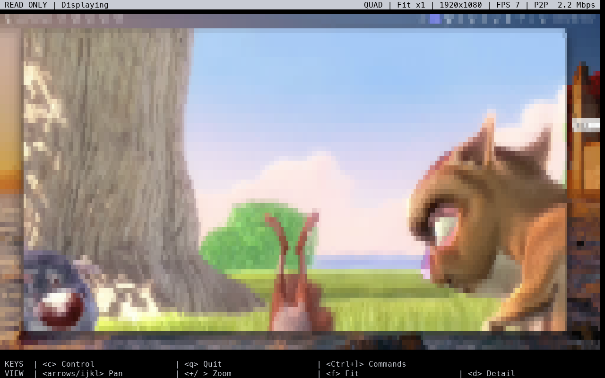
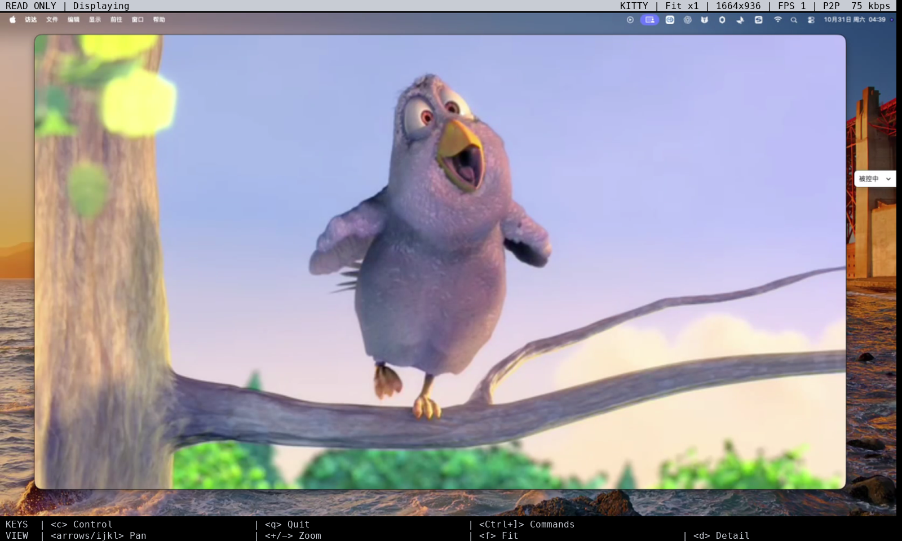

# CrossDesk CLI

CrossDesk 的终端主控客户端，源码位于本仓库的 `apps/cli`。通过真实 MiniRTC ID 会话观看远程桌面；默认只读、静音。包含 ANSI 象限字符画面、局部放大和平移、Kitty / Sixel 图形后端，以及 Pi 自定义 TUI 扩展。

## 画面预览

<table>
  <tr>
    <th width="50%">ANSI 字符画面</th>
    <th width="50%">Kitty 协议像素画面</th>
  </tr>
  <tr>
    <td></td>
    <td></td>
  </tr>
</table>

显示效果取决于终端和窗口大小。默认 `auto` 依次选择 Kitty、Sixel、ANSI；普通终端可指定 `--renderer ansi`，支持对应协议的终端可指定 `--renderer kitty` 或 `--renderer sixel`。显式像素模式需要通过能力探测；增加 Sixel 输出不代表所有 Xshell 版本均可显示图片，终端本身也必须支持该协议。ANSI 全景适合查看桌面轮廓，阅读小字需进入细节模式。

## 安装与连接

### 通过 npm 安装

需要 **Node.js 22 或以上**和 npm。统一入口为 [@chunkdash/crossdesk-cli](https://www.npmjs.com/package/@chunkdash/crossdesk-cli)，分发目标为 macOS / Linux（x64、arm64）和 Windows（x64）。安装时自动选择对应的原生程序，无需 Xmake 或 C++ 编译工具链：

```sh
npm install -g @chunkdash/crossdesk-cli@latest
crossdesk-cli doctor --json
crossdesk-cli 123456789
```

将示例 ID 替换为被控电脑的 9 位 ID，按提示隐藏输入密码。`doctor` 仅检查本机环境，不发起连接。更新到最新版时重新执行上述安装命令。

无需全局安装时，使用 `npx`，首次运行会下载对应平台包：

```sh
npx @chunkdash/crossdesk-cli@latest doctor --json
npx @chunkdash/crossdesk-cli@latest 123456789
```

请安装统一入口并保留 npm 的可选依赖，不要使用 `--omit=optional`。仅安装平台包不会注册命令。运行要求、旧包迁移及安装排障见 [安装指南](docs/npm-distribution.md)。

### 从源码构建

在 CrossDesk 仓库根目录执行以下命令构建 CLI：

```sh
./apps/cli/scripts/prepare-deps.sh
xmake f -y --CROSSDESK_BUILD_DESKTOP=n --CROSSDESK_BUILD_CLI=y --USE_CUDA=n -m release
xmake build crossdesk-cli
xmake run crossdesk-cli doctor --json
xmake run crossdesk-cli 123456789 --quality high --zoom native
```

构建后可直接运行 `build/<platform>/<arch>/release/crossdesk-cli`，也可将对应目录加入 PATH；Windows 的文件名为 `crossdesk-cli.exe`。

### 常用连接命令

以下示例适用于 npm 全局安装，或已将原生程序加入 PATH 的环境。`crossdesk-cli <设备ID> [选项]` 为默认连接方式，`view <设备ID>` 保留为兼容别名。设备 ID 是格式示例，使用时替换为你有权访问的设备，密码通过隐藏提示输入：

```sh
crossdesk-cli 123456789 --renderer kitty
crossdesk-cli 123456789 --renderer sixel --fps 8
crossdesk-cli 123456789 --renderer ansi --zoom native
crossdesk-cli 123456789 --quality balanced --fps 8
crossdesk-cli 123456789 --display 1
```

默认请求 `high` 画质（最高 1920 × 1080）和清晰度优先策略，`--display` 的索引从 `0` 开始。交互 CLI 默认本地输出目标为 30 FPS，远端供帧会随输出耗时自适应；显式 `--fps` 固定目标和相应预览请求，各帧率下均优先保持分辨率，实际画质与帧率仍取决于设备、终端与链路。更多参数见 [主 README](../../README_ZH.md#cli) 和 [终端使用指南](docs/terminal-client.md)。

## 查看、控制与退出

| 操作 | 按键 |
| --- | --- |
| 开启远端控制 | 只读模式下按 `c` |
| 缩放 | 只读或本地命令模式下用 `+` / `=` / `-` 以鼠标位置缩放；只读时也可用滚轮 |
| 回到全景 | 只读或本地命令模式下按 `f`，同时重置倍率、平移和细节模式 |
| 平移 | 只读或本地命令模式下用方向键或 `i` 上、`j` 左、`k` 下、`l` 右 |
| 原始细节 | 只读时点击目标位置，或以 `--zoom native` 启动 |
| 暂停远端输入并进入本地命令模式 | `Ctrl+]` |
| 选择返回后的控制状态 | 本地命令模式下按 `c`，再按 `Esc` / `Ctrl+C` 返回 |
| 退出连接 | 只读模式下按 `q` / `Ctrl+C`；控制模式下先按 `Ctrl+]`，再按 `q` |

缩放尽量保持鼠标下的画面内容原位；没有有效鼠标位置时沿用当前中心。底部提示随模式和窗口宽度调整，`Zoom at mouse` 表示鼠标锚点缩放，`Full view` / `Full` 表示恢复全景。

本地命令模式在缩放、平移和按 `c` 后持续保持，直到手动返回。此模式中鼠标仅更新缩放锚点，点击和滚轮不执行视图操作。控制模式中的 `Ctrl+T`、`Ctrl+C` 和普通按键均传给远端。再次按 `Ctrl+]` 也可离开本地命令模式，若返回控制模式则同时向远端发送该组合键。

## 功能范围与更多帮助

CLI 仅控制远程电脑，不提供音频播放、文件传输、剪贴板同步或 IP 直连，也不能连接开启可信设备限制的电脑。被控端需要有可用桌面，自托管服务器需支持 CLI 临时身份。

- [终端使用指南](docs/terminal-client.md)：参数、显示、输入、Pi 扩展和故障排查。
- [npm 安装与分发](docs/npm-distribution.md)：平台要求、旧版迁移、打包和发布。
- [兼容性与限制](docs/validation.md)：平台和终端的已确认范围。
- [MCP 使用指南](../mcp/README.md)：通过 Agent 操作远端并实时监看。
- [自动化接口](docs/automation-protocol.md) / [终端桥接接口](docs/bridge-protocol.md)：对接脚本、应用或自定义终端界面。
- [源码与许可信息](docs/source-provenance.md)。
