# CrossDesk 使用指南

[返回项目首页](../README.md) · [English](USER_GUIDE_EN.md)

首次使用请先查看 [下载与安装](../README.md#download)。本文介绍当前源码中的客户端操作；安装包的可用功能以对应 Release 为准。

[安装与权限](#installation) · [快速连接](#quick-start) · [IP 直连](#lan-direct) · [桌面墙](#deskhub) · [会话操作](#session) · [设置与更新](#settings) · [iOS](#ios) · [Android](#android) · [鸿蒙](#harmonyos) · [Windows 无人值守](#windows-service) · [自托管](#self-hosting)

截图使用演示设备和凭据，来源与生成方式见 [截图说明](images/README.md)。

<a id="installation"></a>

## 安装补充与系统权限

Linux 每个架构提供两个可独立安装的包，**选择其中一个**：

| 安装包 | 适用场景 |
| --- | --- |
| `crossdesk-linux-<arch>-<version>.deb`（推荐） | 已有桌面的电脑；不会额外安装 Xfce 或 Xvfb |
| `crossdesk-virtual-desktop-xfce-linux-<arch>-<version>.deb` | 需要创建独立桌面的服务器；APT 会额外安装 **Xfce、Xvfb 和 D-Bus 会话工具** |

普通版安装示例（将文件名替换为实际下载名称，arm64 选择对应架构）：

```bash
sudo apt install "./crossdesk-linux-amd64-<version>.deb"
```

如需虚拟桌面版，改为安装：

```bash
sudo apt install "./crossdesk-virtual-desktop-xfce-linux-amd64-<version>.deb"
```

两个包包含相同的完整程序，互相替换并保留用户配置；普通版自行补齐依赖后也能创建虚拟桌面。安装虚拟桌面版不会自动启动会话或切换默认桌面，启动方法见 [Linux 无头运行](HEADLESS.md)。应用更新的下载按钮会选择已安装的包类型。已有版本升级后不会自动删除先前安装的 Xfce。

**macOS 首次运行：** 按应用提示，在“系统设置 → 隐私与安全性”中授予 CrossDesk **屏幕录制**（新系统可能显示为“屏幕与系统音频录制”）及 **辅助功能**权限，再按系统提示重新打开应用。前者用于捕获桌面，后者用于远程键鼠输入。

<a id="quick-start"></a>

## 快速连接

### 通过设备 ID 从另一台电脑连接

1. **准备被控电脑。** 安装并运行 CrossDesk，切换至 ID 连接模式，等待底部显示“已连接服务器”。在左侧“本桌面”查看 **本机 ID** 和 **密码**，提供给控制端。
2. **输入对端 ID。** 在控制端右侧“远程桌面 → 对端 ID”输入被控电脑的 **9 位 ID**，点击 **连接**。
3. **完成密码验证。** 按弹窗输入被控电脑当前的连接密码，确认后等待远程画面出现。需要保存密码时勾选“记住密码”。
4. **再次连接。** 成功连接过的设备会出现在“近期连接”中，可通过卡片重连。点击卡片右上角的“…”菜单可编辑别名、修改分组或删除记录，右下角按钮用于连接 / 断开；标题右侧可按分组筛选设备。

本机密码旁的眼睛按钮用于显示 / 隐藏密码，刷新按钮用于生成新的随机密码，铅笔按钮用于手动修改。密码统一为 **6 位数字或英文字母**。修改或刷新时需保持连接服务器；等待修改成功、客户端重新连接后，再复制当前密码。已保存旧密码的控制端需重新输入。

<a id="lan-direct"></a>

### 通过局域网 IP 直连

当前 IP 直连入口用于 Windows、macOS、Linux 的普通桌面客户端。两台电脑的 IPv4 或 IPv6 地址需要可互相访问；有无外网均可，不需要等待连接信令服务器。浏览器、移动端、Windows 登录前服务及 Linux 无头控制台目前继续使用设备 ID 连接流程。

1. **启用并切换。** 两端在 **设置 → 常规 → 网络连接** 中启用 **IP 直连** 并保存（默认开启），再用主窗口左上角按钮切换到 **IP 直连模式**。
2. **获取对方地址。** 被控端在“本机 IP / 端口”查看地址，复制按钮会复制完整的 `IP:端口`。有多个地址时，选择控制端能够访问的地址。
3. **连接并验证。** 控制端在“远端 IP / 端口”输入例如 `192.168.1.20:52888` 或 `[2001:db8::20]:52888`，点击“连接”，再输入被控端此模式下的六位密码。省略端口时使用 **52888**；支持数字 IPv4 和 IPv6，不支持主机名。
4. **保存与重连。** 密码弹窗可勾选“记住密码”。近期连接按 ID / IP 模式分别显示；不勾选也会保存设备记录，下次连接需重新输入密码。可从卡片重连、修改别名或删除记录。

<p align="center">
  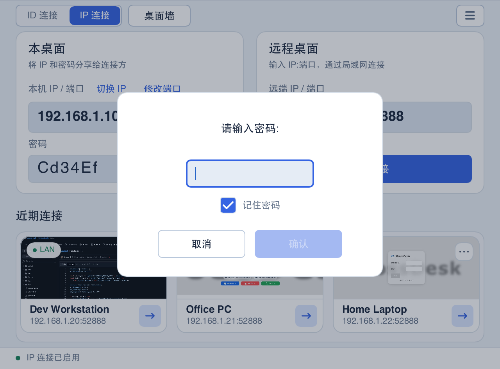
</p>

**地址和端口：** 点击“切换 IP”选择展示与分享的地址，点击“修改端口”编辑该 IP 的端口。默认所有接口共用一个端口；关闭“监听所有 IP 接口”后，程序同时监听可用物理网卡上的 IPv4 和 IPv6，每个 IP 单独保存端口。切换展示地址不会停用其他地址。首次为某个 IP 分配端口时优先使用 **52888**，被占用时自动分配并保存可用端口。已有配置的端口发生冲突时会提示，需手动修改。端口范围为 **1–65535**，修改失败会保留原设置；连接方需要使用界面显示的实际端口。局域网防火墙需允许 CrossDesk 的 TCP 协商连接和 UDP 远控流量。

**所有接口监听：** 在 **设置 → 常规 → 网络连接** 中开启“监听所有 IP 接口”并保存，即可让有线、Wi-Fi、VPN 和虚拟网卡的 IPv4/IPv6 共用一个 TCP 协商端口。此选项默认开启，已有的显式关闭设置会保留；修改后点击“保存”生效，点击“取消”不改变监听，重启仍沿用已保存设置；关闭后恢复原来各物理网卡 IP 的端口。该模式下修改任一展示地址的端口，会修改所有接口共用的端口。“切换 IP”和复制仍使用本机实际地址，不能把 `0.0.0.0` 或 `::` 作为远端地址。新接口自动使用共同端口；VPN 两端仍须允许 TCP 和 UDP 互通。不支持回环远控或自动公网 NAT 穿透。切换监听范围会取消未完成认证的连接；已认证连接保留。若端口被占用或设置无法保存，切换失败并尝试恢复原监听，恢复失败的端口会显示错误并持续重试。

**IPv6 地址：** 可以输入裸 IPv6 使用默认端口，例如 `2001:db8::20`；指定端口时使用方括号，例如 `[2001:db8::20]:52888`。支持全局、ULA 和链路本地单播地址。链路本地地址须带连接端自己的网卡作用域，例如 `[fe80::1234%14]:52888`（也可使用系统支持的网卡名，如 `%en0`）。复制的地址带有被控端作用域，控制端连接时需换成控制端用于访问该链路的网卡编号或名称，两端编号不一定相同。程序仍使用实际地址执行 TCP 认证与 UDP 媒体协商；IPv4 客户端可以继续连接新版。操作系统不支持 IPv6 时，所有接口监听自动退回 IPv4；升级保留原有共享端口与开关状态。

**密码：** IP 直连使用独立的 **6 位英文字母或数字密码，区分大小写**。没有设置时自动生成，眼睛、刷新和铅笔按钮分别用于显示 / 隐藏、随机生成和自定义；修改成功后即时生效，无需重启或连接服务器。已保存旧密码的控制端需要重新输入。

**模式和开关：** 模式切换会保存，下次启动沿用。切回 ID 模式仅切换连接入口和近期记录，IP 监听仍然运行。需要停止 IP 直连时，在设置中取消“启用 IP 直连”并保存：程序会断开现有 IP 直连会话、释放监听端口、回到 ID 模式并隐藏模式按钮；原有 ID 会话继续运行，IP 密码、端口及近期记录保留。重新启用后沿用这些设置。

### 从浏览器连接

1. 保持被控电脑上的 CrossDesk 运行，并确认已连接服务器。
2. 打开 [Web 客户端](https://web.crossdesk.cn/)，输入 **远程设备 ID** 和 **密码**，点击“连接”。
3. 连接后使用页面提供的显示器、鼠标模式和键盘控件操作远端；手机和平板也可通过浏览器访问。

如果使用自建服务器，需要让控制端与被控端接入同一服务；Web 部署配置见 [CrossDesk Web Client](https://github.com/kunkundi/crossdesk-web-client)。

<p align="center">
  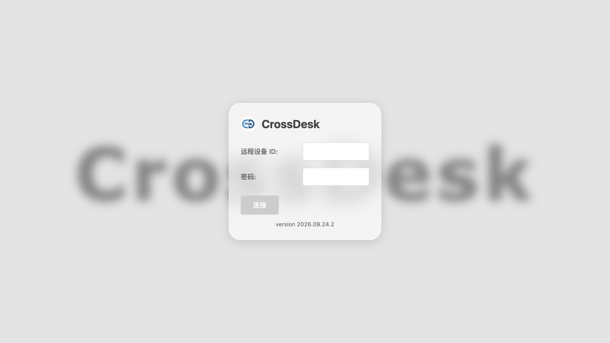
</p>

<a id="deskhub"></a>

## 桌面墙：集中查看与操控多台设备

点击主窗口左上角 **桌面墙**，打开独立窗口；连接窗口仍可用于普通远程连接和全局设置。桌面墙会保存设备成员、分组、排序与窗口布局，重启后需要手动连接设备。

1. **添加设备。** 点击 **添加 → 通过设备 ID 添加**，填写 ID、密码及可选分组，点击“添加并连接”；只有勾选“记住密码”才保存凭据。也可选择 **从近期连接添加**，多选已有记录并导入；导入后用“选择 → 连接”发起连接。
2. **查看与整理。** 从“全部设备”切换到指定分组；拖动网格分隔线统一调整画面大小，拖动设备到另一台设备上交换位置。精简模式隐藏名称和管理工具栏，全屏用于扩大查看区域；翻页保留连接。
3. **放大与操控。** 点击设备画面进入只读放大视图，上方缩略图可切换设备，拖动中间分隔条可调整上下区域。点击 **接管操控** 后才发送键鼠；点击“释放操控”或按 **Ctrl / ⌘ + Shift + Esc** 释放。切换设备或窗口失焦也会释放操控。
4. **批量操作。** 点击 **选择**，勾选设备或“全选”，执行连接、断开，或从“更多”中静音 / 取消静音、分发文件。“全选”覆盖当前分组的全部分页；切换分组会清空选择。

<p align="center">
  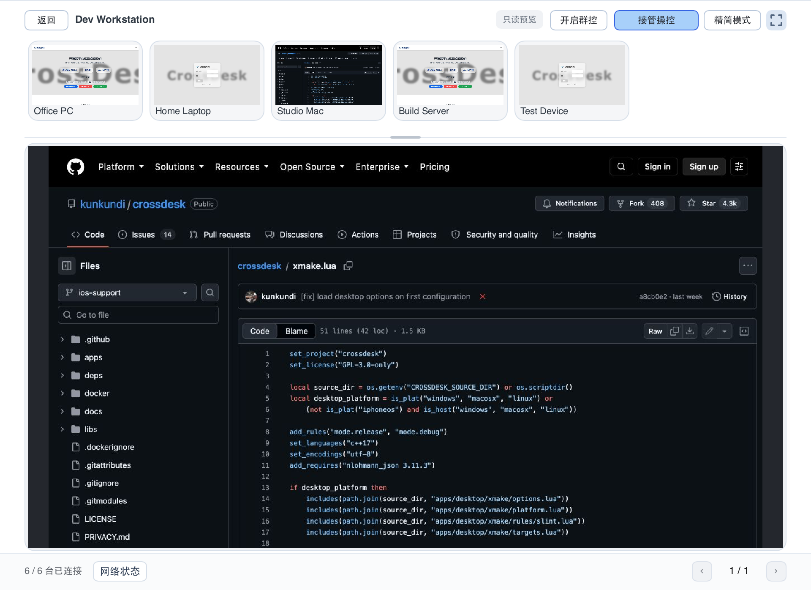
</p>

**群控：** 在放大视图点击“开启群控”，将当前设备的键鼠操作同步到 **所有已连接设备**，包含其他分组、分页及未显示在墙内的连接；范围不受批量勾选限制。各设备接收相同坐标与按键，屏幕尺寸不同时不会另做比例适配。释放操控会同时结束群控。

桌面墙连接默认静音，需要声音时通过“选择 → 更多 → 取消静音”开启。底部 **网络状态** 可查看所有已连接设备的直连 / 中继、加密状态、收发速率、视频延时、丢包率、分辨率与帧率。需要显示器切换、隐私屏等完整单会话工具时，可在主窗口“近期连接”中点击已连接设备，打开独立会话窗口。

**关闭桌面墙会断开全部远程设备连接，并关闭共用连接的独立会话窗口；最小化不会断开。** 分组、分页和选择范围不会限制关闭时的断开范围。更多操作、预览策略与版本兼容性见 [桌面墙说明](deskhub.md)。

<a id="session"></a>

## 会话中的常用操作

远程窗口通过会话标签切换设备，控制栏提供以下操作；控制栏收起时先点击展开按钮。将鼠标悬停在图标上可查看提示。

| 入口 | 用途 |
| --- | --- |
| 显示器 | 切换远端显示器 |
| 键盘 | 发送组合键；Windows 的 `Ctrl+Alt+Del` 依赖远端服务 |
| 鼠标 | 控制 / 释放远端鼠标 |
| 扬声器 | 播放声音 / 静音 |
| 文件夹 | 打开双栏文件浏览窗口，浏览本机和远端目录，双向传输文件与文件夹 |
| 画面设置 | 在当前会话中调整画面质量、采集帧率、受支持的远端分辨率与画面偏好 |
| 网络状态 | 查看流量、丢包率、帧率、分辨率、直连 / 中继、加密状态，以及被控端编码器和控制端解码器 |
| 隐私屏 | 开启或关闭被控电脑的隐私屏；悬停查看当前状态与可用操作 |
| 全屏 | 进入 / 退出全屏 |
| 断开连接 | 结束当前远程会话 |

桌面端可同步文本剪贴板。接收文件的位置可在“设置 → 常规 → 文件保存路径”调整。关闭主窗口会隐藏窗口并保持程序运行；需要完全退出时使用系统托盘或菜单栏中的退出入口。

Windows 任务栏将主窗口与远程控制窗口显示为两个独立图标，可分别切换和最小化。关闭主窗口后，远程控制窗口及其连接继续保留；需要主窗口时从系统托盘重新打开。远程控制窗口的任务栏图标仅在会话窗口存在时显示，固定应用请使用主窗口的图标。

Linux 的主窗口与远程控制窗口使用不同的应用分组标识，支持 X11、XWayland 和原生 Wayland；实际任务栏显示方式由桌面环境及分组设置决定。关闭主窗口不影响远控连接，可从系统托盘重新打开主窗口。固定应用请使用主窗口的启动器。

macOS 保留一个 CrossDesk Dock 应用图标，主窗口与远程控制窗口可独立切换和最小化，不会自动合并为系统窗口标签页。关闭主窗口后，只要还有可见或已最小化的窗口，Dock 图标就会保留，远控连接继续运行；所有窗口关闭后，应用保留在菜单栏中。可从菜单栏重新打开主窗口。

桌面端普通会话、桌面墙和移动端（Android、iOS、鸿蒙）的网络状态均显示“被控端编码器”和“控制端解码器”，使用实际的视频编解码器名称，包括回退后的软件编解码器。名称保持单行，超出可用宽度时自动横向滚动，完整显示时保持静止。名称统一采用“实现名称 (编码格式)”，名称首字母大写、技术缩写保留全大写，例如 `VideoToolbox (H.264)`、`NVENC (H.264)`、`NVDEC (H.264)`、`SVT-AV1 (AV1)`、`Dav1d (AV1)` 和 `LibAOM (AV1)`；Media Foundation 额外标注 `HW`（硬件）或 `SW`（软件）。被控端需要支持编码器状态上报；旧版本或尚未获取到的信息显示“—”。

### 浏览目录与传输文件

点击会话工具栏中的文件夹按钮，同时查看本机和远端文件列表。可输入路径、返回上级目录、按名称筛选、选择多个文件或文件夹，再点击 **发送到远端** / **发送到本机**，也可在两栏之间拖放。目标目录需已存在，同名文件按冲突命名规则另存；远端目录浏览需要兼容的被控端。

底部任务列表显示传输状态和进度，支持取消未完成任务与清除已完成记录。图中的路径、文件名和完成状态均为演示数据。

<p align="center">
  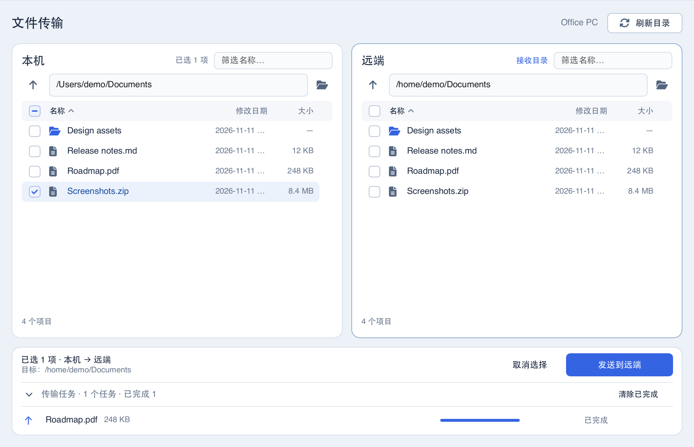
</p>

### 在会话中调整画面

连接成功后，点击工具栏中的 **画面设置**（滑杆图标），直接选择低 / 中 / 高画质、**30 / 60 fps**，以及帧率优先 / 画质优先 / 平衡。选项会发送给当前被控端，无需断开重连；实际画面效果取决于网络、设备与编码器能力。旧版被控端不支持时，菜单会提示并禁用选项。

被控端为 Windows、macOS 或 Linux X11 时，还可在 **画面设置 → 分辨率** 中选择当前显示器支持的桌面分辨率。调整无需重连，最后一个控制端断开后会恢复连接期间首次调整前的显示模式。Linux 需要使用 X11 采集及支持 RandR 的显示服务器；Wayland、XWayland 和使用自定义缩放或平移的显示配置暂不支持。可选分辨率由显示器或虚拟显示服务器提供，仅提供一个模式的虚拟屏不会额外生成模式。

<p align="center">
  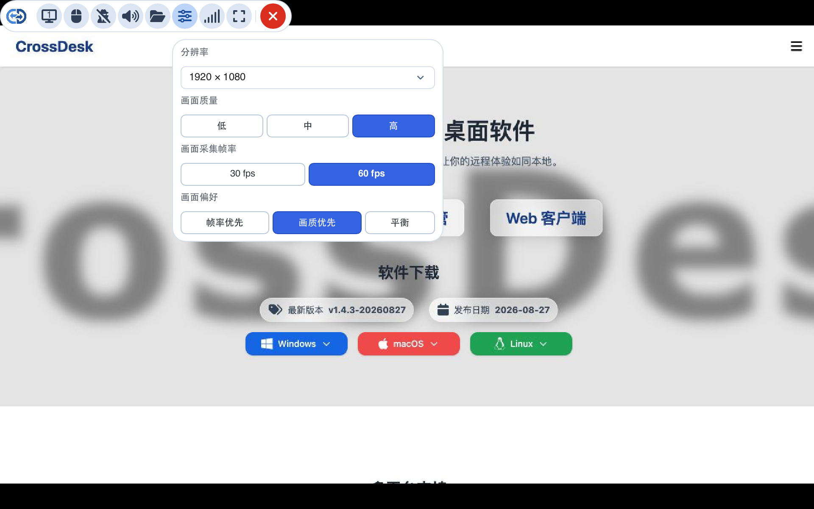
</p>

桌面和原生移动端会按远端设备及显示器记住已确认成功的分辨率。再次连接时，若该显示器仍支持保存的模式，会重新请求应用；被控端在最后一个控制端断开时恢复原显示模式的行为不变。

<a id="settings"></a>

## 客户端设置与更新

点击主窗口右上角 **☰ → 设置**，顶部切换 **常规 / 桌面墙**，修改后点击 **保存**。切换选项卡会保留未保存的修改，点击“取消”放弃修改。“常规”按界面、视频、网络连接等类别组织选项，可向下滚动查看其余设置。编码与连接选项建议在建立连接前调整；会话进行中部分选项不可修改。普通会话的画质、帧率和画面偏好在远程会话工具栏中调整。

<p align="center">
  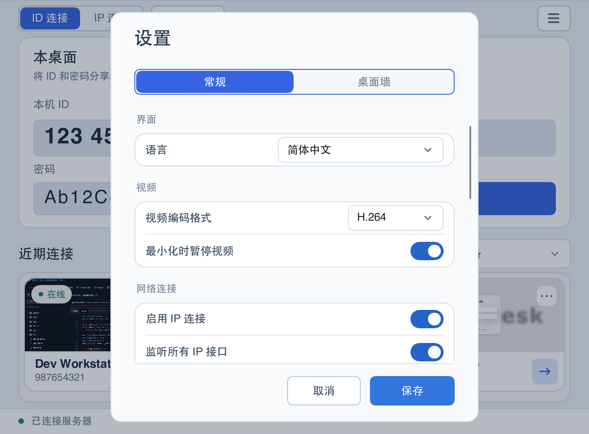
</p>

| 设置 | 说明 |
| --- | --- |
| 语言 | 默认跟随系统，也可手动选择简体中文、繁体中文、英语、俄语、日语、韩语、德语、法语、西班牙语或巴西葡萄牙语，见 [本地化说明](../localization/README.md) |
| 视频编码格式 | H.264 / AV1；H.264 自动优先使用硬件编解码，不可用或初始化失败时回退到软件；桌面端 AV1 使用软件编解码 |
| 启用 IP 直连 | 默认开启；保存后即时启停 IP 直连。关闭会断开 IP 会话、停止监听并隐藏主窗口模式按钮，重启后保持 |
| 强制中继连接 | 关闭时自动选择连接方式，允许 P2P 和 TURN 中继回退；开启时仅通过中继连接 |
| 保存远程画面预览 | 默认开启，保存远程画面预览；关闭后缩略图区域显示被控端平台，并清除已有预览，保留连接记录和密码 |
| 被连接时开启隐私屏 | 设置本机被远程连接时是否自动启用隐私屏；会话中可从控制端工具栏切换 |
| 自托管配置 | 点击“编辑”填写服务器地址和信令服务端口，使用右侧开关启用 |
| 开机自启 | Windows 安装版 Release：使用现有 ID、密码在登录前提供远控；用户登录后 GUI 自动启动并接入后台服务，恢复完整功能。Windows 便携版和 Debug 不支持此开关。其他桌面平台保存后设置登录桌面时自动启动 |
| 启用守护进程 | Windows / macOS / Linux 桌面模式保存后立即启用或停用异常退出后的自动重启，无需重启程序；正常退出或注销不会重新拉起，无头控制台模式不启用内置守护 |
| 文件保存路径 | 选择接收文件的目录 |

网络连接分组中的 IP 直连开关独立于 ID 连接使用的中继设置：

<p align="center">
  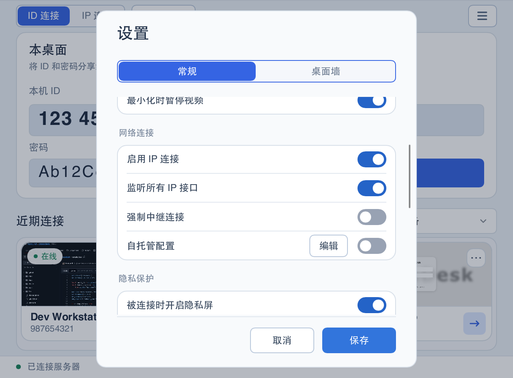
</p>

### 起始带宽与探测配置

退出客户端后，编辑缓存目录中 `config.ini` 的 `[Settings]` 节，重启后生效：

```ini
[Settings]
direct_start_bitrate_bps = 1500000
relay_start_bitrate_bps = 500000
disable_receiver_padding_probing = true
```

两个值的单位均为 bps，分别控制本机原生媒体发送端在 P2P / IP 直连和 TURN 中继路径上的拥塞控制起始估计。桌面端默认值为 1.5 Mbps 和 0.5 Mbps，允许范围为 300000–20000000；缺失或非法值使用对应默认值，启动时补写到配置文件。连接后仍按网络反馈动态调整，桌面墙带宽预算继续生效。观看远程画面时，应修改发送画面的被控端配置。浏览器连接使用独立的带宽控制，不受这两个选项影响。

该文件在 macOS / Linux 上默认位于 `~/.cache/CrossDesk/`（设置 `XDG_CACHE_HOME` 时使用该目录下的 `CrossDesk/`）；Windows 安装版 Release 位于 `%LOCALAPPDATA%\CrossDesk\cache\`，Windows Debug 使用工作目录下的 `cache/`，便携版使用可执行文件旁的 `data/`。

Windows 已配置后台主机时，以 `%ProgramData%\CrossDeskUnattended\shared-identity.json` 的 `host_config` 中保存的 INI 配置为准。管理员须在 GUI 与后台服务均停止时修改其中这些配置项，再重启服务和 GUI；单独修改用户缓存或 `host/config.ini` 会在启动时被共享配置覆盖。

桌面端的 `disable_receiver_padding_probing` 默认为 `true`，禁止尚未发送过本地视频的连接发送填充探测包；设为 `false` 可恢复接收端填充探测。开始发送本地视频后仍保留正常探测和静态画面时的带宽恢复。缺失或非法值使用默认值，已有显式配置保持不变。该选项适用于原生直连和中继，配置位置及重启要求同上；Windows 后台主机共享配置也包含此项。MiniRTC API 零初始化仍默认为 `false`，桌面端会显式传入此配置。

### 桌面墙画面传输

在 **设置 → 桌面墙** 中统一配置墙内设备，保存后立即应用到当前桌面墙会话，并用于后续连接；普通连接不受影响。

| 设置 | 说明 |
| --- | --- |
| 分辨率上限 | 自动、320 × 180、640 × 360、1280 × 720、1920 × 1080、2560 × 1440、3840 × 2160 或原始分辨率；自动模式按网格 / 放大视图调整，固定上限保持比例且不放大源画面 |
| 帧率 | 跟随设备设置，或指定 15 / 30 / 60 FPS |
| 视频总带宽 | 默认 20 Mbps，可选 2 / 5 / 10 / 20 / 50 / 100 Mbps；由支持该能力的桌面墙会话共享，放大画面优先分配，不包含音频、文件传输与普通连接，也不是瞬时流量的硬上限 |

<p align="center">
  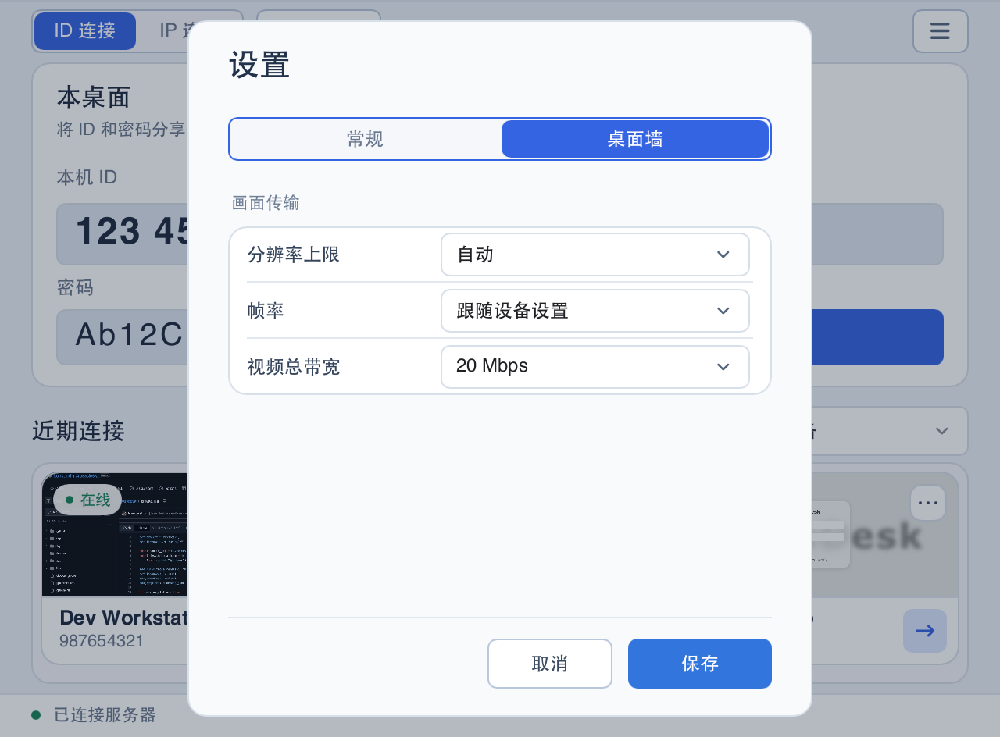
</p>

支持预览订阅的设备在不可见时可暂停视频传输，重新可见时恢复；旧版被控端按其能力回退，不保证所有分辨率、帧率或带宽选项都生效。

### 检查更新

客户端启动后会在后台检查版本，发现新版本时自动弹出更新提示，可查看更新说明并前往下载页面。关闭提示后，本次运行中的后台检查不会再次弹窗，主窗口菜单入口仍会显示更新提示；重新启动客户端后，如仍有新版本则再次提示。打开 **☰ → 关于** 可查看版本；有新版本时，点击版本信息下方的 **更新日志** 可再次打开更新提示，也可点击 **检查更新** 手动检查。

<p align="center">
  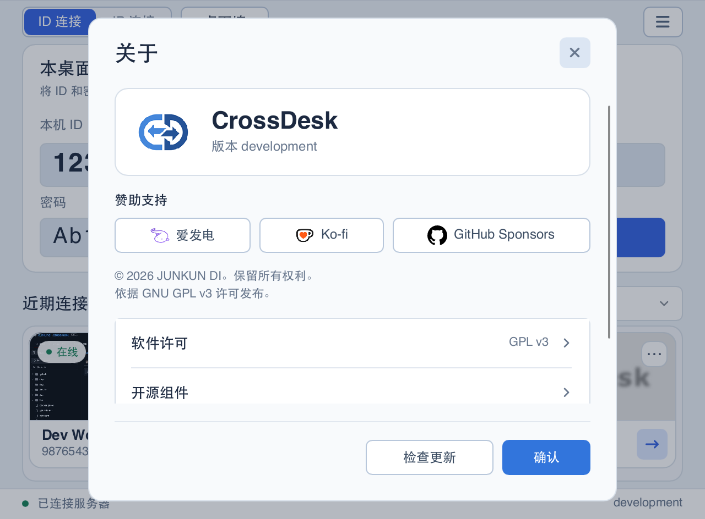
</p>

<a id="feedback"></a>

### 反馈与诊断日志

打开主窗口 **☰ → 反馈与建议**，点击 **前往 GitHub 反馈** 提交问题或建议；点击 **导出诊断日志** 可将 CrossDesk、MiniRTC 日志及基本版本信息保存为 ZIP 文件。导出成功后界面显示保存位置，可在问题中附上日志包，并说明两端系统、版本、连接方式及复现步骤。

<p align="center">
  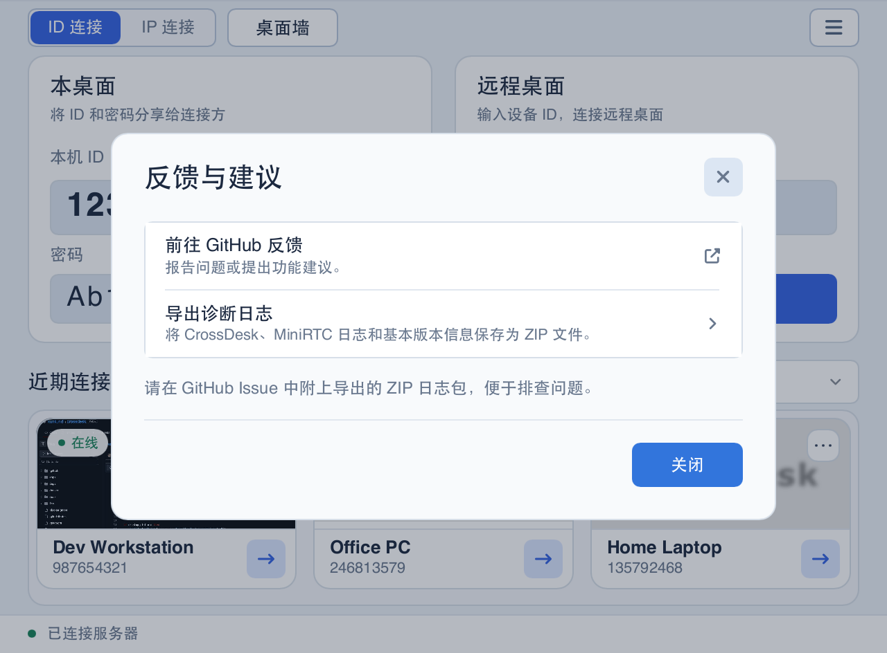
</p>

<a id="ios"></a>

## 原生 iOS / iPadOS 客户端

仓库的 [`apps/ios`](../apps/ios/README.md) 提供原生控制端，与桌面端使用同一套 MiniRTC 协议。它可以控制远端电脑；当前不提供将 iPhone / iPad 作为被控桌面的功能。

1. 从 [App Store](https://apps.apple.com/app/id6828859211) 安装，具体系统要求以商店页面为准；也可按 [iOS 开发说明](../apps/ios/README.md) 使用 Xcode 构建并签名，当前源码目标为 iOS 16+。
2. 在首页输入对端 ID，点击连接并填写密码；成功连接后可从“最近连接”中重连。
3. 在设置中选择鼠标模式：**相对位置**像触控板一样移动光标，**绝对位置**将触摸位置直接映射到远端画面。
4. 点击悬浮图标展开菜单，可切换显示器、显示键盘、控制声音或发送文件。收到的文件位于应用的 `Documents/Received`，可通过传输状态旁的分享按钮导出。

支持接收远端文本到 iOS 剪贴板；点击悬浮菜单中的 **剪贴板** 可发送本机文本到远端。单次文本上限为 **128 KiB**；空文本或超出限制时会显示提示。

当前支持单指点击、双指右键、长按拖动与捏合缩放；缩放后的双指平移用于移动视图。原生端与浏览器端分别维护，使用入口和手势可能不同。

<a id="android"></a>

## 原生 Android 控制端

Android 客户端支持 Android 8.0+ 的 arm64 手机和平板，可从 [官网](https://www.crossdesk.cn/) 或 [GitHub Releases](https://github.com/kunkundi/crossdesk/releases) 下载已签名 APK 安装。自行构建见 [Android 开发说明](../apps/android/README.md)。

1. 在电脑上运行 CrossDesk，在手机首页输入电脑端的设备 ID，连接后填写密码。
2. 在设置中选择相对鼠标（触控板）或绝对位置模式。支持长按右键、双指滚动、捏合缩放，以及外接键盘和鼠标。
3. 展开悬浮菜单，可切换显示器、调节画质与帧率、使用虚拟鼠标、收发文件、查看网络状态，以及发送剪贴板文本。接收的文件可通过保存入口导出。
4. 切换应用时，已有会话优先通过系统画中画保持；画中画不可用时尝试使用带通知的前台服务。关闭画中画窗口或后台保活未能启动会结束会话。

H.264 / AV1 优先使用 MediaCodec 硬件解码；设备不支持或运行失败时回退到对应软件解码器。实际效果取决于设备能力。Android 当前不提供手机被控功能。悬浮菜单中的“隐私屏”按钮可直接开启或关闭电脑本地遮罩，按钮按电脑确认的状态显示“隐私屏已开启”或“隐私屏已关闭”，开启与关闭使用相同配色，正常切换不显示额外文字，仅在异常时显示提示；开启时与桌面端一致屏蔽电脑本地键鼠。

<a id="harmonyos"></a>

## 鸿蒙（HarmonyOS）支持

CrossDesk 已支持鸿蒙 PC、手机和平板，PC 与移动端分别构建 HAP，应用名称统一为 **CrossDesk**，包名统一为 `com.chunkdash.crossdesk`。

| 客户端 | 系统与架构 | 功能 |
| --- | --- | --- |
| 鸿蒙 PC（`2in1`） | API 26，arm64 | 可作为控制端和被控端，复用公共 Slint 桌面界面、会话管理、桌面墙与文件传输 |
| 鸿蒙手机 / 平板 | API 20+，arm64 | 原生 ArkUI 控制端，支持远端画面与声音、触控和外接键鼠、多屏切换、文本剪贴板及双向文件传输 |

鸿蒙 PC、移动端与其他 PC 平台共用文件传输核心。移动端通过系统文件选择器发送和导出文件，PC 可在设置中选择接收目录。

当前为开发版，需按 [鸿蒙构建说明](../apps/harmony/README.md) 使用 DevEco 构建并签名后安装。PC 录屏和输入控制需获得相应系统授权，真机与长期会话验收仍在进行；具体权限、平台差异及验证范围见 [PC 说明](../apps/harmony/desktop-port/README.md) 与 [移动端功能说明](../apps/harmony/MOBILE_PARITY.md)。

<a id="windows-service"></a>

## Windows 锁屏与登录界面

Windows 的屏幕采集统一按 **DXGI → WGC → GDI** 自动回退，适用于实体屏、虚拟屏、无头启动、登录/安全桌面及管道兜底采集。设置页不再提供手动选择，旧的强制采集配置会在加载时清理。后端不可用时才继续尝试下一项；重连及解锁恢复重新按此顺序选择，运行中失效则沿序列继续回退。

**CrossDesk Service**（服务名 `CrossDeskService`）提供锁屏、登录、凭据输入及安全桌面的状态上报、`Ctrl+Alt+Del` 发送和键鼠输入转发。

安装版默认注册按需启动的服务，客户端启动时尝试启动它；未启用无人值守时，本机没有 CrossDesk 客户端进程后服务会自动退出。便携版可在提示窗口或“设置 → 锁屏控制服务”中安装服务，需要管理员权限。

Windows 安装版 Release 的“开机自启”使用无人值守服务：将 `CrossDeskService` 设为系统自动启动，并为启用此选项的用户注册登录后的 GUI 启动任务。后台持续独占本机身份和远控连接，GUI 通过经过身份验证的本机管道接入用户功能。关闭后移除开机与登录自动启动，将服务恢复为按需启动；手动打开 GUI 时仍由后台提供远控连接。“启用守护进程”只控制普通 GUI 的崩溃恢复。便携版和 Debug 不支持此开关。

首次开启时，先让普通客户端联网获得本机 ID。程序会保留当前 ID、密码、设备身份密钥和可信设备记录，并将它们同步到仅管理员和 SYSTEM 可访问的机器配置；原有用户配置保留。旧 Run 启动项会被登录启动任务替代，不再产生另一套无人值守 ID。已经使用旧版独立无人值守身份的安装，在新版中完成迁移后改用普通客户端现有身份。

<a id="windows-service-development-update"></a>

### 使用开发构建更新服务

直接运行新编译的客户端只会尝试启动已经注册的服务，不会修改服务的程序路径，也不会重启正在运行的旧服务。若电脑键盘可用，但系统输入法在记事本与锁屏中均不可用，且日志显示 `Secure desktop text injection failed: error=unknown_command`，请先更新服务程序及其注册路径。

在包含新版 `CrossDesk.exe`、`crossdesk_service.exe` 和 `crossdesk_session_helper.exe` 的完整构建目录中打开**管理员 PowerShell**，执行：

```powershell
$crossdeskExe = (Resolve-Path .\CrossDesk.exe).Path;
foreach ($serviceAction in '--service-stop', '--service-install', '--service-start') {
    $serviceProcess = Start-Process -FilePath $crossdeskExe -ArgumentList $serviceAction -Wait -PassThru;
    if ($serviceProcess.ExitCode -ne 0) {
        throw "$serviceAction failed: $($serviceProcess.ExitCode)"
    }
}
```

服务重启期间远控可能短暂中断。完成后重新连接，分别测试普通桌面和锁屏输入。服务将使用该构建目录中的程序，请保留该目录；恢复使用安装版时，重新安装完整安装包以恢复对应的服务注册。

若已启用“开机自启”，切换构建目录后还需用新版客户端保存一次该设置，或在普通客户端退出后执行新版的 `--unattended-enable`，以更新登录后的 GUI 启动任务。单独修复服务不会更新这个任务的程序路径。

### 开机后尚未登录时远控

在“设置 → 开机自启”中开启并保存，主界面的本机 ID 和密码可以在登录前后通用，无需另记一套连接信息。也可以在完整安装目录中打开**管理员 PowerShell**启用同一功能；首次使用 CLI 启用前，先关闭普通客户端，或直接使用运行中客户端的设置开关：

```powershell
.\CrossDesk.exe --unattended-enable
# 查看共享的设备 ID、密码、online 状态及当前托管方 mode
.\CrossDesk.exe --unattended-status
```

使用原有 `device_id` 和 `password` 从另一台设备连接。密码变更（包括尚未确认的变更记录）、设备身份密钥和可信设备记录会在两种托管模式之间同步。后续重新启用会复用共享身份，不会生成新 ID。自建服务器的根证书需要安装到本地计算机的信任存储中。

启用后，`CrossDeskService` 随系统启动，无需 Windows 自动登录，也不需要保存 Windows 登录密码。服务以 SYSTEM 身份在控制台会话中启动无界面的被控进程，持续负责网络连接、抓屏、键鼠及 `Ctrl+Alt+Del`。GUI 等待用户桌面解锁后附加到后台，不再重新登录信令服务器，也不因 GUI 启动或退出而替换正在进行的远控连接。登录过程中保留同一条连接；退出或重启 GUI 时，后台仍可继续传送画面和处理键鼠。注销、切换 Windows 会话或重启服务仍需重建后台进程；网络中断也可能导致断线。启动时网络尚未就绪会继续重试。

登录前提供画面、键鼠、多屏切换和安全桌面控制。登录界面支持由原生控制端独立绘制光标；采集期间暂时隐藏本机系统光标，停止采集、采集进程退出或连接保活超时后自动恢复。网页控制端仍使用视频内光标。启用自动隐私模式时，后台会在恢复虚拟屏桌面采集前接续光标控制，GUI 随后复用该状态，避免初始化期间短暂出现视频内鼠标；手动关闭隐私遮罩仍会恢复本机光标。GUI 附加后，声音、文件传输、剪贴板和隐私遮罩由登录用户进程处理，通过本机通道复用后台的连接；文件操作不会以 SYSTEM 身份执行。GUI 的主动远控和局域网直连仍使用原有实现。密码、共享设置和可信设备记录由后台统一保存并同步给 GUI。GUI 退出时用户功能暂时不可用，重新打开后恢复。便携版和 Debug 不能启用此模式。共享身份位于 `%ProgramData%\CrossDeskUnattended`，只允许 SYSTEM 和管理员访问；GUI 与 SYSTEM 各自的运行缓存仍保持用户私有权限，日志位于机器目录的 `logs` 子目录。

无实体显示器或切换器未提供显示器信息时，无人值守端会在接受连接前尝试准备虚拟显示器，优先恢复此前记录的显示器分辨率（包括 3840×2160）；没有有效记录时才使用 1920×1080。记录在启用开机自启、初始化抓屏、开始连接和采集期间更新，普通权限启动也能保存到当前用户配置。CrossDesk 自己的虚拟屏、RDP、切换器失去有效显示目标后的临时模式，以及实体屏与虚拟屏共存时的临时复制模式不会覆盖记录。虚拟分辨率只临时应用，不写入 Windows 的持久显示配置；实体显示器稳定接入后，会释放本次创建的虚拟屏并切回实体屏，保持远程视频流编号不变。若驱动初始化失败，程序会记录原因并继续使用 Windows 提供的显示模式。

```powershell
# 停止无人值守被控端，并恢复服务按需启动
.\CrossDesk.exe --unattended-disable
```

关闭设置中的“开机自启”等同于禁用无人值守模式；CLI 的启停结果也会反映在该开关中。禁用或卸载服务会取消无人值守启动，但保留受保护的机器配置；若需彻底清除凭据，在服务停止后由管理员删除该目录。

<details>
<summary>手动部署与服务管理命令</summary>

保留完整安装目录；自行部署构建产物时，将 `CrossDesk.exe`、`crossdesk_service.exe`、`crossdesk_session_helper.exe` 及同次构建输出的全部 `.dll` 放在同一目录。在该目录打开管理员 PowerShell，按需执行：

```powershell
.\CrossDesk.exe --service-install
.\CrossDesk.exe --service-start
.\CrossDesk.exe --service-status
.\CrossDesk.exe --service-ping
# 停止或卸载服务
.\CrossDesk.exe --service-stop
.\CrossDesk.exe --service-uninstall
```

</details>

出现“远端 Windows 服务不可用”时，检查被控电脑的安装和服务状态；普通桌面连接仍可使用，受保护界面的控制能力会受限。

<a id="self-hosting"></a>

## 自托管服务器

可自行部署信令服务与 TURN 中继，并在桌面客户端 **☰ → 设置 → 常规 → 自托管配置** 中填写连接信息。控制端与被控端都需要启用同一套配置。

- [自托管指南](SELF_HOSTING.md)：当前 Compose 部署入口、客户端设置、证书信任与排查。
- [CrossDesk Server](https://github.com/kunkundi/crossdesk-server)：服务端源码与发布配置。
- [CrossDesk Web Client](https://github.com/kunkundi/crossdesk-web-client)：浏览器端源码与自托管说明。

<p align="center">
  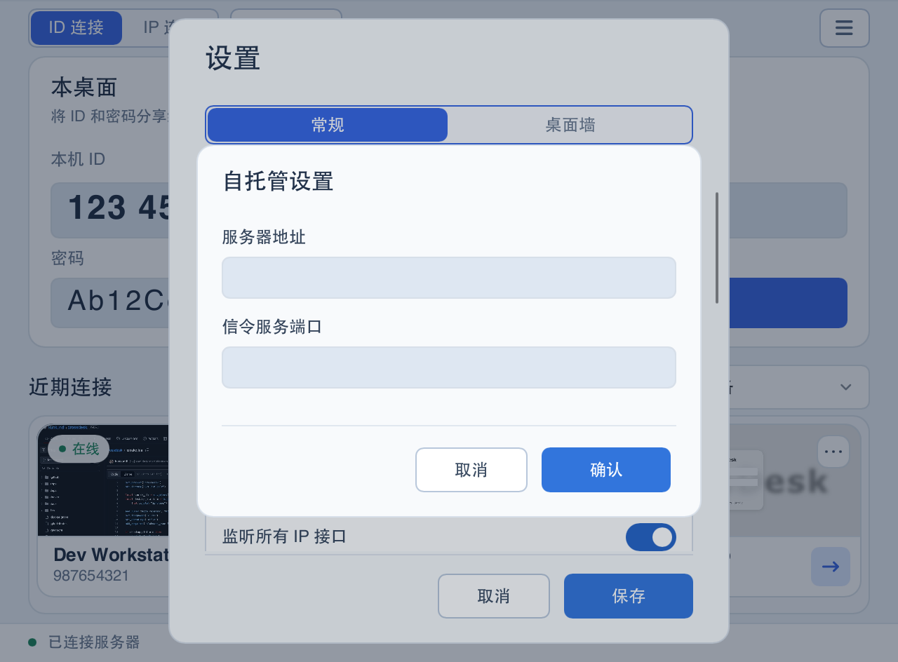
</p>
