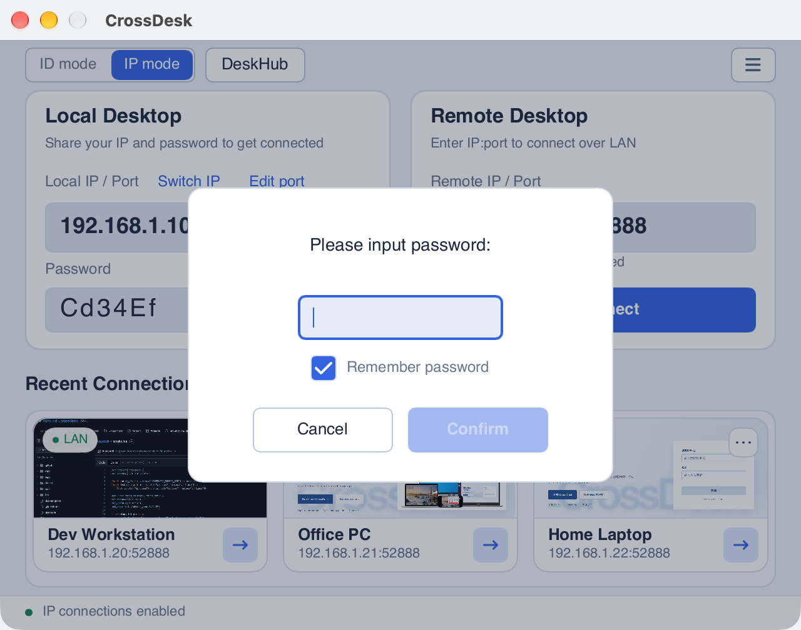
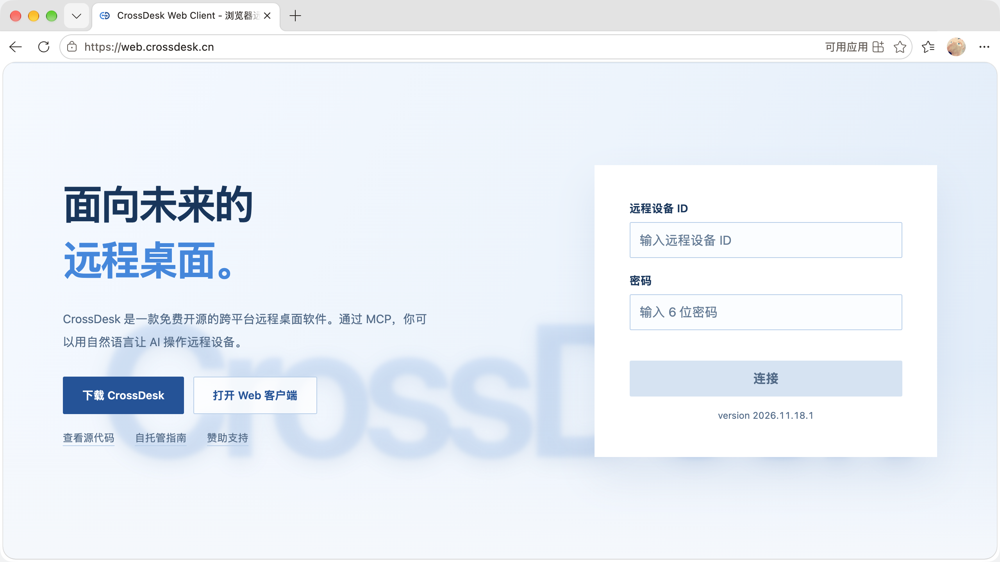
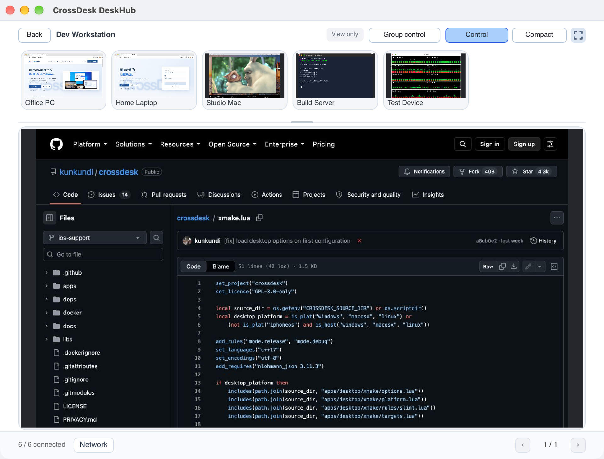
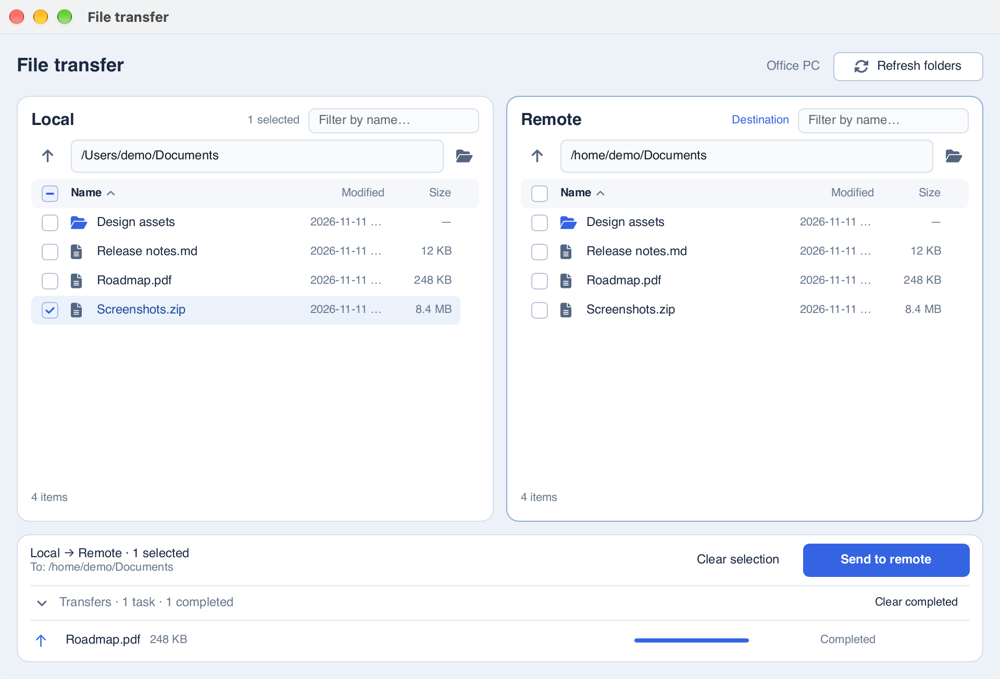
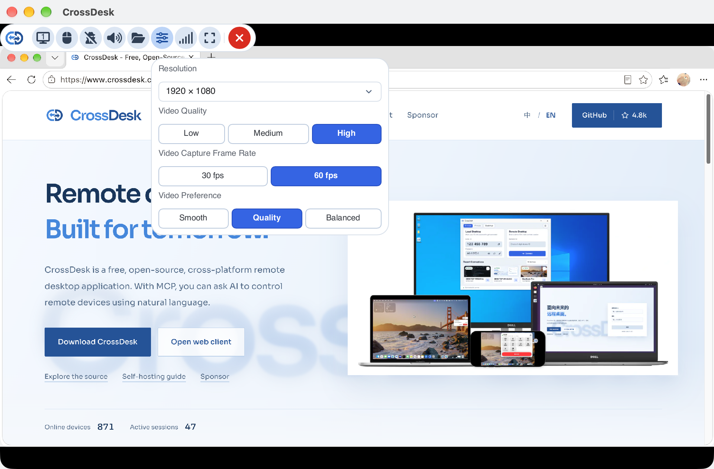
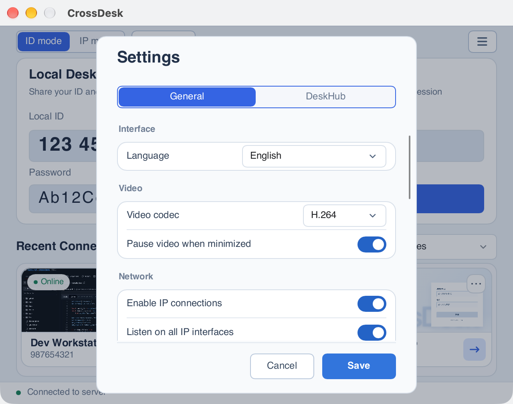
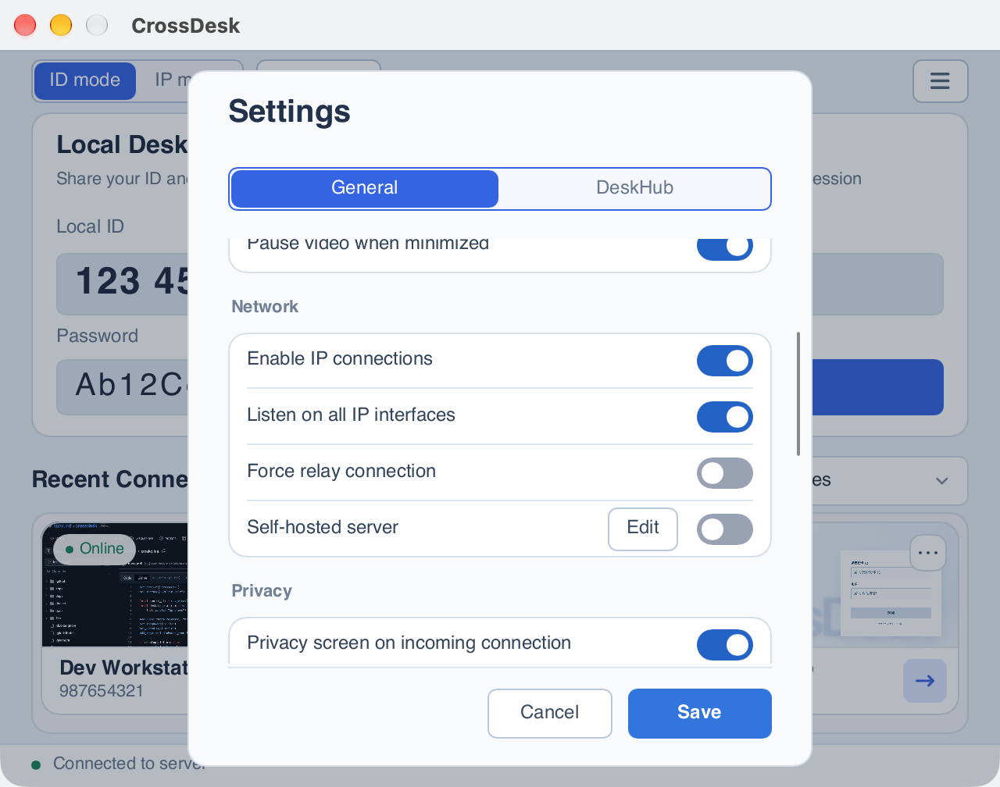
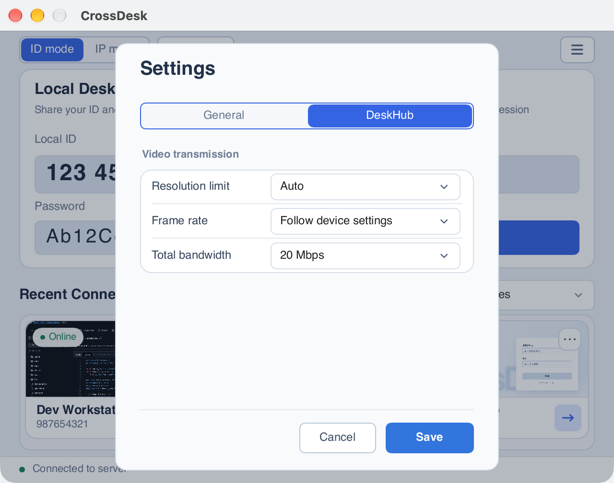
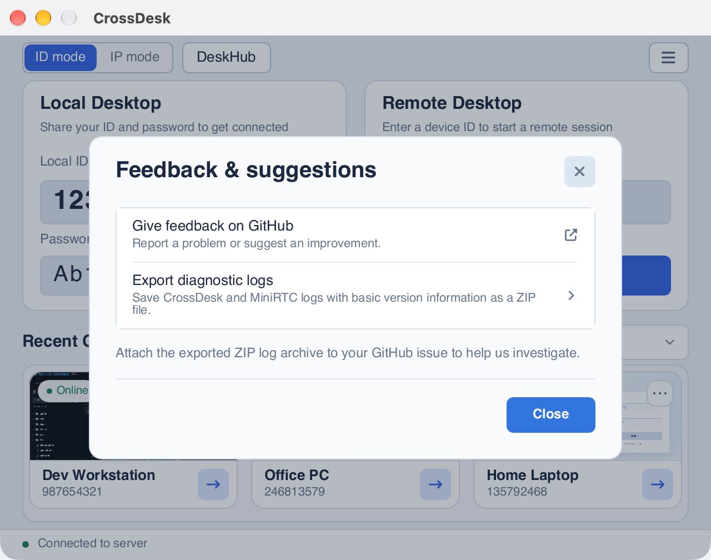
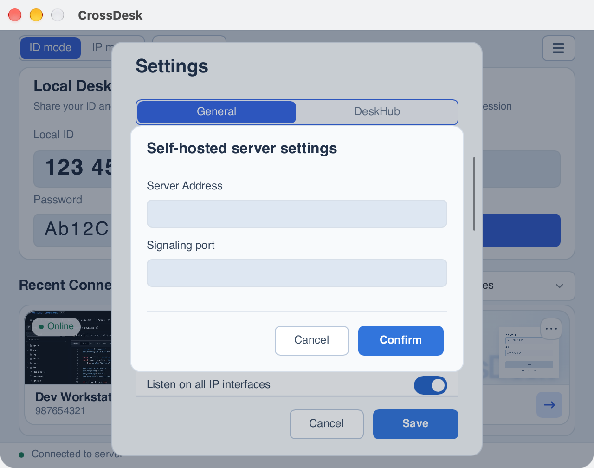

# CrossDesk user guide

[Project overview](../README.md) · [中文](USER_GUIDE.md)

Start with [download and installation](../README.md#download). This guide covers connections and everyday controls. Some new features may not be included in released packages; check the notes for your version.

[Installation and permissions](#installation) · [Quick start](#quick-start) · [Direct IP](#lan-direct) · [Trusted devices](#trusted-devices) · [DeskHub](#deskhub) · [Session controls](#session) · [Settings and updates](#settings) · [iOS](#ios) · [Android](#android) · [HarmonyOS](#harmonyos) · [Windows unattended access](#windows-service) · [Self-hosting](#self-hosting)

<a id="installation"></a>

## Installation details and permissions

Linux provides two standalone packages per architecture. **Choose one**:

| Package | Intended use |
| --- | --- |
| `crossdesk-linux-<arch>-<version>.deb` (recommended) | Computers with an existing desktop; does not install Xfce or Xvfb |
| `crossdesk-virtual-desktop-xfce-linux-<arch>-<version>.deb` | Servers needing an independent desktop; APT additionally installs **Xfce, Xvfb and D-Bus session tools** |

To install the standard package, replace the example filename with your download (use arm64 for that architecture):

```bash
sudo apt install "./crossdesk-linux-amd64-<version>.deb"
```

For the virtual desktop package, install this file instead:

```bash
sudo apt install "./crossdesk-virtual-desktop-xfce-linux-amd64-<version>.deb"
```

Both contain the same complete application, replace each other and preserve user settings. The standard package can also create virtual desktops after you install the optional dependencies. Installing the virtual desktop package does not start a session or change the default desktop; see [Linux headless operation](HEADLESS_EN.md) to start one. The app's update download button selects the installed package type. Upgrading an existing installation does not automatically remove previously installed Xfce components.

**First launch on macOS:** follow the app prompts to grant **Screen Recording** (called **Screen & System Audio Recording** on newer systems) and **Accessibility** under **System Settings → Privacy & Security**. Reopen the app if prompted. These permissions allow desktop capture and remote keyboard/mouse input respectively.

<a id="quick-start"></a>

## Quick start

### Connect from another computer by device ID

1. **Prepare the host.** Install and run CrossDesk on the computer to control and select ID mode. Wait for the bottom status bar to show that the server is connected. Share the **Local ID** and **Password** shown under **Local Desktop** with the controller.
2. **Enter the remote ID.** On the controlling computer, enter the host's **9-digit ID** in **Remote Desktop → Remote ID**, then click **Connect**.
3. **Verify the password.** Enter the host's current connection password when prompted and confirm. Select **Remember password** if you want to save it.
4. **Reconnect later.** Previously connected devices appear under **Recent Connections**. Reconnect from a card, open its top-right **…** menu to rename it, edit its groups, or remove its record, and use the bottom-right button to connect / disconnect. Use the group filter beside the heading to narrow the list.

The eye button shows or hides the local password, the refresh button generates a new random password, and the pencil button lets you edit it. Passwords use **6 ASCII letters or digits**. Stay connected to the server when editing or refreshing a password. Wait for the change to succeed and the client to reconnect, then copy the current password. Controllers that saved the old password must enter it again.

<a id="lan-direct"></a>

### Connect directly over LAN

The regular Windows, macOS, and Linux desktop clients can initiate and accept direct IP sessions. Android, iOS, and HarmonyOS phones and tablets can initiate them. The controller and desktop host need mutually reachable IPv4 or IPv6 addresses. A signaling server connection is optional.

**From a phone or tablet.** Enable direct IP on the computer and copy its displayed address. Paste it into **Device ID or IP address** on the mobile home screen, tap **Connect**, and enter the computer’s **Direct IP password**. On iOS, allow Local Network access when prompted.

1. **Enable and switch.** On each desktop client, select **Enable direct IP** under **Settings → General → Network** and save (enabled by default). Use the top-left button to switch to **Direct IP mode**.
2. **Get the host address.** Read **Local IP / Port** on the host. The copy button copies the full `IP:port`. If several addresses are available, choose one reachable from the controller.
3. **Connect and verify.** Enter an address such as `192.168.1.20:52888` or `[2001:db8::20]:52888` under **Remote IP / Port**, click **Connect**, and enter the host's six-character password for this mode. Omitting the port uses **52888**. Numeric IPv4 and IPv6 addresses are supported; hostnames are not.
4. **Save and reconnect.** Select **Remember password** in the password dialog if needed. Desktop clients show separate recent connections for ID and IP modes. Device records are kept even without a saved password; you will be prompted next time. Cards let you reconnect, rename devices, or remove records.

<p align="center">
  
</p>

**Addresses and ports:** use **Switch IP** to choose the displayed address and **Edit port** to change its port. By default all interfaces share one port. When **Listen on all IP interfaces** is disabled, the app listens on available physical-interface IPv4 and IPv6 addresses simultaneously and saves a separate port for each IP. Selecting a displayed address keeps the others listening. The first port assignment for an IP tries **52888**; if busy, it allocates and saves an available port. A conflict on an already saved port is reported and requires a manual change. Valid ports are **1–65535**; failed changes preserve the previous settings. Connect using the actual port displayed on the host. The LAN firewall must allow CrossDesk's TCP negotiation connection and UDP remote-control traffic.

**Listen on all interfaces:** enabled by default, this shares one port across Ethernet, Wi-Fi, VPN, and virtual interfaces. Editing any displayed address’s port changes the shared port. Turning it off restores separate physical-interface ports. Save to apply changes. Use the actual displayed address, not `0.0.0.0` or `::`. Both VPN ends must allow TCP and UDP; loopback remote control and automatic public NAT traversal are not supported.

**IPv6 addresses:** use `2001:db8::20` with the default port, or `[2001:db8::20]:52888` with an explicit port. Link-local addresses need the controller’s interface zone, for example `[fe80::1234%14]:52888` or a supported name such as `%en0`. Replace a copied host zone with the controller’s interface index or name for that network.

**Passwords:** direct IP has its own **six-character, case-sensitive ASCII letter/digit password**. A missing password is generated automatically. Use the eye, refresh, and pencil buttons to show/hide, randomly generate, or customize it. A successful change applies immediately without restarting or connecting to a server. Controllers that saved the old password must enter the new one.

**Mode and availability:** the selected mode is remembered at the next launch. Switching back to ID mode changes the connection controls and recent list while IP listeners keep running. To stop direct IP, clear **Enable direct IP** in Settings and save. This disconnects IP sessions, releases listening ports, returns to ID mode, and hides the mode button. Existing ID sessions continue; IP passwords, ports, and recent records are retained for re-enabling.

### Connect from a browser

1. Keep CrossDesk running and connected to the server on the host computer.
2. Open the [Web Client](https://web.crossdesk.cn/), enter the **Remote Device ID** and **Password**, and click **Connect**.
3. Use the page's display, mouse-mode, and keyboard controls during the session. Phone and tablet browsers can also connect.

For self-hosting, connect both sides to the same service. Browser deployment is documented in [CrossDesk Web Client](https://github.com/kunkundi/crossdesk-web-client).

<p align="center">
  
</p>

<a id="deskhub"></a>

## DeskHub: view and control multiple devices

Click **DeskHub** at the top left of the main window to open a separate window. The connection window remains available for ordinary remote sessions and global settings. DeskHub saves its device membership, groups, order, and window layout; connections must be started manually after relaunching.

1. **Add devices.** Choose **Add → Add by device ID**, enter an ID, password, and optional group, then click **Add and connect**. Credentials are saved only when you select **Remember password**. Alternatively, choose **Add from recent** and import multiple records; use **Select → Connect** to connect after importing.
2. **Arrange the view.** Switch from **All devices** to a group, drag grid dividers to resize all previews, or drag a device onto another to swap positions. **Compact** hides device names and management controls; fullscreen provides more viewing space. Changing pages keeps connections open.
3. **Enlarge and control.** Click a preview to open a read-only enlarged view. Switch devices with the thumbnails above it, and drag the divider to resize the two areas. Click **Control** to send keyboard and mouse input. Click **Release** or press **Ctrl / ⌘ + Shift + Esc** to release; switching devices or losing window focus also releases control.
4. **Apply batch actions.** Click **Select**, choose devices or **Select all**, and connect, disconnect with **Close**, or use **More** to mute / unmute or send a file. **Select all** includes every page in the current group; switching groups clears the selection.

<p align="center">
  
</p>

**Group control:** click **Group control** in the enlarged view to mirror input from the current device to **all connected devices**, including other groups, pages, and connections not displayed in the wall. The scope is independent of the batch selection. Devices receive the same coordinates and keys without additional scaling for different screen sizes. Releasing control also ends group control.

DeskHub connections are muted by default. Enable sound with **Select → More → Unmute**. The bottom **Network** button shows direct / relay mode, encryption, receive/send rates, video latency, packet loss, resolution, and frame rate for all connected devices. For the full single-session toolbar, including display switching and privacy screens, click a connected device under **Recent Connections** in the main window to open its separate session window.

**Closing DeskHub disconnects all remote devices and closes session windows sharing those connections; minimizing it keeps connections open.** The disconnect scope includes all groups and pages, regardless of selection. See the [DeskHub guide](deskhub.md) (Chinese) for further controls, preview behavior, and compatibility details.

<a id="session"></a>

## Session controls

Each connection opens its own control window. The first connection uses the default window size. Reconnecting restores the last windowed size for that device. You can view multiple devices at once. Focus a window to direct keyboard and mouse input to that device. Closing a control window disconnects that device and leaves the other connections running. If DeskHub is using the device, its preview stays connected. Expand the control bar if it is collapsed, and hover over icons to see their tooltips.

| Control | Action |
| --- | --- |
| Display | Switch the remote monitor |
| Keyboard | Send shortcuts; Windows `Ctrl+Alt+Del` requires the remote service |
| Mouse | Enable / release remote mouse control |
| Speaker | Play / mute remote audio |
| Folder | Open the dual-pane file browser and transfer files or folders between local and remote directories |
| Video settings | Adjust video quality, capture frame rate, supported remote display resolution, and video preference |
| Network statistics | Inspect traffic, packet loss, frame rate, resolution, direct / relay mode, encryption status, the remote encoder, and the local decoder |
| Privacy screen | Enable or disable the host's privacy screen; hover to see its status and available actions |
| Fullscreen | Enter / exit fullscreen |
| Disconnect | End the current remote session |

When a controller connects, the host shows **Controlled** and the number of connected devices to the left of the **☰** menu in the upper-right corner of the main window. Select **Controlled** to open a dropdown listing the controllers. From there you can send a file or disconnect a session. Click outside the dropdown or press Esc to close it.

Desktop clients synchronize text clipboard contents. Configure the receiving directory under **Settings → General → File Save Path**. Closing the main window hides it and keeps the app running; use the system tray or menu-bar exit command to quit completely.

Windows, macOS, and Linux desktop clients support bidirectional file copy and paste when both ends use a version with on-demand pasting. Copy files in the system file manager and return to the current remote session to synchronize the file list only. The transfer starts when you paste on the other computer, using the context menu or `Ctrl+V` on Windows/Linux and `⌘V` in macOS Finder. A compact receiving progress card appears on the destination computer, and the original paste continues automatically after downloading; no second paste is needed. You can also copy remotely and paste locally without opening the transfer window.

Copy up to 128 regular files at a time; use the dual-pane transfer window for folders. Clipboard transfers copy files without deleting their sources. Cancel the whole batch from the receiving card. The card closes automatically after completion or cancellation; no sending progress window appears on the source. Keep both CrossDesk apps and the connection running until pasting finishes. Downloaded files are cached for repeated pastes and cleaned up when the clipboard is replaced, the session disconnects, or CrossDesk exits. A newer clipboard copy invalidates the old file list. Background sessions and DeskHub previews do not receive locally copied files.

Linux receivers support both FUSE 2 and FUSE 3, using the installed runtime and mount helper for on-demand file reads. CrossDesk first tries FUSE 3 (`libfuse3.so.3` or `libfuse3.so.4`), then FUSE 2 (`libfuse.so.2`) if unavailable. The current user still needs access to `/dev/fuse` and permission to mount FUSE filesystems.

The Debian package declares the alternative dependency `fuse3 (>= 3.2) | fuse (>= 2.9)`. APT installation and in-app upgrades accept either installed version without forcing a replacement; if neither is installed, the package manager installs FUSE 3 and its runtime. In-app upgrades retain the protection against automatic package removal. Unlike APT, `dpkg -i` does not download missing dependencies; use `sudo apt install ./package.deb` instead.

If a manually deployed environment lacks FUSE, or container/system permissions prevent mounting, the receiver suggests checking the FUSE installation and mount permissions. The file transfer window, remote control, text clipboard, and copying files to other devices remain available.

On macOS, paste into a local folder in Finder; existing files are preserved by adding a numbered suffix to conflicting names.

On Windows, the main window and remote control windows use separate taskbar groups, so you can switch to or minimize either window independently. Closing the main window leaves the remote control window and its connections running; reopen the main window from the system tray. The remote control button appears only while the session window is present; use the main window's button to pin the application.

On Linux, the main and remote control windows use different application grouping IDs on X11, XWayland, and native Wayland. Taskbar presentation depends on the desktop environment and its grouping settings. Closing the main window keeps remote connections running; reopen it from the system tray. Use the main application's launcher for pinning.

On macOS, CrossDesk keeps one application icon in the Dock. The main and remote control windows can be switched and minimized independently and do not automatically merge into native window tabs. Closing the main window keeps the Dock icon while another window is visible or minimized, and remote connections continue running. Once all windows are closed, the application remains in the menu bar, where you can reopen the main window.

Network statistics show the host encoder and controller decoder actually in use, including software fallback. These details can help diagnose video performance. “—” means the information is unavailable or the host version does not support reporting it.

### Browse directories and transfer files

Open the folder button in the session toolbar to view local and remote file lists side by side. Enter a path, go to the parent directory, filter by name, select files or folders, then click **Send to remote** / **Send to local**, or drag between panes. The destination directory must exist; conflicting names are saved under an alternate name. Remote directory browsing requires a compatible host.

The task list shows transfer status and progress, with controls to cancel unfinished tasks and clear completed records. Paths, filenames, and completion states in the image are illustrative.

<p align="center">
  
</p>

### Adjust video during a session

After connecting, open **Video settings** (the sliders icon) in the toolbar. Choose low / medium / high quality, **30 / 60 fps**, and frame-rate priority / quality priority / balanced adaptation. Changes are sent to the current host without reconnecting; actual results depend on the network, device, and encoder. For older hosts that do not support live video settings, the menu explains the limitation and disables the options.

Adjust horizontal and vertical scrolling under **Video settings → Scroll sensitivity**. The controller remembers the value for each host and restores it on reconnect. DeskHub group control uses each host’s own scroll sensitivity.

For Windows, macOS, and Linux X11 hosts, **Video settings → Resolution** also lists supported desktop resolutions for the selected monitor. Changes take effect without reconnecting; when the last controller disconnects, the display mode from before the first change is restored. Linux requires X11 capture and a RandR-capable display server. Wayland, XWayland, and custom scaling or panning configurations are not supported. Choices come from the monitor or virtual display server; no additional modes are created for virtual screens that expose only one mode.

<p align="center">
  
</p>

Desktop and native mobile controllers remember confirmed resolutions per remote device and display. On reconnection, a saved mode is requested again if still supported. The host still restores the original mode when the last controller disconnects.

<a id="settings"></a>

## Client settings and updates

Open **☰ → Settings** in the top-right corner, choose **General / DeskHub**, and click **Save** to apply changes. Switching tabs preserves pending changes; **Cancel** discards them. General settings are grouped into interface, video, networking, and further sections available by scrolling. Configure codecs and connections before connecting; some settings are disabled during an active session. Adjust ordinary session quality, frame rate, and video preference from its toolbar.

<p align="center">
  
</p>

| Setting | Purpose |
| --- | --- |
| Language | Follow the system by default, or select Simplified / Traditional Chinese, English, Russian, Japanese, Korean, German, French, Spanish, or Brazilian Portuguese; see [localization](../localization/README.md) (Chinese) |
| Capture Method (Windows) | Auto / DXGI / WGC / GDI; choose Auto for automatic headless adaptation |
| Video Encode Format | H.264 / AV1; H.264 automatically prefers hardware codecs, with software fallback when unavailable or initialization fails; desktop AV1 uses software codecs |
| Enable direct IP | Enabled by default; saving starts or stops direct IP immediately. Disabling disconnects IP sessions, stops listeners, and hides the mode button; the choice persists across restarts |
| Force Relay | When off, automatically select a connection path with P2P and TURN relay fallback; when on, use relay connections only |
| Save remote screen previews | On by default. When disabled, the thumbnail area shows the remote device’s platform and existing previews are cleared; connection records and passwords are preserved |
| Privacy screen on connect | Automatically enable privacy when this computer is controlled remotely; the controller can toggle it from the session toolbar |
| Self-Hosted Config | Click Edit to set the server address and signaling port, then enable the switch on the right |
| Auto Start | Installed Windows Release builds use the same ID and password before and after sign-in, with the GUI attaching to the background service after login. Unavailable in portable and Debug Windows builds. With Auto Start enabled, CrossDesk starts in the system tray at desktop login. Open the main window from the tray. |
| Enable Daemon | On Windows / macOS / Linux desktops, saving immediately enables or disables restart after an abnormal exit. Normal exit or logoff does not relaunch the app; headless console mode does not use the built-in daemon |
| File Save Path | Choose where received files are saved |

The direct IP switch in the Network group is independent of the relay settings used for ID connections:

<p align="center">
  
</p>

<details>
<summary>Advanced: adjust initial connection bandwidth</summary>

Most users can keep the defaults. Try the session’s video quality and frame rate controls first.

Quit the client, edit the `[Settings]` section in its cache directory's `config.ini`, then restart:

```ini
[Settings]
direct_start_bitrate_bps = 2500000
relay_start_bitrate_bps = 1500000
disable_receiver_padding_probing = true
```

Both values are in bps and set the local native media sender's initial congestion-control estimate for P2P / direct IP and TURN relay paths, respectively. Desktop defaults are 2.5 Mbps and 1.5 Mbps; the accepted range is 300000–20000000. Missing or invalid values use the corresponding default, which is written to the file on startup. Network feedback continues to adjust bandwidth, and DeskHub bandwidth budgets still apply. To change the stream you watch remotely, edit the host that sends the video. Browser connections use separate bandwidth control and are unaffected.

The file is in `~/.cache/CrossDesk/` on macOS / Linux (`CrossDesk/` under `XDG_CACHE_HOME` when set), and `%LOCALAPPDATA%\CrossDesk\cache\` for installed Windows Release builds. Windows Debug builds use `cache/` under the working directory; portable builds use `data/` beside the executable.

With a Windows background host configured, the INI string in `host_config` inside `%ProgramData%\CrossDeskUnattended\shared-identity.json` is authoritative. An administrator must stop both the GUI and background service before editing these entries there, then restart both. Editing only the user cache or `host/config.ini` is overwritten by the shared configuration on startup.

The desktop default for `disable_receiver_padding_probing` is `true`, suppressing padding probes on connections that have not yet sent local video. Set it to `false` to restore receiver-side padding probes. After local video starts, normal probing and bandwidth recovery during static content remain available. Missing or invalid values use the default; existing explicit settings are preserved. It applies to native direct and relay connections, uses the configuration locations and restart procedure above, and is included in the Windows background host's shared configuration.

</details>

### DeskHub video transmission

Use **Settings → DeskHub** to configure wall sessions together. Saving applies changes immediately to current DeskHub sessions and future connections; ordinary connections are unaffected.

| Setting | Purpose |
| --- | --- |
| Resolution limit | Auto, 320 × 180, 640 × 360, 1280 × 720, 1920 × 1080, 2560 × 1440, 3840 × 2160, or Original resolution; Auto adapts to grid / enlarged views, while fixed limits preserve aspect ratio without upscaling the source |
| Frame rate | Follow device settings, or choose 15 / 30 / 60 FPS |
| Video budget | Defaults to 20 Mbps; choose 2 / 5 / 10 / 20 / 50 / 100 Mbps, shared by compatible DeskHub sessions with priority for enlarged views. Audio, file transfers, and ordinary connections are excluded; this is not a hard limit on instantaneous traffic |

<p align="center">
  
</p>

Devices supporting preview subscriptions can pause video while their views are hidden and resume when visible. Older hosts fall back according to their capabilities, so not every resolution, frame-rate, or bandwidth setting will apply.

### Check for updates

CrossDesk checks for new versions on startup. You can also open **Menu → About → Check for updates** and read the release notes. Follow the available install or download option. Save work and finish file transfers before installing; connections will be interrupted. See the [update guide](UPDATER.md) (Chinese) for recovery steps.

<a id="feedback"></a>

### Feedback and diagnostic logs

Open **☰ → Feedback & suggestions** in the main window. **Give feedback on GitHub** opens the issue page; **Export diagnostic logs** saves CrossDesk and MiniRTC logs with basic version information as a ZIP archive. After export, the panel shows the saved path. Attach the archive to a report with both systems, client versions, connection mode, and reproduction steps.

<p align="center">
  
</p>

<a id="trusted-devices"></a>

## Trusted devices and pairing

If the computer enables **Only allow trusted devices**, first copy the controller’s pairing information, add it to the computer’s trusted list, and compare fingerprints. On desktop, open **Settings → General → Privacy → Manage trusted devices**; on iOS, Android, and HarmonyOS mobile, open **Settings → This device’s pairing info**. The connection password is still required.

Check that every controller you intend to use supports pairing before enabling the restriction. The current terminal CLI does not. See the [pairing and migration guide](CONNECTIONS.md#trusted-devices) (Chinese).

<a id="ios"></a>

## Native iOS / iPadOS client

Install the native controller on your iPhone or iPad to access a remote computer. It cannot share the iPhone or iPad as a remotely controlled desktop.

1. Install from the [App Store](https://apps.apple.com/app/id6828859211), checking the listing for OS requirements. Alternatively, follow the [iOS guide](../apps/ios/README.md) to build and sign with Xcode; current source targets iOS 16+.
2. Enter a remote ID on the home screen, connect, and enter its password. Successful connections become available in the recent devices list.
3. Choose a mouse mode in Settings: **Relative Position** works like a trackpad; **Absolute Position** maps touches directly to the remote screen.
4. Tap the floating icon to expand the menu, then switch displays, open the keyboard, toggle audio, or send files. Received files are stored in `Documents/Received` and can be exported using the share button beside the transfer status.

The app receives remote text into the iOS clipboard. Tap **剪贴板** (Clipboard) in the floating menu to send local text to the remote computer. Text is limited to **128 KiB** per transfer; empty or oversized text displays a hint.

Pinch to zoom and use two fingers to pan the enlarged view. Native and browser controls may differ. The app follows the system or per-app language; see the [language guide](../localization/README.md).

<a id="android"></a>

## Native Android controller

The Android client supports Android 8.0+ arm64 phones and tablets. Install the signed APK from the [website](https://www.crossdesk.cn/) or [GitHub Releases](https://github.com/kunkundi/crossdesk/releases). See the [Android build guide](../apps/android/README.md) (Chinese) to build it yourself.

1. Run CrossDesk on the computer. Enter its device ID on the phone, connect, and enter its password.
2. Choose relative mouse (trackpad) or absolute positioning in Settings. Use long-press for right-click, two fingers to scroll, and pinch to zoom. External keyboards and mice are supported.
3. Open the floating menu to switch displays, adjust video quality and frame rate, use the virtual mouse, send and receive files, inspect network statistics, and send clipboard text. Use the save action to export received files.
4. When switching apps, an active session uses system Picture in Picture when available, with a foreground service and notification as a fallback. Closing the Picture in Picture window or failing to start background session support ends the session.

Android supports H.264 / AV1; performance depends on the device. It cannot act as a remote host. Use **Privacy screen** in the floating menu to toggle the computer’s local cover and block its local keyboard and mouse when supported. The button shows the state confirmed by the computer.

<a id="harmonyos"></a>

## HarmonyOS support

HarmonyOS PC, phone, and tablet clients are development builds that need building and signing before installation. Select the package for your device type.

| Client | System and architecture | Features |
| --- | --- | --- |
| HarmonyOS PC (`2in1`) | API 26, arm64 | Controller and host roles, with the desktop UI, session management, DeskHub, and file transfer |
| HarmonyOS phones / tablets | API 20+, arm64 | Native mobile controller with remote video/audio, touch and external keyboard/mouse input, display switching, text clipboard, and bidirectional file transfer |

Mobile clients use the system file picker to send and export files; PC users can choose the receiving directory in Settings.

These are development builds. Follow the [HarmonyOS build guide](../apps/harmony/README.md) to build and sign them with DevEco before installation. PC screen capture and input control require system authorization, and physical-device and long-session validation are ongoing. See the [PC guide](../apps/harmony/desktop-port/README.md) and [mobile feature guide](../apps/harmony/MOBILE_PARITY.md) for permissions, platform differences, and validation coverage (Chinese).

<a id="windows-service"></a>

## Windows lock screens and sign-in

**CrossDesk Service** (`CrossDeskService`) reports protected desktop states and forwards `Ctrl+Alt+Del`, keyboard, and mouse input on lock screens, sign-in screens, credential prompts, and secure desktops.

The installer registers an on-demand service by default. CrossDesk tries to start it on launch. Unless unattended mode is enabled, the service exits when no local CrossDesk client is running. Portable builds offer service installation in the prompt or **Settings → Lock Screen Service**, with administrator privileges.

In installed Windows Release builds, **Auto Start** enables remote access before sign-in with the same ID and password. After sign-in, the client starts in the system tray. Existing connections stay active. Turning this off disables unattended startup. **Enable Daemon** separately controls recovery after an interface crash. Portable and Debug builds do not offer unattended Auto Start.

<a id="windows-service-development-update"></a>

### Updating the service in a manual deployment

Launching a newly compiled client only tries to start the registered service. It does not change the service executable path or restart an older running service. If the computer keyboard works but the system IME fails in both Notepad and the lock screen, and the log contains `Secure desktop text injection failed: error=unknown_command`, update the service binaries and registration first.

Open an **administrator PowerShell** in the complete new build directory containing `CrossDesk.exe`, `crossdesk_service.exe` and `crossdesk_session_helper.exe`, then run:

```powershell
$crossdeskExe = (Resolve-Path .\CrossDesk.exe).Path;
foreach ($serviceAction in '--service-stop', '--service-install', '--service-start') {
    $serviceProcess = Start-Process -FilePath $crossdeskExe -ArgumentList $serviceAction -Wait -PassThru;
    if ($serviceProcess.ExitCode -ne 0) {
        throw "$serviceAction failed: $($serviceProcess.ExitCode)"
    }
}
```

Remote control may briefly disconnect while the service restarts. Reconnect and test text input on both the ordinary desktop and lock screen. Keep this build directory in place because the service now uses its binaries. Reinstall the complete installer package to return to the installed release's service registration.

### Remote access before Windows sign-in

Enable **Settings → Auto Start** and save to use the main window's device ID and password before and after sign-in. The same feature can be enabled from an **administrator PowerShell** in the complete installation directory. Close the ordinary client before first enabling it through the CLI, or use the running client's settings switch:

```powershell
.\CrossDesk.exe --unattended-enable
# Show the shared device ID, password, online state, and current hosting mode
.\CrossDesk.exe --unattended-status
```

Connect using the existing `device_id` and `password`. Password changes, device identity keys, and trusted-device records are shared between hosting modes. Re-enabling reuses this identity instead of creating a new ID. Self-hosted server root certificates must be trusted in the Local Computer certificate store.

Once enabled, the service starts with Windows without automatic sign-in or saved Windows login passwords. Closing the CrossDesk interface leaves remote viewing and input available. Signing out, switching users, restarting the service, or losing the network can interrupt the connection.

Before sign-in, video, input, monitor switching, and secure-desktop controls are available. Audio, files, clipboard, and privacy screen require the user to sign in and run the CrossDesk interface. Shared identity is in `%ProgramData%\CrossDeskUnattended`, accessible to administrators and SYSTEM; logs are in its `logs` subdirectory.

Without a physical monitor, the unattended host attempts to prepare a virtual display before accepting connections, preferring a previously recorded resolution and using 1920 × 1080 when no valid record exists. These temporary modes do not overwrite persistent Windows display configuration. Once a physical display is stable, the temporary virtual display is released while preserving the remote stream index.

```powershell
# Stop the unattended host and restore on-demand service startup
.\CrossDesk.exe --unattended-disable
```

Turning off **Auto Start** disables unattended mode; CLI enable/disable operations are also reflected in the switch. Disabling or uninstalling the service disarms unattended startup but retains the protected machine profile. To erase its credentials, stop the service and delete that directory as an administrator.

<details>
<summary>Manual deployment and service commands</summary>

Keep the complete installation directory. For manual deployment, place `CrossDesk.exe`, `crossdesk_service.exe`, `crossdesk_session_helper.exe`, and all `.dll` files from the same build together. Open an administrator PowerShell in that directory and run the commands you need:

```powershell
.\CrossDesk.exe --service-install
.\CrossDesk.exe --service-start
.\CrossDesk.exe --service-status
.\CrossDesk.exe --service-ping
# Stop or uninstall the service
.\CrossDesk.exe --service-stop
.\CrossDesk.exe --service-uninstall
```

</details>

If **Remote Windows service unavailable** appears, check installation and service status on the host. Ordinary desktop connections remain available, while control of protected screens is limited.

<a id="self-hosting"></a>

## Self-hosting

Host your own signaling and TURN services, then enter their connection details under **☰ → Settings → General → Self-Hosted Config**. Enable the same server configuration on both the controller and host.

- [Self-hosting guide](SELF_HOSTING_EN.md): current Compose deployment, client settings, certificate trust, and troubleshooting.
- [CrossDesk Server](https://github.com/kunkundi/crossdesk-server): server source and release configuration.
- [CrossDesk Web Client](https://github.com/kunkundi/crossdesk-web-client): browser source and deployment instructions.

<p align="center">
  
</p>
